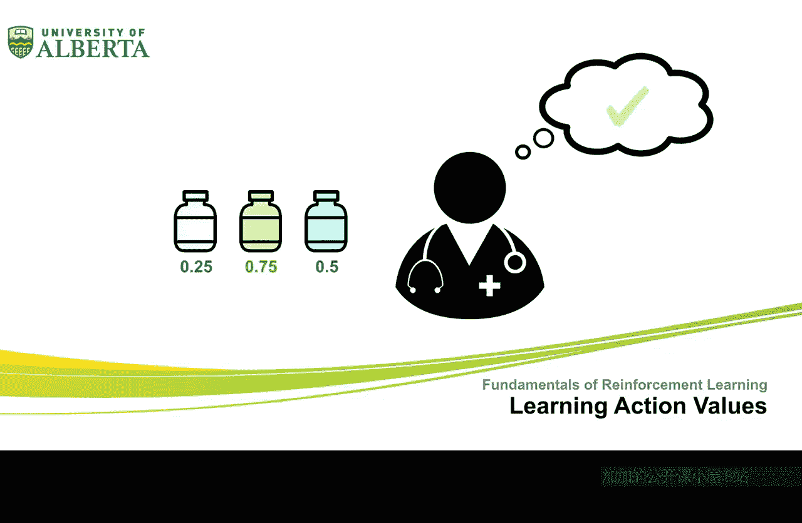
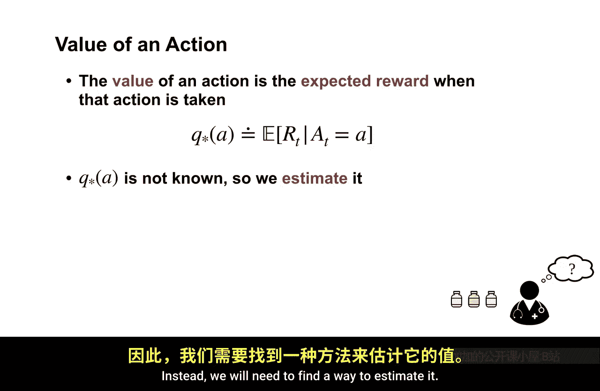
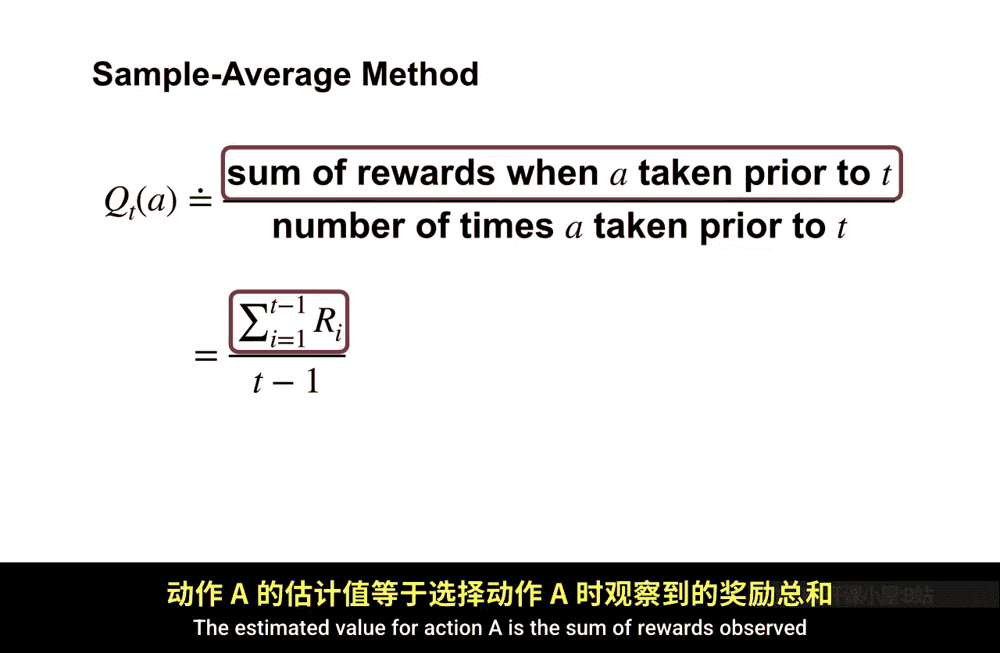
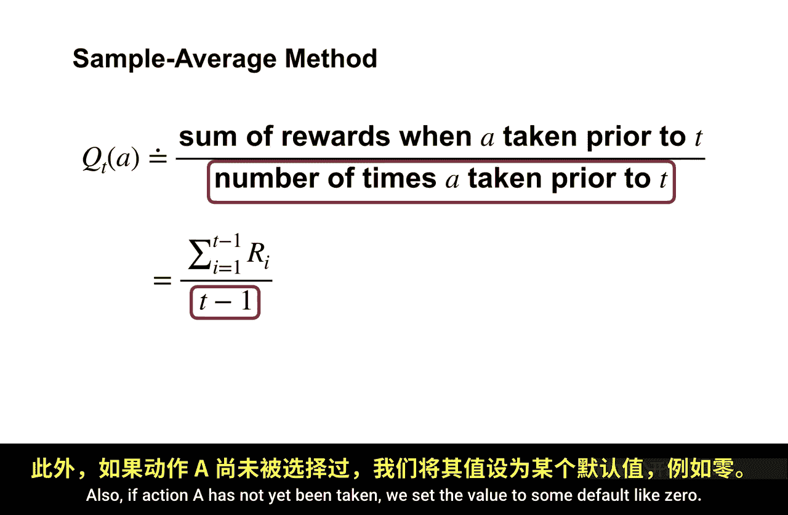
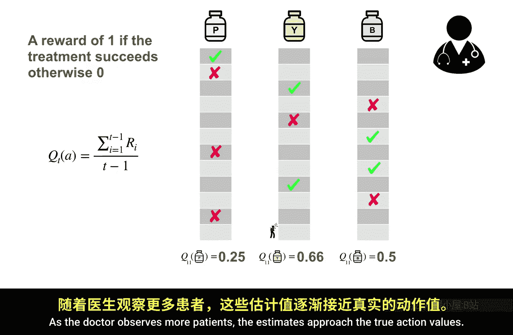

# 006：学习动作价值 🎯

在本节课中，我们将学习如何估计不同动作的价值，这是强化学习智能体做出决策的基础。我们将从一个医生进行药物试验的例子开始，介绍样本平均法，并探讨如何基于当前知识选择动作。

还记得我们那位进行药物试验的医生吗？如果这位医生已经知道每种治疗方案的长期效果，那么选择合适的治疗方案将变得非常简单。然而，实际情况往往并非如此。

通常，医生会进行多次试验来了解每种治疗方案。每一天，医生都可以利用之前收集的所有数据来估计他们认为最好的治疗方案。让我们来学习这可能如何运作。今天我们将讨论一种估计动作价值的方法，称为样本平均法。

我们将使用这种方法来计算我们药物试验例子中每种治疗方案的价值。然后，我们将描述贪婪动作选择，最后，我们将介绍强化学习中的探索与利用困境。

## 回顾动作价值定义 📖

在开始之前，让我们回顾一下动作价值的定义。选择一个动作 `a` 的价值 `Q*(a)`，是在采取该动作后收到的期望奖励。

`Q*(a)` 对于智能体来说是未知的，就像医生不知道每种治疗方案的效果一样。因此，我们需要找到一种方法来估计它。

## 样本平均估计法 📊

一种估计 `Q*` 的方法是计算样本平均值。我们只需记录每个动作获得的总奖励，然后除以该动作被选择的次数。

为了直观地理解样本平均估计，让我们看一个具体的动作，动作 `A`。动作 `A` 的估计价值是采取动作 `A` 时观察到的奖励之和，除以动作 `A` 被采取的总次数。

我们使用 `T-1` 是因为时间 `T` 的价值是基于时间 `T` 之前采取的动作。此外，如果动作 `A` 尚未被采取，我们将其价值设置为某个默认值，例如零。

## 应用于药物试验案例 💊

让我们回到药物试验的例子。我们的医生必须决定开三种可能的治疗方案中的哪一种。如果病人好转，医生记录奖励为 1。否则，医生记录奖励为 0。

假设我们知道真实的 `Q*`，但我们的医生不知道。医生在时间步骤 1 给第一位病人开了治疗方案 P。病人报告感觉好转。医生为该治疗记录奖励 1，并更新其价值估计。到目前为止只有一个数据点，所以治疗方案 P 的估计价值是 1。

第二位病人到来。医生随机地再次开了治疗方案 P。治疗失败。医生记录奖励 0，并将治疗方案 P 的价值估计更新为 0.5。其他动作的估计价值保持为零，因为我们定义初始估计值为零。

让我们稍微快进一下时间。在每种治疗方案都尝试了几次之后，我们可以根据观察到的数据计算估计价值。随着医生观察更多病人，这些估计值会接近真实的动作价值。

## 贪婪动作选择 🤔

在现实中，我们的医生不会随机分配治疗方案给病人。相反，他们可能会分配他们当前认为最好的治疗方案。我们称这种选择动作的方法为**贪婪**。贪婪动作是当前具有最大估计价值的动作。

选择贪婪动作意味着智能体正在**利用**其当前知识。它试图立即获得尽可能多的奖励。

我们可以通过取估计价值的 `argmax` 来计算贪婪动作。或者，智能体可以选择通过选择一个非贪婪动作来**探索**。智能体会牺牲即时奖励，希望获得关于其他动作的更多信息。

智能体不能同时选择探索和利用。这是强化学习中的一个基本问题，即**探索与利用困境**。我们将在接下来的视频中进一步讨论这个问题。

## 总结 ✨

本节课中，我们一起学习了用于估计动作价值的样本平均法，并将贪婪动作定义为具有最大价值估计的动作。我们通过医生的例子理解了如何从数据中逐步更新对动作价值的认知，并初步认识了智能体在决策时面临的探索与利用的根本性权衡。