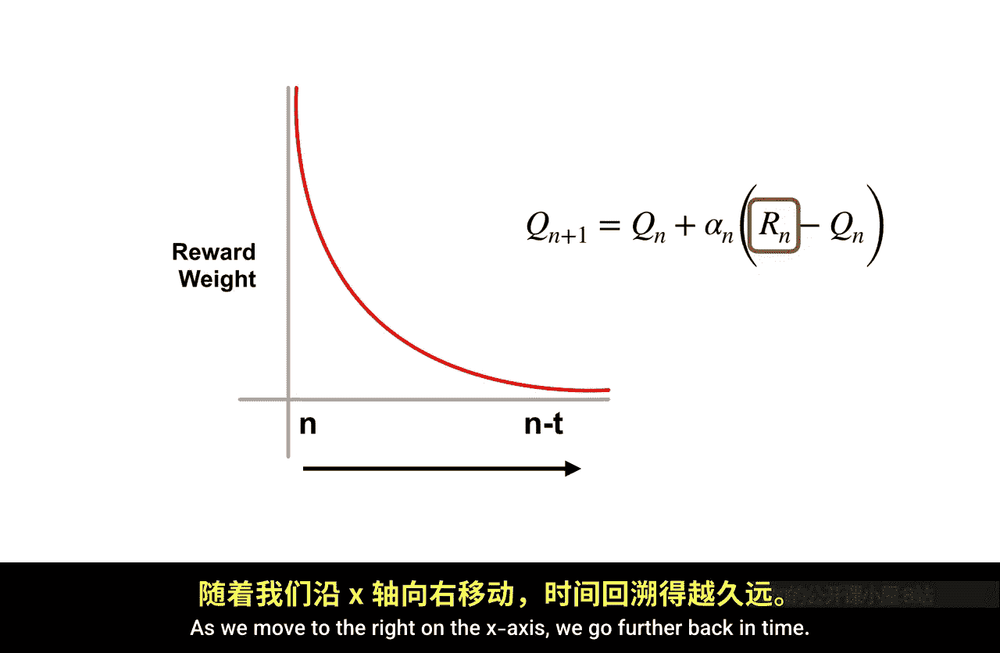

# 007：增量式估计动作价值

在本节课中，我们将学习如何在不存储海量历史数据的情况下，持续更新对动作价值的估计。我们将从样本平均法的递归形式开始，推导出增量更新规则，并将其推广为一个通用学习公式。最后，我们将探讨这个通用规则如何应用于奖励分布会随时间变化的非平稳问题。

## 从样本平均到增量更新

上一节我们介绍了使用样本平均法来估计动作价值。然而，当数据量极大时，存储所有历史数据并重新计算平均值是不现实的。

想象你运营一个日访问量达数百万次的网站。你可以将此建模为一个K臂赌博机问题。每个广告的估计价值对应其产生的总收益。你的目标是展示能带来最多收益的广告。那么，如何在不存储数百万次点击数据的情况下，保持价值估计的实时更新呢？

以下是实现增量更新的关键步骤。我们将展示如何将样本平均法改写为递归形式，从而避免存储所有过往数据。

首先，回顾样本平均法的定义公式：
`Q_n = (R_1 + R_2 + ... + R_{n-1}) / (n-1)`

为了推导递归形式，我们从 `Q_{n+1}` 的定义开始：
`Q_{n+1} = (R_1 + R_2 + ... + R_n) / n`

接下来，我们将最新的奖励 `R_n` 从求和式中分离出来：
`Q_{n+1} = [ (R_1 + ... + R_{n-1}) + R_n ] / n`

此时，求和部分只包含前 `n-1` 个奖励。我们引入 `Q_n` 的定义来替换这个求和。因为 `Q_n = (R_1 + ... + R_{n-1}) / (n-1)`，所以 `(R_1 + ... + R_{n-1}) = (n-1) * Q_n`。

将其代入上式：
`Q_{n+1} = [ (n-1) * Q_n + R_n ] / n`

对上式进行展开和整理：
`Q_{n+1} = (n/n) * Q_n - (1/n) * Q_n + (1/n) * R_n`
`Q_{n+1} = Q_n + (1/n) * [ R_n - Q_n ]`

于是，我们得到了**增量更新规则**：
`新估计 = 旧估计 + 步长 * (目标 - 旧估计)`
具体公式为：
`Q_{n+1} = Q_n + α_n * [ R_n - Q_n ]`
其中，步长 `α_n = 1/n`。

## 通用学习规则

上一节我们得到了增量更新公式。本节中，我们来看看这个公式如何被抽象为一个更通用的学习规则，这个规则将在整个课程中反复出现。

我们得到的方程具有一种通用形式。让我们定义其中的关键术语。

*   **误差**：`[ R_n - Q_n ]` 代表了旧估计 `Q_n` 与新观测到的目标 `R_n` 之间的差异。
*   **目标**：在这个例子中，新获得的奖励 `R_n` 就是我们的目标。
*   **步长**：参数 `α_n` 决定了我们朝着新目标迈出的步伐大小。

因此，通用更新规则可以描述为：**通过朝着目标方向迈出一步来更新估计值，这一步的大小由步长参数和当前估计的误差共同决定。**

在样本平均法的特定情况下，步长 `α_n = 1/n`。这个步长会随着时间推移而减小，确保估计值最终收敛到真实期望值。

## 应用于非平稳问题

我们已经介绍了适用于平稳环境的通用更新规则。现在，让我们考虑环境本身会发生变化的情况，即非平稳问题。

回到我们友好的医生例子。如果其中一种疗法在特定条件下更有效呢？例如，假设疗法B在冬季月份更有效。这就是一个**非平稳赌博机问题**的实例。这类问题与我们之前讨论的赌博机问题类似，但**奖励的分布会随时间变化**。医生可能不知道这种变化，但希望模型能够适应它。

在这种情况下，使用递减步长 `α_n = 1/n` 可能不是最佳选择，因为它会给所有历史数据赋予相同的权重（在平均意义上），导致模型难以适应新的变化。

一种选择是使用**固定步长**。如果 `α_n` 是一个常数（例如 `α = 0.1`），那么最近的奖励会比更早的奖励对估计值产生更大的影响。

下图展示了最近一次获得的奖励与 `T` 步之前获得的奖励分别对当前估计值的权重影响。当步长固定时，权重随时间呈指数衰减。

为了理解其原因，让我们再次审视增量更新方程：
`Q_{n+1} = Q_n + α * [ R_n - Q_n ]`，其中 `α` 为常数。

首先分配 `α` 并重新排列：
`Q_{n+1} = (1 - α) * Q_n + α * R_n`

注意这个递归形式。我们可以将 `Q_n` 的定义代入这个方程，得到：
`Q_{n+1} = (1 - α) * [ (1 - α) * Q_{n-1} + α * R_{n-1} ] + α * R_n`
`= (1 - α)^2 * Q_{n-1} + α(1 - α) * R_{n-1} + α * R_n`

继续展开这种递归关系，不断用其定义替换 `Q`，直到回溯到初始值 `Q_1`：
`Q_{n+1} = (1 - α)^n * Q_1 + α * Σ_{i=1}^{n} (1 - α)^{n-i} * R_i`

这个方程告诉我们什么？

1.  它表明了当前价值估计 `Q_{n+1}` 与初始值 `Q_1` 以及所有观测到的奖励之间的关系。
2.  第一项 `(1 - α)^n * Q_1` 告诉我们，初始值 `Q_1` 的贡献随着时间呈指数级减少。
3.  第二项是一个奖励的加权和，时间越早的奖励 `R_i`，其权重 `α(1 - α)^{n-i}` 越小，贡献也呈指数级减少。

总而言之，随着数据越来越多，我们对 `Q` 的初始化的影响力会趋近于零。**最近的奖励对当前估计的贡献最大**。这使得固定步长非常适合需要持续适应变化环境的非平稳问题。

## 总结

本节课中我们一起学习了动作价值的增量式估计方法。

我们首先将样本平均法推导为递归形式，得到了增量更新规则 `Q_{n+1} = Q_n + (1/n) * [ R_n - Q_n ]`。接着，我们将其概括为一个通用学习规则：`新估计 = 旧估计 + 步长 * (目标 - 旧估计)`，并解释了误差、目标和步长的概念。最后，我们探讨了在奖励分布随时间变化的非平稳问题中，如何使用固定步长（如 `α = 0.1`）让价值估计更侧重于近期经验，从而快速适应环境变化。这种方法避免存储全部历史数据，是处理在线学习和大规模问题的关键技术。