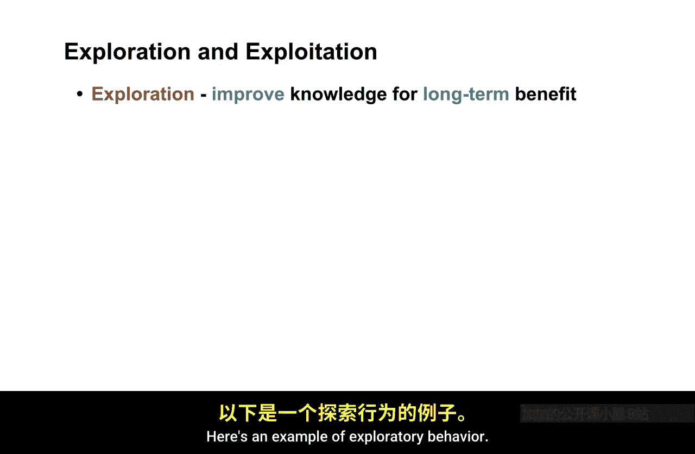
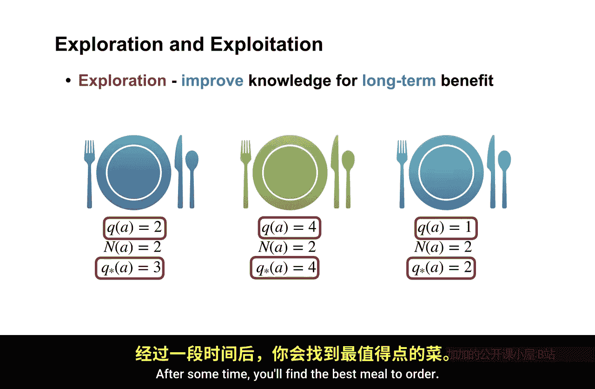
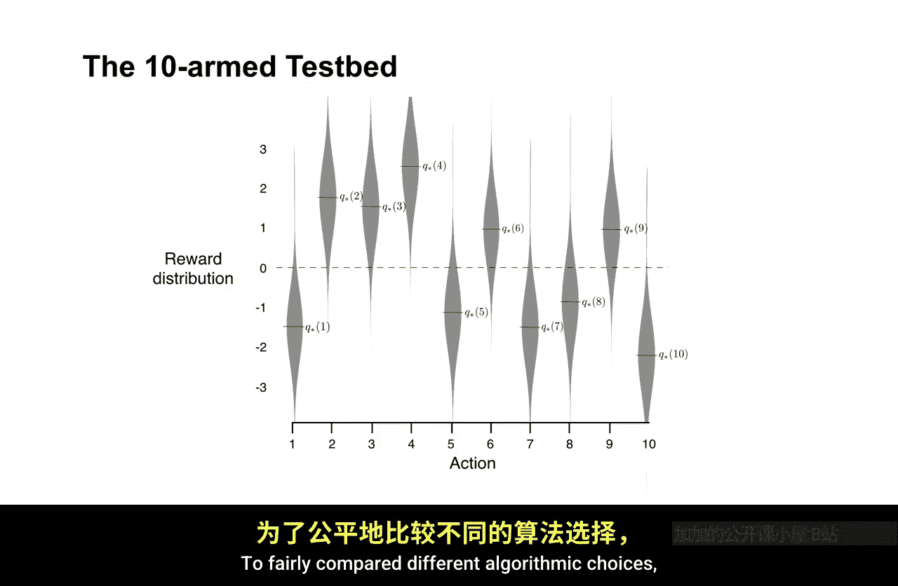
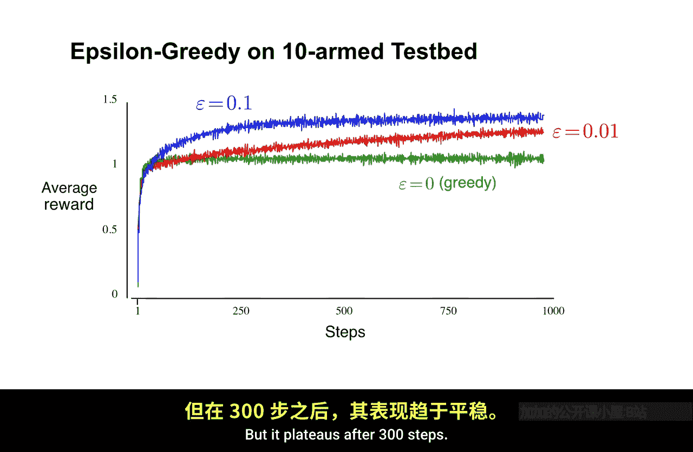

# 008：探索与利用的权衡

在本节课中，我们将学习强化学习中的一个核心概念：探索与利用的权衡。我们将定义什么是探索与利用，并介绍一种简单的平衡方法——Epsilon-greedy策略。

想象一下，你今晚要和朋友们出去吃饭。当你到达餐厅时，你需要决定点什么菜。你之前去过几次，每次都点同样的菜，你知道如果再次点它，你会很满意。然而，菜单上的其他许多菜品看起来也非常美味。你如何决定是再次点那道熟悉的好菜，还是尝试一些新东西呢？

## 探索与利用的定义

在讨论权衡之前，我们先明确何时需要探索，何时需要利用。

**探索**允许智能体改进其对每个动作的了解，这有望带来长期收益。通过提高对动作价值估计的准确性，智能体可以在未来做出更明智的决策。

以下是一个探索行为的例子。

假设每个盘子代表你最喜欢的餐厅里的一道菜，你正在尝试选择要点哪道菜。`Q(A)` 是选择那道菜的估计价值。`N(A)` 是你选择那道菜的次数。`Q*(A)` 是每道菜的真实价值。

每次你光顾这家餐厅，你都遵循一个严格的方案，以轮询的方式选择每道菜。也许某道菜有时做得特别好，因此点它会得到很高的奖励。一段时间后，你就能找到最好点的那道菜。

另一方面，**利用**是利用智能体当前估计的价值；它选择贪婪动作以试图获得最多的奖励。但是，仅基于估计价值进行贪婪选择，实际上可能无法获得最多的奖励。

让我们看看纯粹的贪婪动作选择如何导致次优行为。

想象智能体喜欢第一道菜。智能体收到了正奖励，使得那道菜的价值估计变高。其他动作的价值估计为零。因此，贪婪动作总是选择第一道菜。这意味着智能体从未看到其他菜品的任何样本，其他两个动作的估计价值与真实价值相差甚远，导致智能体从未发现最佳动作。

## 探索与利用的权衡

这自然引出了探索与利用的两难问题：我们如何选择何时探索、何时利用？当我们探索时，我们能获得更准确的价值估计；当我们利用时，我们可能获得更多奖励。然而，我们无法同时进行两者。

一种在探索和利用之间进行选择的非常简单的方法是随机选择。我们可以在大部分时间选择利用，同时保留一小部分机会进行探索。

例如，我们可以掷一个骰子，如果掷出1点，我们就探索；否则，我们就选择贪婪动作。我们称这种方法为 **Epsilon-greedy** 策略，其中 `epsilon` 指的是选择探索的概率。在这个例子中，`epsilon` 等于 1/6。

我们可以用以下方式描述 Epsilon-greedy 策略：

在时间步 `t` 选择的动作 `A_t`，以 `1 - epsilon` 的概率是贪婪动作，或以 `epsilon` 的概率是随机动作。

## Epsilon-greedy 策略在十臂赌博机问题上的演示

我们可以在教科书中的十臂赌博机测试平台上演示 Epsilon-greedy 动作选择的有效性。

十臂赌博机问题有10个动作，沿X轴显示。在Y轴上，我们将显示奖励的分布。每个奖励都是从均值为 `Q*(A)`、方差为1的正态分布中采样的。每个 `Q*(A)` 是从均值为0、方差为1的正态分布中抽取的。

每次我们运行十臂测试平台，`Q*` 都会从正态分布中重新抽取。请注意这个实验中涉及了多少随机性：`Q*` 是从正态分布中随机采样的；奖励是基于 `Q*` 随机采样的；并且在探索步骤中，动作是随机采取的。

为了公平地比较不同的算法选择，我们需要进行多次独立运行。

让我们看一下一个 epsilon-greedy 智能体在十臂测试平台上的单次运行。对于这个智能体，我们设置 `epsilon = 0.1`。X轴是时间步，Y轴是在该时间步收到的奖励。

注意这条曲线有多嘈杂，有几个尖锐的峰值。我们大致看到这些峰值中心有轻微的上升趋势，但考虑到这种程度的噪声，很难得出任何结论。

如果我们用不同的随机种子运行另一个智能体，会得到另一条嘈杂的曲线。再运行第三次也是如此。对于每个时间步，我们可以取这三个运行在该时间步观察到的奖励的平均值。这将产生一条线，代表这三个运行的平均奖励。

例如，当我们取20次这样的运行并平均奖励时，曲线上的峰值就变得不那么明显了。如果我们取100次运行并平均，我们会看到曲线形状清晰得多。在前200步中，奖励有明显的增加。用2000次运行来做这件事，我们就能清楚地看到这种方法的性能。

这个结果说明，这种行为方式在所有可能的随机结果中，期望能获得这么多奖励。在整个专项课程中，我们使用多次独立运行的平均性能来进行科学比较。如果不使用平均值这样的汇总统计量，就很难在算法之间进行公平的比较。

在这个例子中，随机种子是这个 epsilon-greedy 智能体不同运行之间的唯一区别，但性能看起来却大不相同。

## 不同 Epsilon 值的比较

让我们回到十臂测试平台上的实验。我们将比较具有不同 `epsilon` 值的 epsilon-greedy 智能体。

首先，我们研究每种算法获得的平均奖励。X轴显示时间步，Y轴显示超过2000次运行的平均奖励。

以下是 `epsilon = 0` 时的性能。当 `epsilon` 为零时，智能体不执行任何探索步骤，只执行贪婪步骤。

以下是 `epsilon = 0.01` 时的性能。注意，平均奖励随着时间的推移持续提高。这种方法有1%的时间在探索，最终收敛到99.1%的时间采取最优动作。

`epsilon = 0.1` 的智能体平均比其他方法更早获得更多奖励，但在300步之后趋于平稳。

## 总结

在本节课中，我们一起讨论了探索与利用之间的权衡。我们还讨论了 **Epsilon-greedy** 策略，这是一种平衡探索与利用的简单方法。后续课程中，我们将讨论在探索与利用之间进行选择的更复杂方法。