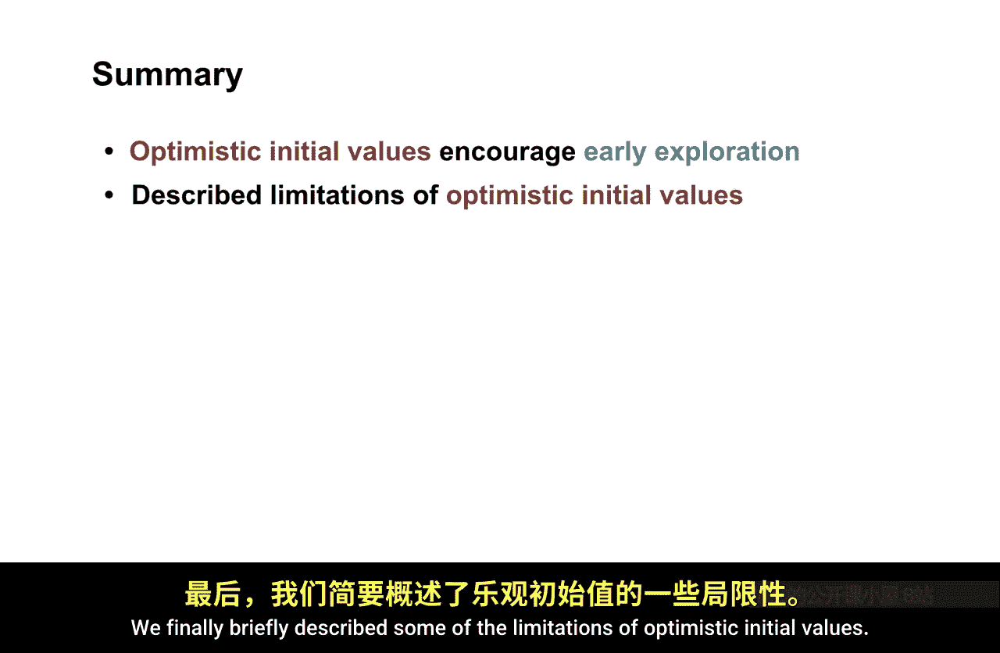

# 009：乐观初始值

在本节课中，我们将要学习一种名为“乐观初始值”的策略，它用于在强化学习中平衡探索与利用。我们将通过医生进行药物试验的例子，理解乐观初始值如何鼓励智能体在早期进行探索，并讨论这种方法的优势与局限性。

## 乐观初始值的概念

如果进行药物试验的医生最初对每种疗法的效果都持非常乐观的态度，会发生什么？这种面对不确定性时保持乐观的原则，是平衡探索与利用的一种常见策略。

本节中，我们将讨论如何通过设置乐观的初始值来实现这一想法。通过本视频的学习，你将理解乐观初始值如何鼓励早期探索，并能描述其作为一种探索机制的某些局限性。

## 乐观如何影响行动选择

上一节我们介绍了乐观初始值的概念，本节中我们来看看它如何具体影响行动选择。让我们再次以医生为例进行说明。

假设医生最初认为每种疗法都是100%有效的，直到事实证明并非如此。那么，医生会开始随机开具处方，直到其中一种疗法未能治愈患者。之后，医生可能会从剩下的两种疗法中随机选择一种，并继续这个过程，直到该疗法也失效。医生将持续这种方式，总是假设疗法具有最大效果，直到估计值需要被修正为止。

让我们通过具体的数值来看看这是如何运作的。之前，我们假设初始估计值为零，但这并不一定是乐观的。现在，我们的医生在试验开始前乐观地假设每种疗法都非常有效。为了确保我们肯定是高估了，让我们将每个行动的初始值设得非常高，例如设为 `Q(a) = 2`。我们假设医生总是选择贪婪行动（即当前估计价值最高的行动）。

## 乐观初始值的运作示例

以下是行动价值增量更新规则的回顾，我们将用其进行演示：

**公式：** `Q(A) = Q(A) + α * (R - Q(A))`

我们设定学习率 `α = 0.5` 用于本次演示。

1.  **第一位患者到来**：由于所有行动的估计值当前都相等（均为2），医生随机选择疗法P。患者报告感觉好转，获得奖励 `R = 1`。根据更新规则，疗法P的估计值从2更新为 `2 + 0.5*(1-2) = 1.5`。请注意，即使治疗成功，估计值也下降了，因为奖励（1）低于我们乐观的初始估计（2）。

2.  **第二位患者到来**：医生在具有最高估计值的疗法（Y和B，均为2）中选择。随机选择了疗法Y。患者报告没有好转，奖励 `R = 0`。疗法Y的估计值更新为 `2 + 0.5*(0-2) = 1`，现在低于疗法P的当前估计值（1.5）。

3.  **第三位患者到来**：疗法B具有最高的估计值（2），医生开具疗法B。患者感觉好转，奖励 `R = 1`。疗法B的估计值更新为 `2 + 0.5*(1-2) = 1.5`。

患者持续到来，医生不断提供治疗并修正价值估计。从这个例子中，我们可以看到，使用乐观初始值鼓励了学习早期的探索：医生在前三个时间步尝试了所有三种疗法，并在之后继续尝试所有疗法。

## 在10臂老虎机问题中的应用

让我们看另一个例子，这次是教科书中的10臂老虎机问题。每个行动的真实价值是从正态分布中采样的。对于这个问题，将初始估计值设为5很可能是乐观的，因为在此图中，所有真实价值都小于3。

每当智能体选择一个行动时，该行动第一次被选择所获得的实际奖励很可能低于乐观的初始估计。因此，该行动的估计值会下降，相比之下，其他行动开始显得更有吸引力。这自然驱使智能体去探索其他选项。

## 实验与局限性分析

我们运行一个实验来观察使用乐观初始值的智能体的行为。作为基线，我们运行一个ε-贪婪智能体（`ε = 0.1`），其初始估计值设为0（非乐观）。同时，我们运行一个使用乐观初始值的贪婪智能体。

我们绘制了智能体选择最优行动的时间百分比（多次运行的平均值）。在早期学习中，乐观智能体表现更差，因为它探索得更多。随着时间推移，其探索行为会减少，因为估计值中的乐观成分会随着更多样本而被“冲刷”掉。

使用乐观初始值并不一定是平衡探索与利用的最佳解决方案。它存在一些局限性：

1.  **探索的暂时性**：乐观初始值只驱动学习早期的探索。这意味着智能体在一段时间后将不再继续探索。
2.  **非平稳环境中的问题**：例如，某个行动的价值可能在若干时间步后发生变化。一个乐观智能体可能已经固守于某个特定行动，而不会注意到现在有另一个行动更优。
3.  **参数设置的不确定性**：在实践中，我们可能并不总是知道如何设置乐观的初始值，因为我们可能不知道最大奖励是多少。

尽管存在这些局限性，乐观初始值已被证明是一种非常有用的启发式方法。在本课程的后续部分，我们将会继续使用这种方法，并经常与其他探索方法结合使用。

## 总结

本节课中，我们一起学习了初始价值函数估计的影响。我们描述了乐观初始值如何鼓励早期探索，并通过几个例子演示了这一点。最后，我们简要描述了乐观初始值的一些局限性。乐观初始值为我们提供了一种简单而直观的方式来引导智能体进行初步探索。

下次课我们将讨论另一种平衡探索与利用的策略。