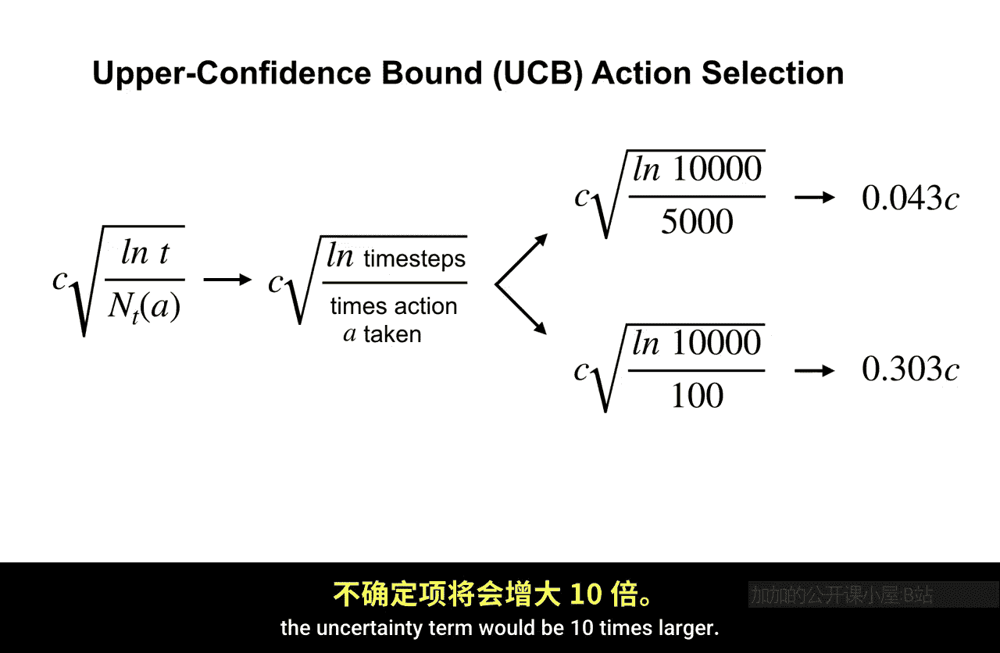
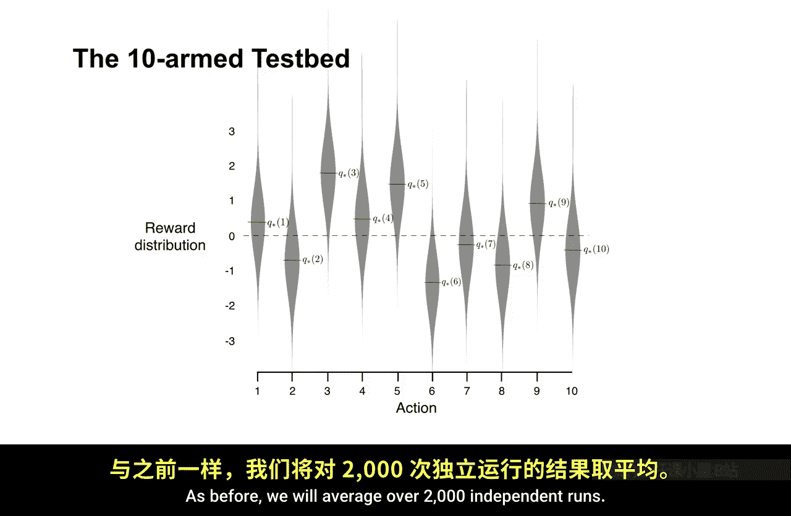
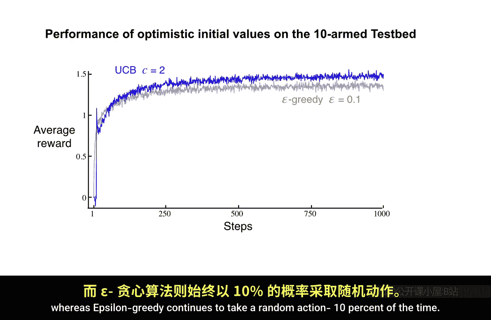

# 010：置信上限（UCB）动作选择


在本节课中，我们将要学习一种名为“置信上限”的动作选择方法，它用于在强化学习中平衡探索与利用。我们将理解UCB如何利用价值估计中的不确定性来驱动智能体进行更有效的探索。

## 探索与利用的平衡

上一节我们介绍了几种平衡探索与利用的方法。因为我们是从采样的奖励中估计动作价值，所以我们的估计值存在固有的不确定性。我们进行探索，正是为了减少这种不确定性，以便在未来做出更好的决策。

## 不确定性是什么？

“估计值存在不确定性”意味着什么？假设 `Q(a)` 代表我们对动作 `a` 的当前估计值。我们可以用一个置信区间来表示这个估计的不确定性。这个区间表示我们确信动作 `a` 的真实价值 `Q*(a)` 位于这个范围内的某个位置。区间的左边界称为**下界**，右边界称为**上界**，两者之间的区域就是**置信区间**，它代表了我们的**不确定性**。

*   如果这个区域很小，我们非常确定动作的真实价值接近我们的估计值。
*   如果这个区域很大，我们则不确定动作的真实价值是否接近我们的估计值。

## 面对不确定性的乐观原则 😊

UCB方法遵循“面对不确定性保持乐观”的原则。这很简单：如果我们对某件事不确定，就应该乐观地假设它是好的。

例如，假设我们有三个动作及其对应的不确定性区间。我们的智能体不知道哪个最好，因此它会乐观地选择具有**最高上界**的那个动作。这是合理的，因为要么这个动作确实价值最高，我们能获得高奖励；要么通过选择它，我们可以了解我们最不了解的动作，从而减少其不确定性。

## UCB动作选择公式

我们可以使用以下公式，通过上置信界来选择动作：

```
动作选择 = argmax_a [ Q(a) + c * sqrt( ln(t) / N(a) ) ]
```

我们将选择具有最高“估计价值”加上“乐观置信界扩展项”的动作。

这个上界项可以分解为三个部分：
1.  **`Q(a)`**：动作 `a` 的当前价值估计（**利用部分**）。
2.  **`c`**：一个由用户指定的参数，用于控制探索的程度。
3.  **`sqrt( ln(t) / N(a) )`**：不确定性度量（**探索部分**）。其中 `t` 是总时间步数，`N(a)` 是动作 `a` 被选择的次数。

从这个公式可以清楚地看到UCB如何结合探索与利用：第一项 `Q(a)` 代表**利用**，第二项代表**探索**。

## 探索项示例

让我们看几个探索项的例子。假设到目前为止我们已经执行了 `t = 10,000` 步。

*   **情况一**：如果我们已经选择动作 `a` 了 `N(a) = 5,000` 次，那么不确定性项大约是 `0.043 * c`。
*   **情况二**：如果我们只选择动作 `a` 了 `N(a) = 100` 次，那么不确定性项将是情况一的10倍左右。




## 在10臂老虎机上的性能

现在，让我们使用10臂老虎机测试平台来研究置信上限动作选择的性能。我们使用与之前相同的设置：10个动作的真实价值 `Q*(a)` 服从均值为0、标准差为1的正态分布。奖励则从以 `Q*(a)` 为均值、方差为1的正态分布中采样。我们将对2000次独立运行的结果进行平均。

为了在10臂老虎机问题上比较UCB和ε-贪心算法，我们将UCB的参数 `c` 设为2，将ε-贪心的参数 `ε` 设为0.1。




从上图我们可以看到，在大约100个时间步之后，UCB获得的平均奖励开始超过ε-贪心算法。最初，UCB会进行更多探索以系统地减少不确定性。随着时间的推移，UCB的探索会减少，而ε-贪心算法则始终有10%的时间在进行随机探索。




## 总结

本节课中，我们一起学习了**置信上限动作选择**方法。UCB利用价值估计中的不确定性来平衡探索与利用。它通过一个公式来选择动作，该公式结合了当前的价值估计（利用）和一个基于选择次数的不确定性项（探索）。与固定的ε-贪心策略相比，UCB能够更智能地分配探索努力，从而在测试中通常能获得更好的长期性能。