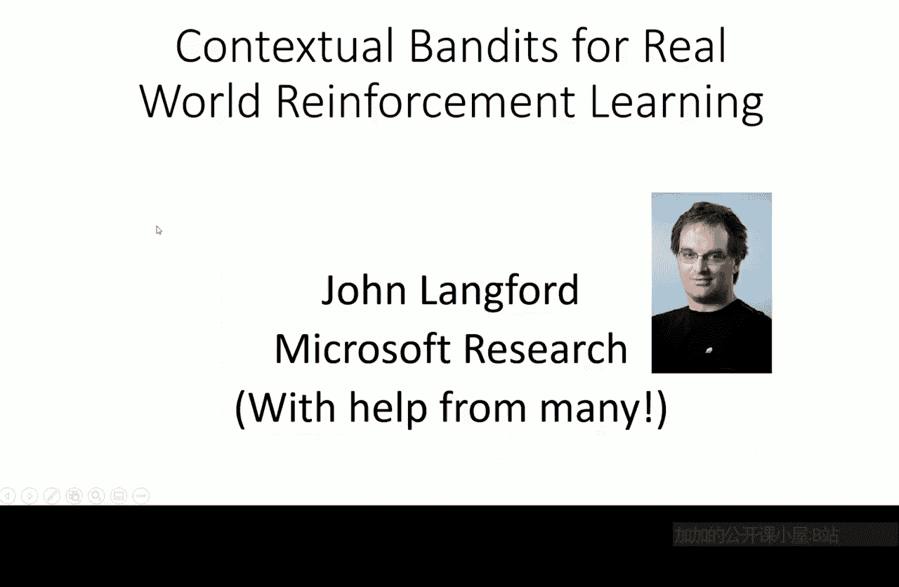
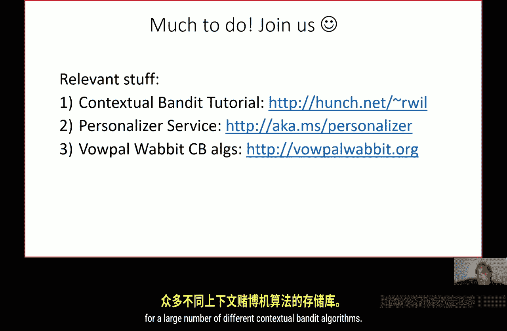

# 011：现实世界强化学习中的情境赌博机 🎰

在本节课中，我们将探讨如何将强化学习应用于现实世界，并重点介绍情境赌博机这一核心方法。我们将了解现实世界应用与模拟器训练之间的关键差异，以及为何情境赌博机是当前部署现实世界强化学习系统的主流方式。

## 概述：现实世界与模拟器的差异

上一节我们介绍了强化学习的基本框架。本节中，我们来看看当我们将强化学习从模拟器迁移到现实世界时会遇到哪些挑战。

典型的模拟器强化学习流程如下：模拟器提供观测值，学习算法根据策略选择一个动作，模拟器处理该动作并返回某种奖励。例如，在游戏玩法中就是如此。

然而，当你想将其应用于现实世界时，这些环节的匹配就成为了问题。现实世界的观测值通常与模拟器中的不同。基于观测值采取的动作也往往不同，因为观测性质的变化会导致即使策略相同，动作也可能不同。此外，从现实世界获得的奖励也常常与模拟器中的奖励不相似。

因此，模拟器与现实之间存在差距。虽然你可以在模拟器中学习，但所学内容对现实世界应用的适用性并不明确，在许多情况下甚至可能无法应用。

## 优先级的转变：支持现实世界应用

鉴于基于模拟器的强化学习（这是当前主流）与基于现实世界的强化学习之间存在差距，我们该如何进行现实世界强化学习呢？关键在于优先级的转变。

你需要将优先级转向支持现实世界强化学习应用。以下是几个转变的例子：

*   **信用分配的重要性**：在模拟器中，确定哪个动作导致了最终结果（信用分配）对强化学习至关重要。但在现实世界，泛化到不同观测值的能力可能更为重要。
*   **环境的控制权**：在模拟器中，强化学习算法可以轻松控制环境（例如，“请向前一步”）。但在现实世界，通常是环境控制着你。这是与现实世界交互时接口设计的根本区别。
*   **效率的考量**：在模拟器中，计算效率是关键限制因素，因为你可以计算尽可能多的样本。但在现实世界，统计效率是更大的担忧，因为你只能获得现实世界提供的有限样本，必须利用这些样本实现最大影响。
*   **状态与观测**：在基于模拟器的强化学习中，我们常思考“状态”，这是做出决策所需的基本信息。但在现实世界，你通常拥有非常复杂的观测值（例如，一个百万像素的摄像头图像），其中可能包含远超决策所需的信息。区分将所有可能的像素设置视为一个“状态”与其他决策方式变得很重要。
*   **离策略评估**：在现实世界中，能够进行离策略评估变得重要。在稍后将讨论的情境赌博机中，有些算法不仅进行学习，还能作为副产品生成可用于离策略评估的数据。自然地，这些支持离策略评估的算法变体在实际应用中更受青睐。
*   **对策略的关切**：在模拟器中，你可能运行很长时间，只关心最终得到的策略。但在现实世界，收集的每个数据点都涉及与世界的某种交互，你希望每次交互的性能都相当好。因此，你真正关心的是整个策略轨迹，即学习过程中产生的一系列策略。

## 实例：个性化新闻推荐

让我们思考一个现实世界强化学习的自然应用：个性化新闻推荐。

也许你有一组可能的新闻文章，是今天感兴趣的。某个用户访问网站，你想选择一篇他们可能感兴趣的新闻文章，然后你会获得关于他们是否实际阅读了该文章的反馈。

这是一个非常自然的强化学习结构，事实上它更简单，是一种情境赌博机结构。

## 情境赌博机详解

那么，什么是情境赌博机呢？在情境赌博机中，会发生以下事情：

你观察到一些特征。这可能是用户的地理位置，可能是基于用户过去行为的某种画像，也可能是可用动作（新闻文章）本身的特征。基于这些特征，你选择一个动作，然后获得一些奖励。你的目标是在此设置下最大化奖励。

这听起来很像完整的强化学习，在很大程度上确实如此。但有一个重要的前提：我们假设这里不存在信用分配问题。也就是说，展示给你的新闻文章不会影响展示给我时我的行为方式。

## 发展历程与工具

这个领域的发展实际上相当新近，在过去十年中世界发生了巨大变化。

以下是其关键发展节点：

*   **2007年**：出现了第一个情境赌博机算法，称为“Epoch-Greedy”。它本质上是ε-贪婪算法的一个变体，其ε值取决于你的知识量。我们很快发现了一篇更早的关于“Hedge算法”的论文，该算法在统计上更高效，但计算上极其糟糕。
*   **2010年**：我们在雅虎研究院时，部署了第一个现实世界中的个性化新闻应用。
*   **2011年**：我们首次将Epoch-Greedy风格的学习与Hedge风格的学习结合，实现了计算和统计上都高效的算法。
*   **2014年**：我们提出了一个更好的算法，至今仍可使用。
*   **2016年**：我们创建了决策服务的第一版，这是一个通用的云服务，可用于创建你自己的情境赌博机学习系统。
*   **2019年**：这最终催生了一项强化学习服务产品，即Azure认知服务中的“个性化推荐器”。基于此服务，你可以个性化你的网站或其布局等许多其他方面。它是一个通用服务，你可以输入任意特征，选择一个动作，然后发送任意奖励供其学习。基于该系统，我们实际上获得了2019年年度AI系统奖。

## 深入学习资源

由于时间关系，我无法在此深入细节，但如果你对情境赌博机的更多细节感兴趣，我和Alex Slivkins在2019年做过一个教程，推荐你查看。

如果你对个性化推荐器服务感兴趣，可以通过此URL访问。

如果你对个性化推荐器服务背后的算法以及情境赌博机算法的通用实现感兴趣，Vowpal Wabbit已经成为一个包含大量不同情境赌博机算法的代码库。

## 总结

本节课中，我们一起学习了将强化学习应用于现实世界的关键挑战，并深入了解了情境赌博机作为解决方案的核心思想。我们探讨了现实应用与模拟器训练在优先级上的根本区别，例如从强调信用分配转向重视泛化能力，从追求计算效率转向追求统计效率。通过个性化新闻推荐的实例，我们看到了情境赌博机的实际应用框架。最后，我们回顾了该领域的发展历程，并指出了进一步学习的宝贵资源。掌握情境赌博机，是迈向成功部署现实世界强化学习系统的重要一步。