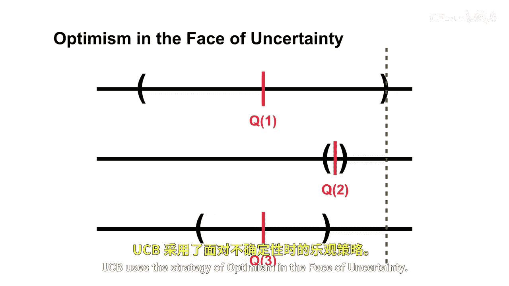

# 012：多臂老虎机问题总结 🎰

在本节课中，我们将回顾第一周学习的核心内容：多臂老虎机问题及其相关的强化学习基础概念。我们将介绍问题设定、价值估计方法，以及探索与利用的平衡策略。

---

## 问题设定与价值函数

我们首先描述了多臂老虎机问题的设定。在这个问题中，有一个智能体（agent）需要选择动作（action），并根据所选动作获得奖励（reward）。

我们定义每个动作的价值为执行该动作时期望获得的奖励。这个真实的价值函数 **Q*** 对智能体来说是未知的。

为了估计 **Q***，我们引入了**采样平均法**。该方法计算动作 **a** 被选中时获得的所有奖励之和，再除以动作 **a** 被选中的次数。其公式表示为：

**Q_t(a) = (R_1 + R_2 + ... + R_{N_t(a)}) / N_t(a)**

其中，**N_t(a)** 是动作 **a** 在时间 **t** 之前被选中的次数。

---

## 增量式更新与步长参数

上一节我们介绍了采样平均法，本节中我们来看看如何更高效地实现它。我们推导出了一个**增量式更新规则**，为采样平均找到了一个递归定义。

通过这种方式，我们只需要存储每个动作被选中的次数以及上一次的价值估计值，而无需保留所有历史奖励数据。其更新规则为：

**Q_{n+1} = Q_n + α * (R_n - Q_n)**

其中，**α** 是步长参数，通常设为 **1/n**。

我们进一步将步长参数泛化。事实上，通过使用一个**恒定步长 α**，我们可以更有效地解决那些奖励分布会随时间变化的非平稳老虎机问题。

---

## 探索与利用的平衡

接下来，我们遇到了强化学习中的一个核心矛盾：**探索（Exploration）与利用（Exploitation）**。

我们定义**探索**为智能体尝试新动作以改进其知识的机会。有些动作可能比我们当前认为的更好，我们必须尝试那些我们认为不是最优的动作，以改进我们的估计。

我们定义**利用**为智能体选择当前认为价值最高的动作，以期获得最多的即时奖励。

智能体无法同时进行探索和利用。那么，我们如何决定何时探索、何时利用呢？

为了解决这个问题，我们介绍了 **ε-贪心（Epsilon-Greedy）** 动作选择策略。

以下是 ε-贪心策略的核心要点：
*   **探索概率 ε**：智能体以 **ε** 的概率进行探索。
*   **利用概率 1-ε**：智能体以 **1-ε** 的概率进行利用。
*   **利用时的选择**：当选择利用时，智能体选择当前价值估计值最高的动作。
*   **探索时的选择**：当选择探索时，智能体在所有动作中**均匀随机**地选择一个。

---

## 乐观初始值与置信区间

我们还研究了**乐观初始值（Optimistic Initial Values）** 的效果。

如果我们将动作价值的初始估计值设置得比真实的 **Q*** 更高，智能体在初期会系统地探索所有动作。因为每个动作的初始高估会随着收到实际奖励而逐渐“降温”，智能体最终会停止探索，收敛到最优动作。

最后，我们讨论了**置信区间上界（Upper Confidence Bound, UCB）** 动作选择方法。

UCB 通过使用置信区间来混合利用和探索。它采用**面对不确定性时的乐观（Optimism in the Face of Uncertainty）** 策略。UCB 在选择动作时，不仅考虑当前的平均奖励（利用），还考虑该奖励估计的不确定性（探索），倾向于选择那些潜力（即上界）更大的动作。

---

## 总结

本节课中，我们一起学习了多臂老虎机问题以及强化学习中最基础的一些概念。

我们主要将老虎机问题视为更大规模强化学习问题的一个子集。在面对不确定性时，如何最大化奖励、如何选择动作等概念，是强化学习的核心。

我们下周将开始介绍完整的强化学习问题，请务必预习下周课程的相关教材。🚀