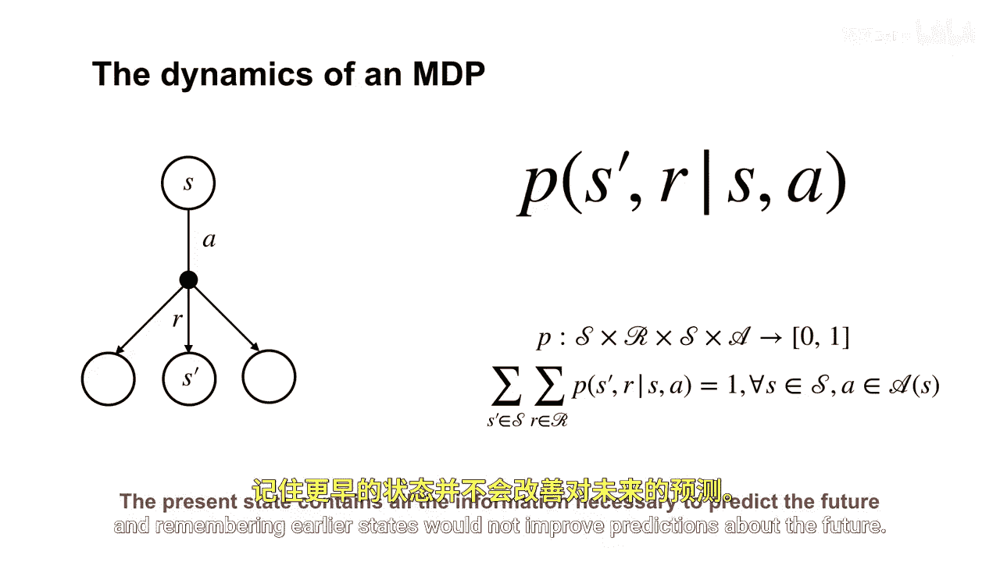

强化学习专项课程：第3章：马尔可夫决策过程


在本节课中，我们将要学习马尔可夫决策过程。我们将了解MDP如何为顺序决策问题提供一个通用框架，并描述MDP的动态特性是如何定义的。

---

### **从老虎机问题到MDP**

上一节我们介绍了K臂老虎机问题，它引出了许多有趣的问题。然而，它并未包含现实世界问题的许多方面。

在老虎机问题中，智能体在每个时间步面临相同的情境，并且最优行动总是相同的。但在许多问题中，不同的情境需要不同的应对策略。此外，我们当前选择的行动会影响未来能获得的奖励数量。

马尔可夫决策过程的形式化框架捕捉了现实世界问题的这两个方面。

---

### **一个简单的例子：兔子觅食**

让我们从一个简单的例子开始，来突显老虎机问题与MDP之间的区别。

想象一只兔子在田野里游荡觅食。它发现自己处于一种情境：右边有一根胡萝卜，左边有一棵西兰花。兔子更喜欢胡萝卜，所以吃胡萝卜会产生+10的奖励。而吃西兰花只产生+3的奖励。

但是，如果后来兔子发现自己处于另一种情境：右边是西兰花，左边是胡萝卜呢？显然，兔子此时会倾向于向左走，而不是向右走。K臂老虎机问题无法解释“不同情境需要不同行动”这一事实。

它在另一个方面也存在局限。假设我们确实考虑了不同情境下的不同行动。在这里，兔子似乎想向右走以获取胡萝卜。然而，向右走也会影响兔子接下来看到的情境。

假设就在胡萝卜的右边，有一只老虎。如果兔子向右移动，它能吃到胡萝卜。但之后，它可能来不及逃离老虎。如果我们考虑到行动的长期影响，兔子应该向左走，选择西兰花，以给自己更好的逃生机会。一个只关心即时奖励的“老虎机兔子”会选择胡萝卜，但通过考虑决策的长期影响，可以做出更好的决定。

---

### **状态、行动与奖励**

现在，让我们看看随着兔子采取行动，情境是如何变化的。我们将这些情境称为**状态**。

在每个状态，兔子选择一个**行动**。例如，兔子可以选择向右移动。基于这个行动，世界会转变到一个新的状态，并产生一个**奖励**。

在这个例子中，兔子吃了胡萝卜并获得+10的奖励。然而，兔子现在位于老虎旁边。假设兔子选择向左移动的行动，世界会转变到一个新的状态（老虎吃掉了兔子），兔子获得-100的奖励。

从原始状态出发，兔子也可以选择向左移动，那么世界会转变到另一个新状态，兔子获得+3的奖励。

下图展示了两种可能的状态序列，实际发生的序列取决于兔子采取的行动。

```
状态S1 (胡萝卜在右) -> 行动A1 (向右) -> 状态S2 (老虎在旁) & 奖励R1 (+10)
状态S1 (胡萝卜在右) -> 行动A2 (向左) -> 状态S3 (安全) & 奖励R2 (+3)
```

我们可以用一个通用框架来形式化这种交互。

---

### **MDP框架**

在这个框架中，智能体与环境在离散的时间步上进行交互。

在每个时间步 `t`，智能体从环境接收一个**状态** `S_t`，它来自所有可能状态的集合 `𝒮`。幻灯片上展示的配置就是一个状态的例子。

基于这个状态，智能体从一个可能的**行动**集合中选择一个行动 `A_t`。`𝒜(S_t)` 表示在状态 `S_t` 下所有有效行动的集合。“向右移动”就是一个行动的示例。

一个时间步之后，部分基于智能体的行动，智能体发现自己处于一个新的状态 `S_{t+1}`。例如，兔子位于老虎旁边的状态。

环境同时提供一个标量**奖励** `R_{t+1}`，它来自所有可能奖励的集合 `ℛ`。在这个例子中，吃胡萝卜的奖励是+10。

下图总结了MDP框架中的智能体-环境交互。这种交互生成了一条由状态、行动和奖励组成的**经验轨迹**。行动不仅影响即时奖励，也通过影响未来状态来影响未来的奖励。

---

### **MDP的动态特性：转移概率函数**

那么，我们如何表示这种交互的动态特性呢？与老虎机问题一样，结果是随机的，因此我们使用概率的语言。

当智能体在一个状态下采取一个行动时，存在许多可能的下一个状态和奖励。

**转移动态函数 `P`** 形式化了这个概念。给定一个状态 `s` 和行动 `a`，`P` 告诉我们下一个状态 `s'` 和奖励 `r` 的联合概率。

在本课程中，我们通常假设状态、行动和奖励的集合是有限的。但别担心，后续你将学习能够处理无限集和不可数集的算法。

由于 `P` 是一个概率分布，它必须是非负的，并且对所有可能的下一个状态和奖励求和必须等于1。

```
P(s', r | s, a) ≥ 0
∑_{s' ∈ 𝒮} ∑_{r ∈ ℛ} P(s', r | s, a) = 1
```

请注意，未来的状态和奖励**仅取决于**当前的状态和行动。这被称为**马尔可夫性质**。这意味着当前状态是充分的，记住更早的状态不会改善对未来的预测。



---

### **本节总结**

本节课中我们一起学习了马尔可夫决策过程。MDP为顺序决策提供了一个通用框架，其动态特性由一个概率分布 `P(s', r | s, a)` 定义。在下一个视频中，我们将讨论几种决策任务，并将每一种形式化为一个MDP。