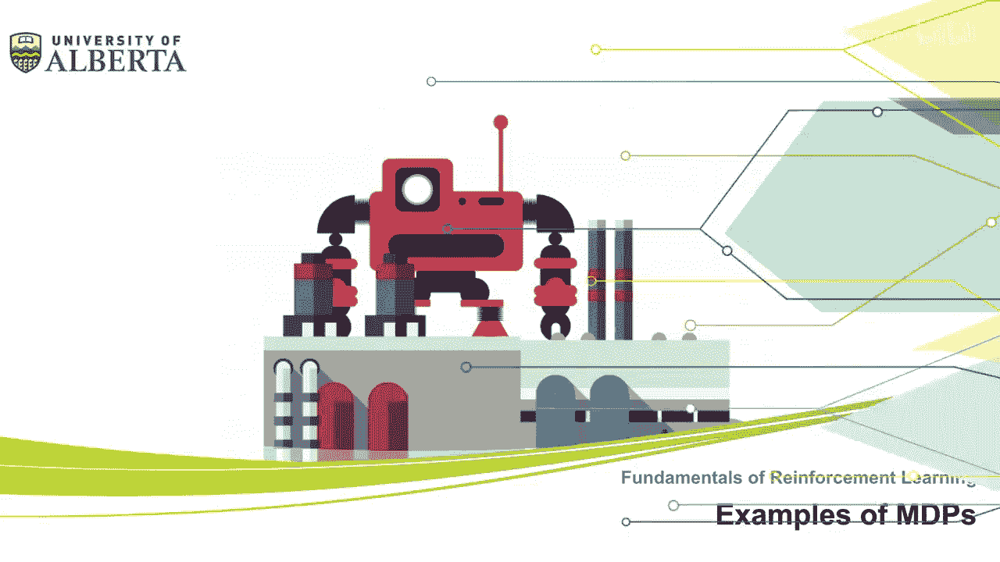
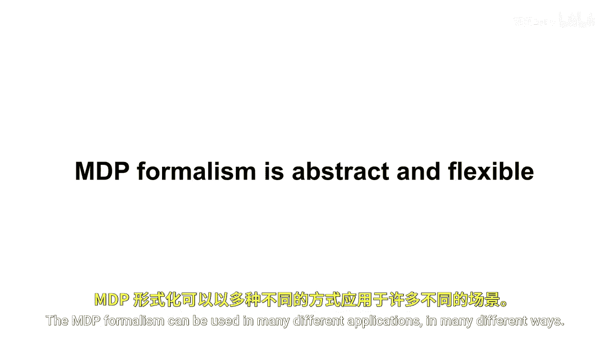

强化学习专项课程：P14：马尔可夫决策过程示例 🧠

在本节课中，我们将通过几个示例来探索马尔可夫决策过程（MDP）形式的灵活性。你将学习如何将决策问题形式化为MDP，并体会MDP框架的广泛适用性。

---

### 示例一：回收机器人 🤖

考虑一个在办公室环境中收集空易拉罐的回收机器人。它能探测到易拉罐，用机械臂拾取它们，并将其放入回收箱。机器人使用可充电电池运行，其目标是尽可能多地收集罐子。

现在，让我们将这个问题形式化为一个MDP。我们将从定义状态、动作和奖励开始。

我们假设传感器只能区分两种电量水平：**低**和**高**。这些电量水平代表了机器人的状态。在每个状态下，机器人有三个选择：
1.  它可以搜索一段时间来寻找罐子。
2.  它可以保持静止，等待有人给它带来一个罐子。
3.  或者它可以去充电站给电池充电。

我们只允许在低电量状态下充电，因为当电量高时充电没有意义。

接下来，我们考虑状态转移的动态过程。首先，用空心圆表示状态。

当电量水平为**高**时搜索罐子，可能会将电量水平降低到**低**。也就是说，在**高**状态下执行搜索动作，可能以概率 **α** 保持状态不变，也可能以概率 **1-α** 将电量降至**低**。在这两种情况下，机器人搜索都会获得奖励 **R_search**。例如，**R_search** 可以是 +10，表示机器人找到了10个罐子。

机器人也可以选择**等待**。等待不会消耗电池，因此状态不会改变。等待动作会获得奖励 **R_wait**。例如，**R_wait** 可以是 +1。

当电量水平为**低**时进行搜索，可能会耗尽电池，那么机器人就需要被救援。我们将这个概率记为 **1-β**。如果机器人被救援，其电池会恢复，但需要救援会产生一个负奖励 **R_rescue**。例如，**R_rescue** 可以是 -20，因为我们会对机器人感到恼火。或者，电池可能没有耗尽，这种情况发生的概率是 **β**，机器人会获得奖励 **R_search**。

执行**充电**动作会将电池恢复到**高**水平，并获得零奖励。

至此，我们已经完全为回收机器人问题指定了MDP。

---

### MDP框架的灵活性 🔄

我们讨论了一个使用MDP来精确描述问题的例子，但你可能会问，这个框架有多通用？

MDP形式可以以多种不同的方式应用于许多不同的领域。

状态可以是低级别的感官读数，例如视频帧的像素值。它们也可以是高级别的，例如物体描述。同样，动作可以是低级别的，例如这个机器人的轮速；动作也可以是高级别的，例如“去充电站”。时间步长可以非常小，也可以非常大，例如一毫秒或一个月。

让我们再看一个应用示例。

---

### 示例二：机器人手臂控制 🦾

假设我们想使用强化学习来控制一个机器人手臂执行抓取和放置任务。机器人的目标是拾取物体并将其放置到特定位置。

我们可以用多种方式形式化这个任务，这里提供一种可能性：
*   **状态**：可以是关节角度和速度的读数。
*   **动作**：可以是施加到每个电机上的电压。
*   **奖励**：成功放置每个物体可以获得 +100 的奖励。但同时，我们希望机器人尽可能少地使用能量，因此可以加入一个与使用能量相对应的小的负奖励。

这并不难。

---

### 总结 📝

本节课中，我们一起学习了如何将实际问题形式化为马尔可夫决策过程。我们通过回收机器人和机器人手臂控制两个具体示例，定义了状态、动作、奖励和转移概率。更重要的是，我们认识到MDP框架具有高度的灵活性，能够适应从低级控制到高级决策、从微小时间尺度到宏观时间尺度的各种顺序决策问题。