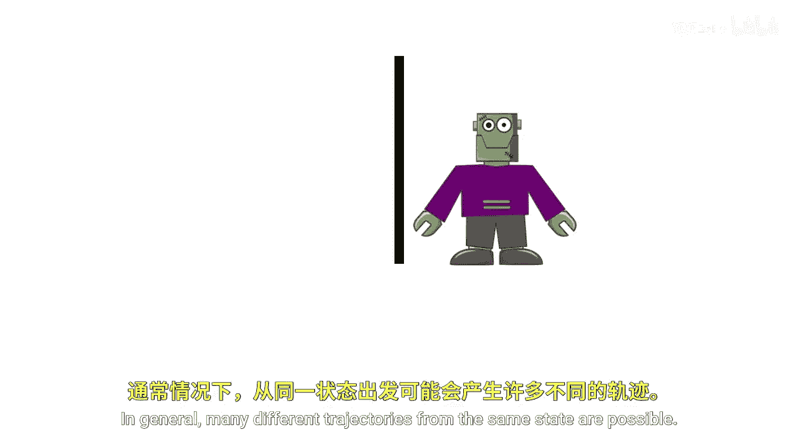
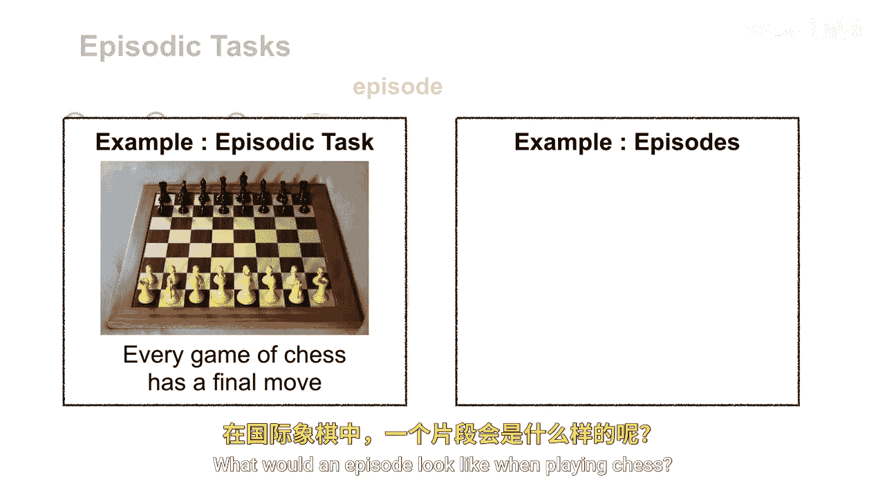

# 015：强化学习的目标 🎯

在本节课中，我们将正式定义强化学习智能体的目标，即最大化未来的累积奖励。我们将探讨为何不能只关注即时奖励，并介绍“回报”这一核心概念，以及一种重要的任务类型——分幕式任务。

## 智能体的目标

上一节我们介绍了多臂老虎机问题，其中智能体的目标是最大化即时奖励。然而，在更一般的马尔可夫决策过程中，这通常行不通。

一个在当前时间步能带来高奖励的动作，可能导致智能体转移到一个未来只能获得低奖励的状态。

因此，从短期看有利的选择，从长期来看可能并非最佳。

考虑一个学习走路的机器人，奖励可以与前进距离成正比。猛地向前冲显然能最大化即时奖励，但这个动作会导致机器人摔倒。如果机器人改为最大化总的前进距离，它就会走得又快又稳。

## 定义回报

现在，让我们正式定义“最大化总未来奖励”的含义。

在时间步 **t** 的**回报**，简称为从时间步 **t** 之后获得的所有奖励之和。我们用字母 **G** 表示回报。

**G_t = R_{t+1} + R_{t+2} + R_{t+3} + ...**

回报是一个随机变量，因为MDP的动态过程（包括状态转移和奖励）可能是随机的。

为了更好地理解这一点，想象我们的捡罐子机器人从这里开始。从这个状态出发，机器人总是采取相同的动作序列。

有时它可能获得较大的回报，有时可能获得较小的回报。

这是由于单个奖励和状态转移中存在的随机性。一般来说，从同一个状态出发，可能产生许多不同的轨迹。

这就是为什么我们要最大化**期望回报**。为了使这个定义有意义，奖励之和必须是有限的。

## 分幕式任务

具体来说，我们假设存在一个最终时间步 **T**，此时智能体与环境的交互终止。交互终止时会发生什么？

在最简单的情况下，交互自然地分解为称为**幕**的片段。每一幕的开始独立于前一幕的结束。在终止时，智能体会被重置到一个起始状态。每一幕都有一个最终状态，我们称之为**终止状态**。我们称这类任务为**分幕式任务**。

为了更好地理解分幕式任务，让我们看一个具体例子。考虑国际象棋游戏。

一局国际象棋总是以将死、和棋或认输结束。在下棋时，一幕会是什么样子？

正如你可能猜到的，**单局国际象棋就构成了一幕**。每局游戏都从相同的起始状态开始，所有棋子被重置。

## 总结

本节课中我们一起学习了强化学习智能体的目标。我们将其形式化为最大化期望回报。然后我们讨论了分幕式任务，在这种任务中，智能体与环境的交互被分解为多个独立的片段（幕）。理解目标是设计有效强化学习算法的第一步。