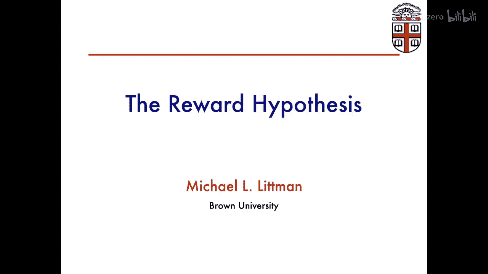
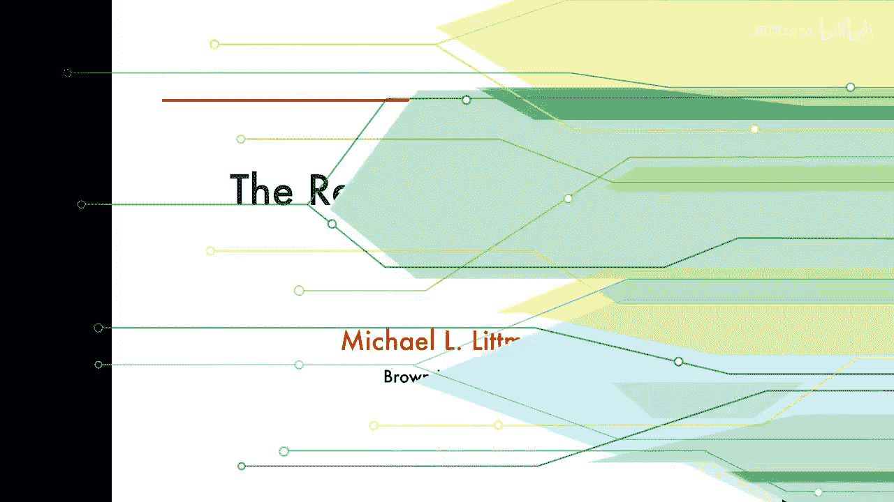

# 016：奖励假说 🎯





在本节课中，我们将学习强化学习中的一个核心概念——**奖励假说**。我们将探讨其基本思想、不同表述、实际应用中的挑战，以及它作为设计智能体指导原则的潜力与局限。

---

## 概述

奖励假说是强化学习领域的基石性思想。它认为，我们**可以通过最大化所接收的累积标量奖励信号的期望值，来描述和实现任何目标或目的**。本节课将深入解析这一假说，并探讨如何在实际中定义和使用奖励。

## 三种创造智能行为的方式

理解奖励假说之前，我们可以先看看三种实现智能行为的范式。

**第一种方式：“授人以鱼”**。这对应着传统的人工智能方法。我们直接为机器编程，赋予它我们期望的具体行为。然而，当新问题出现时，机器无法适应新环境，需要我们持续提供新的程序。

**第二种方式：“授人以渔”**。这对应着监督学习。我们为机器提供训练样本，机器则自己编写程序来匹配这些样本。只要我们能提供训练样本，机器就能学会编写自己的程序。但环境会变化，训练样本可能无法覆盖所有新情况。

**第三种方式：“使人爱鱼”**。这对应着强化学习。我们无需指定实现目标的具体机制，只需对目标本身进行编码（即定义奖励），机器便能自行设计达成目标的策略。这赋予了智能体强大的适应能力。

上一节我们介绍了实现智能的三种范式，本节中我们来看看奖励假说本身的具体表述。

## 奖励假说的多种表述

关于奖励假说的具体表述，学界存在一些有趣的讨论和不同版本。

*   **常见表述**：许多资料，如Muhammad Ashshraoff的博客和大卫·席尔瓦的课程，将其表述为：“**所有目标都可以被描述为对期望累积奖励的最大化**”。
*   **里奇·萨顿的表述**：强化学习先驱里奇·萨顿在其博客中写道：“**我们所说的目标和目的，可以被很好地理解为对接收到的标量信号（奖励）的累积和的期望值的最大化**”。这个版本强调了“标量”特性，并超越了单纯的目标表述。
*   **迈克尔·利特曼的表述**：在21世纪初的演讲中，迈克尔·利特曼将其表述为：“**行为产生于个体在复杂多变的世界中，寻求最大化其接收到的奖励信号的行为**”。这个版本强调了奖励的简洁性与现实世界复杂性之间的对比。

尽管措辞略有不同，但这些表述的核心精神是一致的：**智能行为源于对累积奖励的追求**。

理解了假说的核心思想后，我们需要思考其实际应用。如果我们接受这个假说，研究将主要围绕两个分支展开。

## 奖励假说引出的两个研究方向

接受奖励假说意味着我们需要解决两个关键问题：

1.  **确定智能体应该优化什么奖励**。
2.  **设计最大化这些奖励的算法**。

人们通常对第一个问题（如何定义奖励）给予了大量关注。接下来，我们将聚焦于这个挑战：**如何定义奖励？**

## 定义奖励的挑战

为什么定义合适的奖励本身就是一个难题？有时很简单，有时则不然。

*   **简单情况**：存在“通用货币”。例如，股票交易智能体的奖励可以直接用金钱（美元）定义。购买消耗美元，出售产生美元。再如，太阳能电池板追踪系统的奖励是能量，电机移动消耗能量，阳光照射产生能量。
*   **困难情况**：缺乏“通用货币”。例如，设计一个恒温器控制智能体。开启暖气或空调消耗能源（成本），但不开启会导致居住者不适（另一种成本）。两者没有天然的通用度量单位。虽然可以都转换为货币，但这并不自然，且难以精确量化“舒适度”的价值。

即使我们接受奖励假说，定义“正确”的奖励仍然是一项艰巨的工作。以下是两种常见的编码目标的方式。

### 两种目标编码方式

我们可以用奖励来表达目标。以下是两种基本方法：

*   **目标奖励编码**：将达成目标的状态奖励定义为 **+1**，其他所有状态奖励为 **0**。
    ```python
    # 伪代码示例：目标奖励编码
    if state == goal_state:
        reward = +1
    else:
        reward = 0
    ```
*   **行动惩罚编码**：在目标达成前的每一步，都给智能体 **-1** 的惩罚。一旦达成目标，就不再产生成本。
    ```python
    # 伪代码示例：行动惩罚编码
    if state != goal_state:
        reward = -1  # 每一步的代价
    else:
        reward = 0   # 目标达成，惩罚停止
    ```

这两种方式都能引导智能体达成目标，但存在细微差别：第一种可能缺乏紧迫感；第二种在智能体有小概率永远无法达成目标时，会导致严重问题。对于周期极长的目标（例如“获得诺贝尔奖”），这两种简单编码都可能失效，此时需要设计**中间奖励**来引导智能体。

既然定义奖励如此重要且具有挑战性，那么这些奖励本身从何而来呢？我们可以借鉴“授人以鱼”的三种范式来思考奖励的来源。

## 奖励的来源

与行为的来源类似，奖励也可以通过多种方式定义。

*   **编程定义**：这是最常见的方式。由人类将行为目标转化为具体的奖励值，编写成程序函数：`reward = f(state)`。近期研究也探索使用如时序逻辑等特殊语言来指定任务，作为人机之间沟通的中间格式。
*   **人工实时提供**：由人类在智能体学习过程中实时给予奖励。但这带来了挑战，因为人类的行为模式与静态奖励函数不同，他们可能会根据智能体的学习进度动态调整奖励。标准的强化学习算法难以很好地处理这种非平稳的奖励信号。
*   **从示例中学习**：智能体可以学习模仿人类给出的奖励。一个非常有趣的变体是**逆强化学习**。在逆强化学习中，训练者演示期望的行为，学习者则反向推断训练者是在最大化什么样的奖励，才使得该行为是最优的。
    *   **强化学习**：从 **奖励** 推导出 **行为**。
    *   **逆强化学习**：从 **行为** 推导出 **奖励**。
*   **通过优化过程衍生**：如果存在某种高级行为评价标准，我们可以通过优化算法来搜索能鼓励该行为的奖励函数。这类似于进化过程：拥有良好奖励函数和优化算法的智能体得以“生存”，并将其奖励函数传递给“后代”。这属于**元强化学习**的范畴，即在进化层面学习，以创造个体层面更好的学习方式。

尽管奖励假说非常强大，但我们必须谨慎看待，不应过于教条地理解它。

## 奖励假说的局限性与思考

奖励假说是设计先进智能体的优秀工作假设，并已引领我们取得了卓越成果。但我们应保持开放态度，在其不再适用时勇于摒弃它。

以下是一些值得思考的局限性和挑战：

1.  **风险规避行为**：如何用奖励最大化框架描述“风险规避”行为？风险规避者选择的可能不是平均收益最好的行动，而是能最小化最坏结果发生概率的行动。或许可以通过在奖励流中放大负面结果的影响来刻画这种行为。
2.  **行为平衡**：有时期望的行为不是“一直做最好的事”，而是“平衡地做一系列事”。例如，一个纯粹最大化奖励的音乐推荐系统，可能会找出你最喜欢的歌然后无限循环播放，这显然不是我们想要的。解决思路可能是扩展状态空间，例如，如果一首歌最近刚播放过，则再次播放它获得的奖励会降低。这类似于动物喝水：只有在口渴时喝水才有高价值，刚喝过水后立刻再喝的奖励就很低。
3.  **对人类高级行为的适用性**：一味追求显性奖励是否与人类的高级行为良好匹配？我们并不认为那些只专注于自身明确目标的人是理想的伙伴。道德哲学家指出，我们应追求的目标并非一目了然。随着年龄增长和思考深入，我们不断学习“做出好决定”和“成为有道德的人”的更深层含义。这部分是强化学习（理解行动对环境和他人的影响），但部分也涉及**阐明更深层次的目的感**：我们是在发掘已存在于心智中的奖励函数细节，还是在为自己创造更好的目标？

## 总结

本节课中，我们一起学习了**奖励假说**。我们了解了它的核心思想——智能体通过最大化累积奖励来学习达成目标，并探讨了其不同表述。我们认识到，在实际应用中，**定义合适的奖励**本身就是一个关键挑战，并分析了奖励的不同来源（如编程、人工提供、逆强化学习等）。最后，我们以批判性的眼光审视了奖励假说的局限性，提醒自己它作为一个强大的**工作假设**和**近似模型**的价值，而非绝对真理。在设计和理解智能体时，应灵活运用这一思想，同时保持对更复杂行为动机的探索。