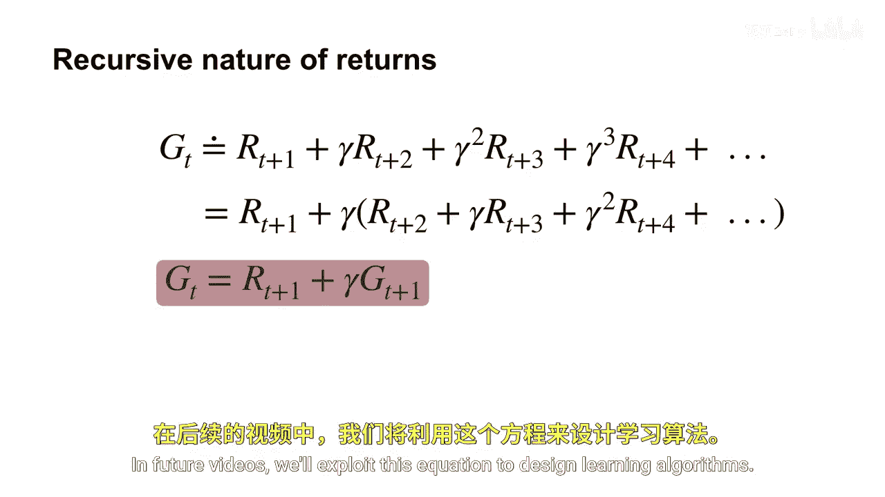
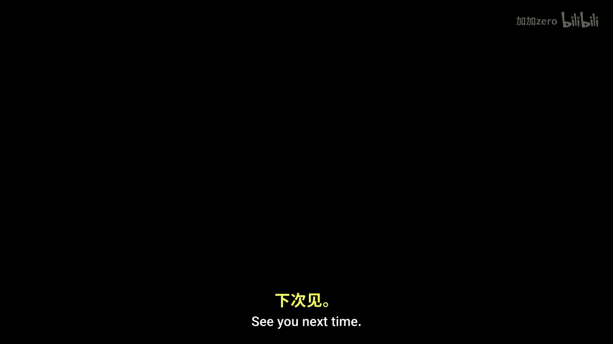

强化学习专项课程：第17讲：持续任务

在本节课中，我们将学习持续任务的概念，了解其与分幕式任务的区别，并掌握如何为持续任务定义回报。

上一节我们讨论了分幕式问题。然而，在许多问题中，智能体与环境的交互会无限持续下去。本节中，我们来看看这类问题如何被表述为持续任务。

**分幕式任务与持续任务的区别**

以下是两者的主要区别：
*   **分幕式任务**：交互过程被分解为多个幕。每一幕必须在终止状态结束。下一幕的开始与上一幕的结束方式无关。时间步 `T` 的回报是直到终止状态的所有奖励之和。
*   **持续任务**：交互过程持续进行，没有终止状态。无法被分解为独立的幕。

为了让概念更具体，考虑一个智能恒温器的例子。它可以被表述为一个持续任务，因为恒温器永远不会停止与环境的交互。状态可以是当前温度、时间、建筑内人数等。动作只有两个：打开或关闭加热器。奖励设定为：每当有人手动调节温度时，奖励为 `-1`，否则为 `0`。为了避免负奖励，恒温器将学会预测用户的偏好。

**为持续任务定义回报**

我们可以尝试像处理分幕式任务那样，将所有未来奖励相加。但现在我们是在对一个无限序列求和，这个回报可能不是有限的。

如何修改这个求和式，使其总是有限的呢？一个解决方案是使用一个称为**折扣率**的因子 `γ` 来对未来奖励进行**折扣**。`γ` 的取值范围是 `0 ≤ γ < 1`。回报公式可以修改为包含折扣：

`G_t = R_{t+1} + γ * R_{t+2} + γ^2 * R_{t+3} + ...`

折扣对回报的影响很简单：即时奖励对总和的贡献更大；未来的奖励贡献更少，因为它们被乘以了 `γ` 的更高次幂。直观上，这个选择是合理的：今天的一美元比一年后的一美元对你更有价值。

我们可以简洁地将这个和写成：`G_t = Σ_{k=0}^{∞} (γ^k * R_{t+k+1})`，这个表达式保证是有限的。原因如下：假设 `R_max` 是智能体在任何时间步能获得的最大奖励。我们可以用 `R_max` 替换每个奖励来得到回报 `G_t` 的上界。由于 `R_max` 是常数，可以提到求和符号外。注意第二个因子是一个几何级数，其和为 `1 / (1 - γ)`。因此，`R_max * 1 / (1 - γ)` 是有限的，并且是 `G_t` 的上界，所以 `G_t` 是有限的。

**折扣因子的影响**

现在来看看折扣因子 `γ` 对智能体行为的影响。我们可以看两个极端情况：
*   当 `γ = 0` 时，回报 `G_t` 就等于下一个时间步的奖励 `R_{t+1}`。此时智能体是**短视**的，只关心即时期望奖励。
*   当 `γ` 接近 `1` 时，即时奖励和未来奖励在回报中的权重几乎相等。此时的智能体是**远视**的。

**回报的递归关系**

最后，讨论回报的一个简单但重要的性质：它可以被递归地定义。让我们从求和式的第二项开始提取公因子 `γ`：

`G_t = R_{t+1} + γ * (R_{t+2} + γ * R_{t+3} + γ^2 * R_{t+4} + ...)`

括号内的序列正是下一个时间步的回报 `G_{t+1}`。因此，我们可以将其替换：

`G_t = R_{t+1} + γ * G_{t+1}`

现在我们得到了一个递归方程，左边是 `G_t`，右边是 `G_{t+1}`。这个简单的方程比看起来更强大，在未来的课程中，我们将利用这个方程来设计学习算法。

**总结**

本节课中，我们一起学习了持续任务，其中智能体与环境的交互无限期进行。我们使用折扣来确保回报是有限的，并且看到了回报可以被递归地定义。