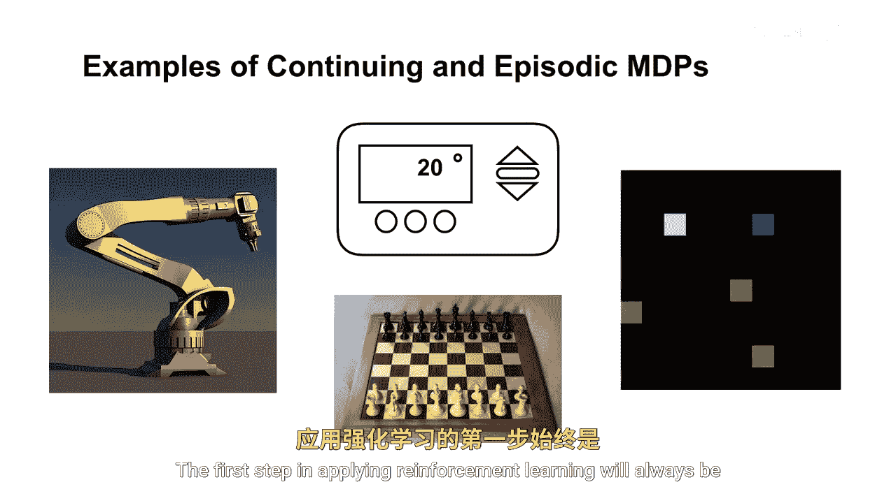

强化学习专项课程：第2周：马尔可夫决策过程总结

在本节课中，我们将总结第二周关于马尔可夫决策过程的核心内容。我们将回顾MDP的基本框架、核心概念及其在强化学习中的重要性。

---

当你初次听说马尔可夫决策过程时，你可能会认为这个用于描述所有强化学习问题的形式过于简单。现在，你或许开始理解它能代表许多复杂问题。

回顾一下，MDP形式化地描述了智能体与环境交互的问题。智能体和环境在离散的时间步上进行交互。在每个时间步，智能体观察环境的当前状态。

基于这个状态，智能体选择一个动作。之后，环境会转移到一个新状态并产生一个奖励。请记住，智能体的选择具有长期后果，它选择的动作会影响未来的状态和奖励。

智能体的目标是最大化未来的总奖励。这通常意味着需要在即时奖励和动作的长期后果之间取得平衡。

我们使用**期望回报**来形式化这个目标，它是未来奖励的期望折扣总和。通过使用小于1的折扣因子 **γ**，我们可以保证回报是有限的。**γ** 的具体值定义了我们在短期奖励与长期奖励之间的权衡程度。

我们讨论了许多可以自然地表述为**回合制**或**持续型**MDP的问题实例。MDP形式化框架可用于建模许多现实世界的问题。应用强化学习的第一步，始终是将问题表述为一个MDP。

---

本节课中，我们一起学习了马尔可夫决策过程的核心框架。我们明确了智能体与环境交互的循环、定义了期望回报的目标，并理解了折扣因子的作用。掌握将实际问题转化为MDP模型是学习强化学习的关键第一步。