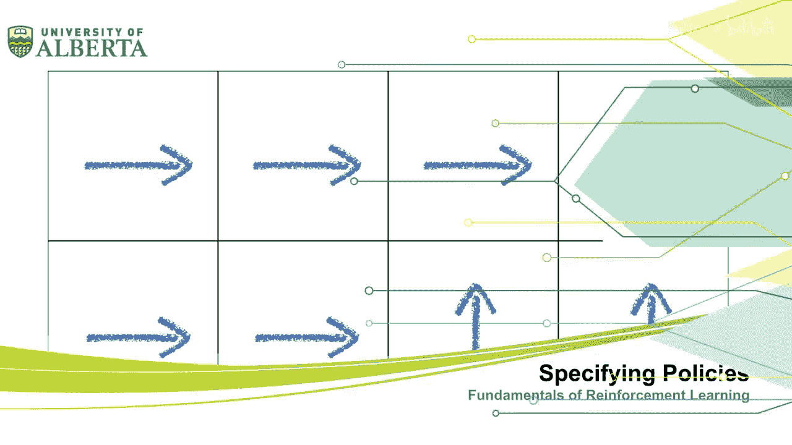
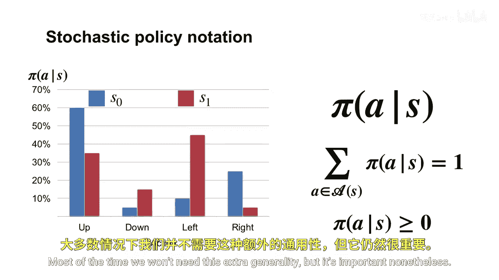

# 020：策略规范 🎯

在本节课中，我们将要学习强化学习中的一个核心概念：**策略**。策略定义了智能体在环境中如何根据当前状态选择行动。我们将探讨策略的两种主要形式，并理解其背后的数学规范。

## 概述

强化学习是在不确定性下进行序贯决策的问题框架。之前我们了解到，智能体在交互中的角色是在每个时间步选择一个行动。行动的选择会直接影响即时奖励和下一个状态。本节视频将描述**策略**——智能体如何选择这些行动。

## 确定性策略

在最简单的情况下，策略将每个状态映射到**单个**行动。这种策略被称为**确定性策略**。我们使用希腊字母 **π** 来表示一个策略。

**π(s)** 表示在状态 **s** 下，策略 **π** 所选择的行动。例如，在一个策略中，它可能在状态 **S0** 选择行动 **A1**，在状态 **S1** 和 **S2** 选择行动 **A0**。

我们可以用一个表格来可视化确定性策略。每一行描述了策略 **π** 在每个状态下选择的行动。注意，智能体可以在多个状态中选择相同的行动，而某些行动可能在任何状态下都不会被选择。

考虑一个智能体在网格上向房子移动的例子。状态对应网格上的位置，行动是上、下、左、右移动。箭头描述了一个可能的确定性策略，它指引智能体向房子移动。每个箭头告诉智能体在每个状态下应向哪个方向移动。

## 随机性策略

上一节我们介绍了确定性策略，本节中我们来看看更一般的情况。通常，策略为每个状态下的每个行动分配一个**概率**。我们使用符号 **π(a|s)** 来表示在状态 **s** 下选择行动 **a** 的概率。

**随机性策略**是指多个行动可能以非零概率被选择的策略。例如，对于状态 **S0**，策略 **π** 可能指定了如下的行动概率分布：
*   行动 A0 的概率：0.2
*   行动 A1 的概率：0.8

请记住，**π** 为**每个状态**指定了一个独立的行动概率分布。因此，它必须遵循一些基本规则：
*   对于每个状态，所有行动的概率之和必须为 1。
*   每个行动的概率必须是非负的。

让我们看看另一个状态 **S1**。在这个例子中，**π** 在 **S1** 下对应一个完全不同的行动分布。虽然在这个例子中，每个状态下可用的行动集是相同的，但通常这个集合在每个状态下可以不同。

回到我们的房子例子，一个随机性策略可能在底行以相等的概率选择“向上”或“向右”。请注意，这个策略到达房子所需的步数与之前讨论的确定性策略相同。之前我们讨论过，像 **ε-greedy** 这样的随机性策略对于探索很有用。同样的探索-利用权衡也存在于马尔可夫决策过程中。

## 策略的依赖关系

一个重要的原则是，策略**只能依赖于当前状态**，而不能依赖于其他因素，如时间或之前的状态。状态定义了用于在当前 MDP 中选择行动的所有信息。

例如，在这个 MDP 中，我们可以定义一个策略，以相等的概率选择向左或向右。我们可能也想定义一个策略，选择与上一次行动相反的方向（即在左和右之间交替）。然而，这将不是一个有效的策略，因为它的选择条件依赖于上一次行动，这意味着行动依赖于状态之外的东西。

最好将其视为对**状态**的要求，而不是对智能体的限制。在 MVPs（马尔可夫过程）中，我们假设状态包含了决策所需的所有信息。如果交替左右能产生更高的回报，那么上一次行动就应该被包含在状态中。

## 总结

本节课中我们一起学习了策略的核心概念。最重要的两点是：
1.  智能体的行为由**策略**指定，该策略将状态映射到行动的概率分布上。
2.  策略**只能依赖于当前状态**，而不能依赖于时间或之前的状态等其他因素。

我们将在下次课程中继续深入。