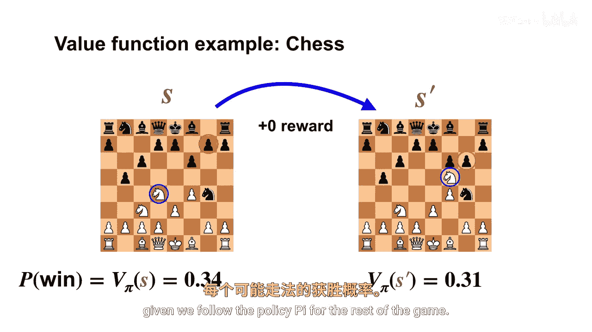

# 021：价值函数

在本节课中，我们将要学习强化学习中的核心概念——价值函数。我们将了解状态价值函数和动作价值函数的定义、作用及其与策略的关系，并通过具体例子加深理解。

许多问题都涉及一定程度的延迟奖励。例如，商店经理可以通过降价清空库存来最大化短期收益。但从长远来看，维持库存并在需求旺盛时销售会带来更好的收益。在强化学习中，奖励捕获了短期收益的概念。然而，我们的目标是学习一个能在长期获得最多奖励的策略。价值函数正是为了形式化这一长期目标而定义的。

## 🎯 价值函数的定义与作用

上一节我们提到了长期收益的重要性，本节中我们来看看如何用数学语言来定义和衡量它。

粗略地说，**状态价值函数**是智能体从某个特定状态开始，预期能获得的未来奖励。更精确地讲，状态价值函数是在给定状态下，遵循特定策略所能获得的**期望回报**。由于智能体的行为（即策略）决定了它能获得多少总奖励，因此价值函数总是相对于一个给定的策略来定义的。下标 **π** 表示该价值函数依赖于智能体根据策略 **π** 来选择动作。同样，期望符号 **E** 的下标 **π** 表示该期望是根据策略 **π** 来计算的。

我们也可以定义**动作价值函数**。动作价值描述了当智能体首先选择一个特定动作后会发生什么。更正式地说，一个状态的**动作价值**是：如果智能体选择动作 **A**，然后遵循策略 **π**，所能获得的期望回报。

价值函数在强化学习中至关重要，它允许智能体查询其当前状况的质量，而无需等待观察长期结果。这样做的好处有两个：第一，回报并非立即可得；第二，由于策略和环境动态的随机性，回报本身也可能是随机的。价值函数通过对所有可能的未来回报取平均值，总结了所有可能性。

## ♟️ 价值函数示例：国际象棋

为了理解价值函数如何帮助我们评估策略，让我们看一个国际象棋的例子。

国际象棋是一个分幕式MDP。状态由棋盘上所有棋子的位置定义。动作是合法的走子。当游戏以胜利、失败或平局结束时，幕终止。我们可以将奖励定义为：获胜时奖励为+1，其他所有走子奖励为0。

这个奖励定义在比赛过程中并不能告诉我们智能体下得有多好，我们必须等到游戏结束才能看到任何非零奖励。而价值函数能告诉我们更多信息。状态价值等于未来奖励的期望总和。由于唯一可能的非零奖励是获胜时的+1，因此状态价值简单地等于遵循当前策略 **π** 时获胜的概率。

在这个双人游戏中，对手的走子也是状态转移的一部分。例如，环境移动了智能体的棋子（蓝色圆圈）和对手的棋子（红色圆圈），使棋盘进入新状态 **S‘**。注意，状态 **S‘** 的价值低于状态 **S** 的价值。这意味着，假设我们继续遵循策略 **π**，从这个新状态赢得游戏的可能性更低了。动作价值函数则允许我们评估每个可能走子的获胜概率，前提是在游戏的剩余部分遵循策略 **π**。

## 🧮 价值函数示例：网格世界

为了建立更直观的理解，让我们看一个简单的持续性MDP例子。

状态由网格上的位置定义。动作是向上、下、左、右移动。智能体不能移出网格，撞墙会产生-1的奖励。大多数其他动作不产生奖励。然而，有两个特殊状态A和B。在状态A的每个动作都会产生+10奖励，在状态B则产生+5奖励。在状态A和B的每个动作都会分别将智能体转移到状态 **A‘** 和 **B‘**。

记住，我们必须先指定策略，才能计算出价值函数。让我们看看均匀随机策略。由于这是一个持续性任务，我们需要指定折扣率 **γ**，这里设为0.9。

以下是计算出的每个状态的价值（已预先计算好）。首先，注意底部附近的负值。这些值很低，因为智能体在到达高价值状态A和B之前，很可能撞到墙。记住，A和B是这个MDP中唯一的正奖励来源。

状态A的价值最高。注意，这个价值小于10，尽管从状态A出发的每个动作都会产生+10的奖励。为什么？因为从A出发的每次转移都会使智能体靠近下墙，而在下墙附近，随机策略很可能撞墙并获得负奖励。另一方面，状态B的价值略大于5。从B出发的转移将智能体移动到中间位置。在中间位置，智能体不太可能撞墙，并且靠近高价值状态A和B。价值函数能如此紧凑地总结所有这些可能性，确实非常神奇。

## 📝 本节总结

本节课中，我们一起学习了状态价值函数和动作价值函数的定义。状态价值函数指的是在特定策略下，从给定状态出发的期望回报。动作价值函数指的是在给定状态下，选择特定动作然后遵循给定策略所能获得的期望回报。价值函数使我们能够评估策略的长期性能，是后续学习如何寻找最优策略的基础。在接下来的课程中，我们将讨论如何计算这些价值函数。