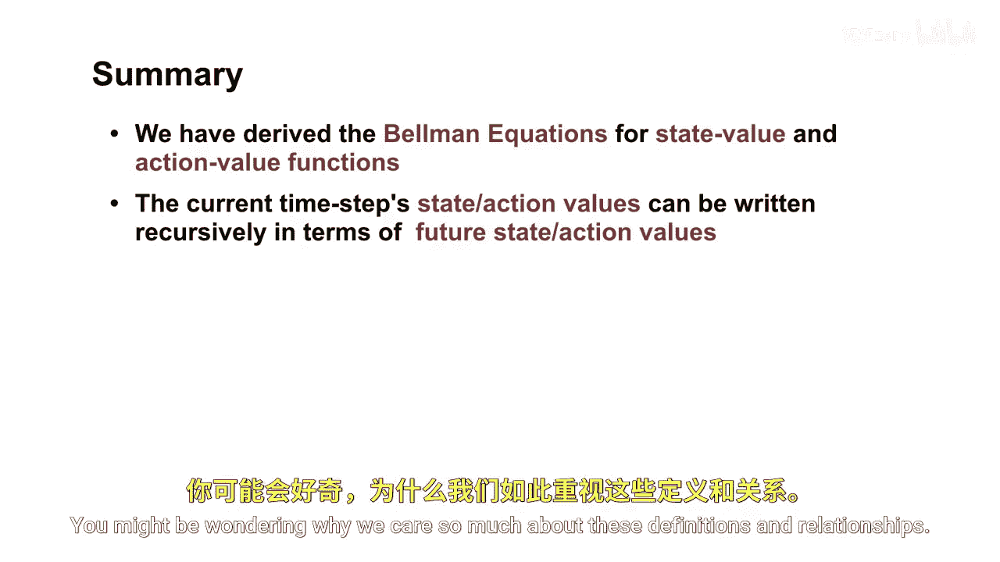

# 023：贝尔曼方程推导 🧮

在本节课中，我们将学习强化学习的核心数学工具——贝尔曼方程。我们将了解如何从状态价值函数和动作价值函数的定义出发，推导出它们各自的贝尔曼方程，并理解这些方程如何将当前状态（或状态-动作对）的价值与其后续可能状态的价值联系起来。

在日常生活中，我们经常在没有得到明确的正反馈或负反馈的情况下学习。例如，想象你正在骑自行车，撞上了一块石头，导致你失去平衡。假设你恢复了平衡，没有受伤。你可能会学会在未来避开石头，并且如果再次撞上，反应会更快。我们如何知道撞上石头是坏事，即使这次没有发生任何坏事？答案是，我们认识到失去平衡的状态是不好的，即使没有摔倒和受伤。也许我们过去有过类似的不那么顺利的经历。

在强化学习中，一个类似的理念使我们能够将当前状态的价值与未来状态的价值联系起来，而无需等待观察所有未来的奖励。我们使用贝尔曼方程来形式化这种状态价值与其可能后继状态之间的联系。

通过本视频的学习，你将能够推导状态价值函数的贝尔曼方程，定义动作价值函数的贝尔曼方程，并理解贝尔曼方程如何联系当前价值和未来价值。

## 状态价值函数的贝尔曼方程

首先，我们来讨论状态价值函数的贝尔曼方程。状态价值函数的贝尔曼方程定义了**一个状态的价值与其可能后继状态的价值之间的关系**。

现在，我们将说明如何从状态价值函数和回报的定义中推导出这种关系。

让我们首先回顾，状态价值函数被定义为从状态 `s` 开始的**期望回报**。回顾一下，回报被定义为未来奖励的**折扣总和**。我们之前看到，时间 `t` 的回报可以递归地写为即时奖励加上时间 `t+1` 的折扣回报。

现在让我们展开这个期望回报。

以下是展开期望回报的步骤：
1.  首先，我们将期望回报展开为对智能体可能采取的动作选择求和。
2.  其次，我们在给定状态 `s` 和动作 `a` 的条件下，对可能的奖励和下一个状态进行展开。

我们可以按这个顺序分解，因为动作选择仅取决于当前状态，而下一个状态和奖励仅取决于当前状态和动作。结果是一个加权和，每一项由即时奖励加上从下一个状态 `s'` 开始的期望未来回报组成。

我们所做的只是明确地将期望写出来，它被定义为可能结果的加权和，权重是它们发生的概率。

> 注意，大写的 `R_{t+1}` 是一个随机变量，而小写的 `r` 代表每个可能的奖励结果。

期望回报依赖于无限远的未来状态和奖励。我们可以根据需要递归地多次展开这个方程，但这只会使表达式更复杂。相反，我们可以注意到，这个期望回报也是状态 `s'` 的价值函数的定义。唯一的区别是时间索引是 `t+1` 而不是 `t`。这不是问题，因为策略 `π` 和转移函数 `p` 都不依赖于时间。

进行这个替换后，我们得到了状态价值函数的贝尔曼方程。

价值函数的魔力在于，我们可以用它来代表无限多个可能未来的平均值。

## 动作价值函数的贝尔曼方程

上一节我们介绍了状态价值函数的贝尔曼方程，本节中我们来看看动作价值函数的贝尔曼方程。我们可以为动作价值函数推导一个类似的方程。它将是一个关于状态-动作对价值与其可能后继状态-动作对价值的递归方程。

在这种情况下，方程不是从策略选择动作开始的。这是因为动作已经作为状态-动作对的一部分被固定了。相反，我们直接跳到转移函数 `p` 来选择即时奖励和下一个状态 `s'`。

同样，我们得到一个加权和，每一项由即时奖励加上给定特定下一个状态 `s'` 的期望未来回报组成。然而，与状态价值函数的贝尔曼方程不同，我们不能在这里停止。我们想要一个关于下一个状态-动作对的、针对一个状态-动作对价值的递归方程。

目前，我们只有给定下一个状态的期望回报。为了改变这一点，我们可以将来自下一个状态的期望回报表达为对智能体可能动作选择的求和。

具体来说，我们可以将期望条件改为同时基于下一个状态和下一个动作，然后对所有可能的动作求和。每一项的权重是策略 `π` 在状态 `s'` 下选择动作 `a'` 的概率。

现在，这个期望回报与状态 `s'` 和动作 `a'` 的动作价值函数的定义相同。进行这个替换后，我们得到了动作价值函数的贝尔曼方程。

## 总结与意义

本节课中我们一起学习了如何推导状态价值函数和动作价值函数的贝尔曼方程。这些方程提供了状态（或状态-动作对）的价值与可能的下一个状态（或下一个状态-动作对）的价值之间的关系。

你可能会想，我们为什么如此关心这些定义和关系。贝尔曼方程捕捉了强化学习问题的一个重要结构。它之所以如此基础，是因为它将一个复杂的、涉及无限未来的期望计算，转化为一个关于当前和下一步的递归关系。在接下来的课程中，我们将讨论为什么这种关系在强化学习中如此根本，以及我们如何利用它来设计高效估计价值函数的算法。