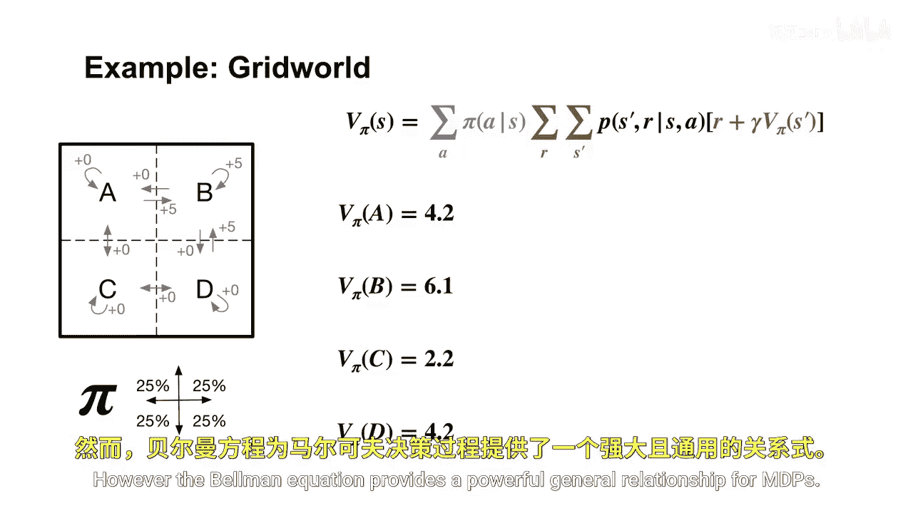

# 024：为什么需要贝尔曼方程 🧮

在本节课中，我们将学习贝尔曼方程如何将计算状态价值这一复杂问题，转化为一个可求解的线性方程组。我们将通过一个简单的网格世界示例，直观地理解其工作原理和强大之处。

上一节我们介绍了贝尔曼方程，它允许我们用后续可能状态的价值来表达当前状态（或状态-动作对）的价值。本节中，我们来看看如何实际应用贝尔曼方程来计算价值函数。

考虑一个仅由四个状态（A、B、C、D）组成的简单网格世界示例。动作空间包括向上、向下、向左、向右移动。任何试图移出网格的动作都会导致智能体停留在原地。

例如，从状态C开始。向上移动会到达状态A。如果接着尝试向左移动，会撞墙并停留在状态A。然后向右移动会到达状态B。从B向下移动会到达状态D。

奖励设定为：除了智能体**到达**状态B时会获得+5奖励外，其他所有情况的即时奖励均为0。这包括从B开始或撞墙留在B的情况。

我们考虑一个均匀随机策略，即智能体在每个方向移动的概率均为25%。折扣因子 **γ** 设为 **0.7**。

那么，如何计算在这个策略下，每个状态（A、B、C、D）的价值呢？

回想一下，价值函数定义为在策略 **π** 下的期望回报。这需要对智能体可能选择的**无限多**个未来动作序列所获得的回报进行平均。

幸运的是，状态价值函数的贝尔曼方程提供了一个优雅的解决方案。

利用贝尔曼方程，我们可以写出状态A的价值表达式，它是基于对四个可能动作及相应后继状态的求和。

在这个特定例子中，表达式可以进一步简化，因为对于每个动作，只有一个可能的后继状态和奖励。因此，对 **s‘** 和 **r** 的求和简化为单个值。注意，这里的 **s‘** 和 **r** 仍然依赖于所选动作和当前状态 **s**，但为了符号简洁，我们没有明确写出。

以下是状态A的价值方程推导过程：
*   从状态A向右移动，会到达状态B并获得+5奖励。在随机策略下，这发生的概率是 **1/4**。
*   从状态A向下移动，会到达状态C且无即时奖励。同样，概率为 **1/4**。
*   从状态A向上或向左移动，都会留在状态A且无奖励。这两个动作各发生 **1/4** 的概率，因此可以合并为一个系数为 **1/2** 的项。

最终，我们得到状态A的价值表达式：
**V(A) = (1/4) * [5 + γV(B)] + (1/4) * [0 + γV(C)] + (1/2) * [0 + γV(A)]**

我们可以为其他每个状态写出类似的方程。

以下是所有状态的价值方程组：
*   **V(A) = (1/4)[5 + γV(B)] + (1/4)[0 + γV(C)] + (1/2)[0 + γV(A)]**
*   **V(B) = (1/4)[5 + γV(B)] + (1/4)[0 + γV(A)] + (1/4)[0 + γV(D)] + (1/4)[0 + γV(B)]**
*   **V(C) = (1/4)[0 + γV(A)] + (1/4)[0 + γV(C)] + (1/4)[0 + γV(D)] + (1/4)[0 + γV(C)]**
*   **V(D) = (1/4)[0 + γV(B)] + (1/4)[0 + γV(C)] + (1/2)[0 + γV(D)]**

现在我们有了一个包含四个方程和四个未知数的方程组。你可以手动求解，或将其输入自动方程求解器。

该方程组的唯一解如下：
*   **V(A) ≈ 6.12**
*   **V(B) ≈ 8.23**
*   **V(C) ≈ 3.08**
*   **V(D) ≈ 4.85**

关键点在于，贝尔曼方程将一个难以处理的、对可能未来的无限求和问题，简化成了一个简单的线性代数问题。

对于这个小问题，你或许能想出其他方法来计算各状态价值。然而，贝尔曼方程为马尔可夫决策过程提供了一个强大且通用的关系式。

在这个例子中，我们使用贝尔曼方程直接写出状态价值的方程组，并通过求解方程组找到价值。这种方法对于中等规模的MDP是可行的。

然而，在更复杂的问题中，这并不总是实用的。以国际象棋为例，我们甚至可能无法列出所有可能的状态（约有 **10^45** 个）。构建并求解由此产生的贝尔曼方程组将是另一回事。但人类却能学会下得很好。

不过，这个简单游戏只代表了人类经验的一小部分，而人类可以学会做很多事情。我们的智能体也应该能够学会处理许多任务。

在接下来的课程中，我们将讨论基于贝尔曼方程的算法，这些算法能够扩展到大型问题。

本节课中，我们一起学习了贝尔曼方程的核心价值。总结如下：
*   没有贝尔曼方程，我们可能不得不考虑无限多个可能的未来。
*   贝尔曼方程利用了MDP公式的结构，将这个无限求和问题简化为一个线性方程组。
*   我们随后可以通过直接求解贝尔曼方程来找到状态价值。

希望你现在能明白，为什么贝尔曼方程对于强化学习如此基础且重要。