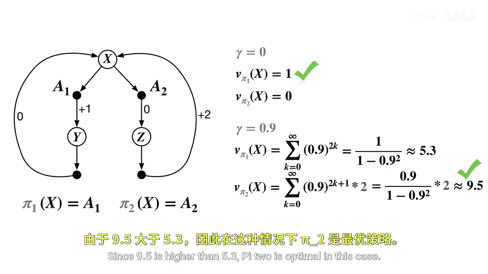

# 025：最优策略

在本节课中，我们将学习强化学习的核心目标：寻找最优策略。我们将明确“最优策略”的定义，理解其性质，并探讨如何为一个给定的马尔可夫决策过程识别最优策略。

## 策略比较与最优策略定义

到目前为止，我们通常将策略视为给定的东西。策略规定了智能体在给定行为方式下的行动准则。然后，我们的目标是找到该策略对应的价值函数。但强化学习的目标不仅仅是评估特定策略，最终，我们希望找到一个能在长期内获得尽可能多奖励的策略。

在本节中，我们将通过“最优策略”的概念来精确阐述这一目标。

要定义最优策略，首先必须理解一个策略比另一个策略“更好”意味着什么。

下图展示了两个策略在不同状态下的价值函数。请注意，图中用连续线表示仅是为了便于说明，我们仍在讨论离散状态，并且价值在状态间可能并非平滑变化。

该图说明，在某些状态下，策略 π₁ 的价值更高；而在另一些状态下，策略 π₂ 的价值更高。因此，简单地说 π₁ 比 π₂ 好，或 π₂ 比 π₁ 好，意义不大。

我们将定义：**当且仅当在每一个状态下，策略 π₁ 的价值都大于或等于策略 π₂ 的价值时，我们称策略 π₁ 不劣于策略 π₂**。我们用符号 `π₁ ≥ π₂` 来表示这种关系。

在上图中，代表 π₁ 价值的线始终在 π₂ 的上方，因此在这种情况下，π₁ 不劣于 π₂。

基于此，最优策略的定义如下：

**最优策略是指不劣于所有其他策略的策略。也就是说，一个最优策略将在每一个状态下都拥有可能达到的最高价值。**

至少存在一个最优策略，但也可能存在多个。我们使用符号 **π\*** 来表示任意一个最优策略。

## 最优策略的存在性

为什么一定存在最优策略（即在每个状态下都不劣于所有其他策略的策略）？会不会出现一种情况：在一个状态表现出色，就必须在另一个状态表现糟糕？

假设存在这样的策略 π₁，它在某些状态表现出色，而策略 π₂ 在另一些状态表现出色。我们可以将这两个策略组合成第三个策略 π₃，该策略在当前状态下，总是根据 π₁ 和 π₂ 中价值更高的那个来选择行动。

那么，π₃ 在每个状态下的价值必然都大于或等于 π₁ 和 π₂。因此，我们永远不会遇到“在一个状态表现出色必须以牺牲另一个状态的价值为代价”的情况。正因如此，总是存在某个在每个状态下都是最优的策略。

这当然只是一个非正式的论证，但事实上存在严格的数学证明，表明至少存在一个最优的确定性策略。

请注意，在某些状态下，π₃ 的价值严格大于 π₁ 或 π₂。作为练习，请尝试解释：既然 π₃ 只是简单地在每个状态根据 π₁ 和 π₂ 中价值更高的那个来选择行动，这种情况是如何发生的？

## 最优策略示例分析

让我们看一个具体例子，以建立对最优策略的直观理解。

考虑下面所示的“二选一”MDP。唯一需要做出决策的是顶部标记为 **X** 的状态，智能体可以采取行动 **A1** 或 **A2**。

*   从状态 X 出发，行动 A1 将智能体带到状态 Y。在状态 Y，只有行动 A1 可用，它将智能体带回状态 X。
*   另一方面，在状态 X 采取行动 A2 会将智能体带到状态 Z。从状态 Z 出发，同样只有行动 A1 可用，它将智能体带回状态 X。

数字表示智能体在每次行动后获得的奖励。注意，虽然 A1 提供 +1 的即时奖励，但 A2 在经过一步延迟后提供更大的 +2 奖励。

在这个 MDP 中只有两个确定性策略，完全由智能体在状态 X 的选择定义：采取行动 A1 或采取行动 A2。我们称它们为 π₁ 和 π₂。这两个策略中哪个是最优的？

最优策略将是使状态 X 价值最高的那个。答案取决于折扣因子 **γ**。

**情况一：γ = 0**
此时，价值仅由即时奖励定义。状态 X 在 π₁ 下的价值是 +1，而在 π₂ 下的价值是 0（因为 +2 的奖励发生在一步延迟之后，当 γ 设为 0 时不影响回报）。因此，在这种情况下，π₁ 是最优策略。

**情况二：γ = 0.9**
此时，每个策略下状态 X 的价值是一个无穷级数。
*   π₁ 会获得即时奖励 1，然后是 0，接着又是 1，依此类推。价值表达式中的每一项奖励都按 γ 的某次幂进行折扣。我们可以将其简洁地表示为一个几何级数。应用几何级数求和公式，我们得到 π₁ 的价值约为 5.3。
*   π₂ 的价值可以类似地写出，区别在于它将在每个奇数步获得奖励 2，而不是在每个偶数步获得奖励 1。同样可以写成一个几何级数并获得闭式解。在这种情况下，解约为 9.5。

由于 9.5 高于 5.3，因此在这种情况下，π₂ 是最优策略。

## 寻找最优策略的挑战

在这个“二选一”MDP 中，寻找最优策略相对简单，因为只有两个确定性策略，我们只需计算每个策略的价值函数即可。

然而，在一般情况下，即使我们只考虑确定性策略，问题也不会如此简单。可能的策略数量等于 **（可能的行动数量）^（状态数量）**。这是一个指数级的数量。

我们可以使用暴力搜索，计算每个策略的价值函数来找到最优策略。但很容易看出，即使对于中等规模的 MDP，这种方法也会变得难以处理。

幸运的是，有一种更好的方法来组织我们对策略空间的搜索。解决方案将以另一组贝尔曼方程的形式出现，即**贝尔曼最优性方程**，我们将在接下来的视频中介绍。

## 总结

本节课中，我们一起学习了最优策略的核心概念。最重要的要点是：
1.  **最优策略**被定义为在所有状态下都具有最高价值的策略。
2.  至少存在一个最优策略，但也可能存在多个。
3.  由于可能的策略数量呈指数级增长，通过暴力搜索寻找最优策略是难以处理的。这引出了对更高效方法（如贝尔曼最优性方程）的需求，我们将在后续课程中探讨。