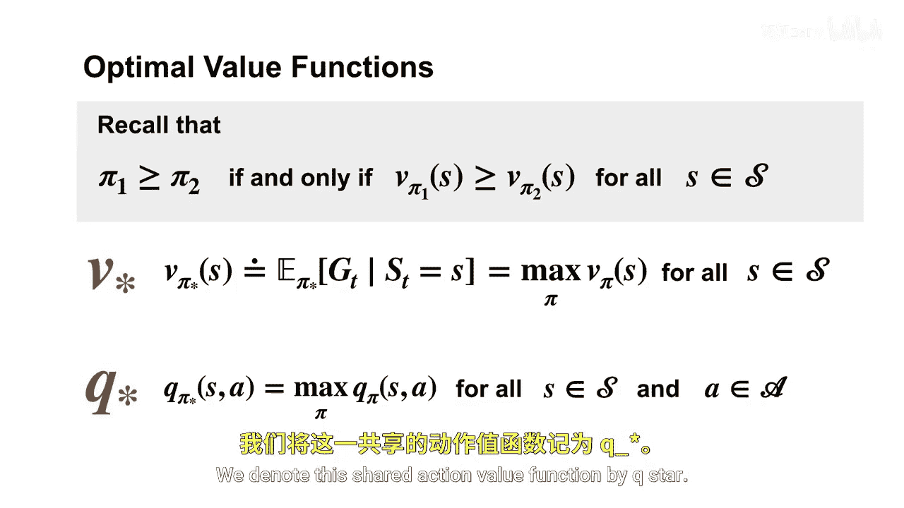
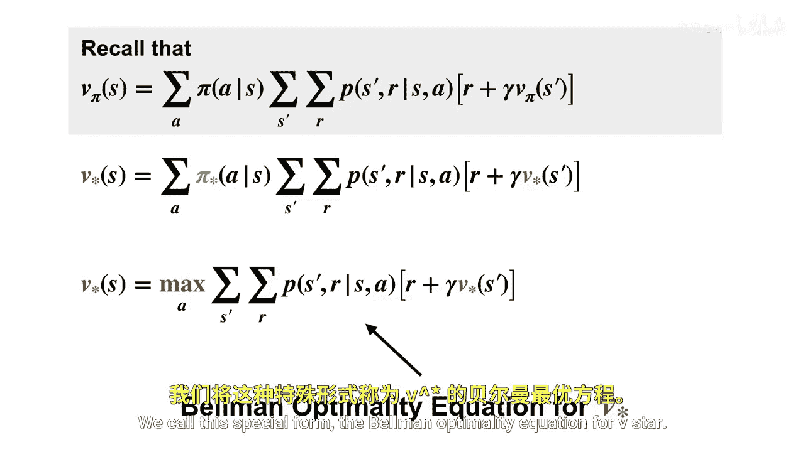
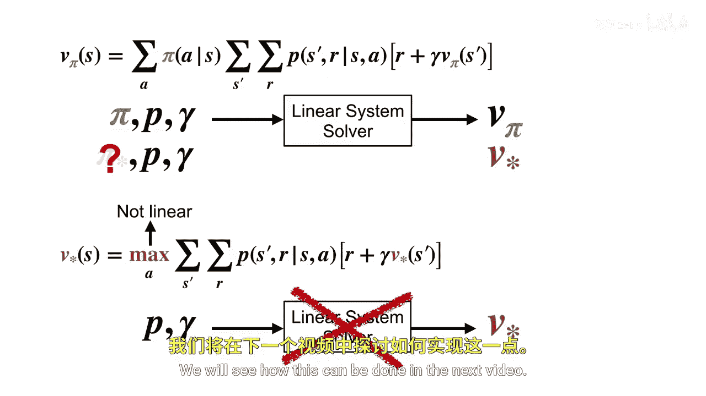
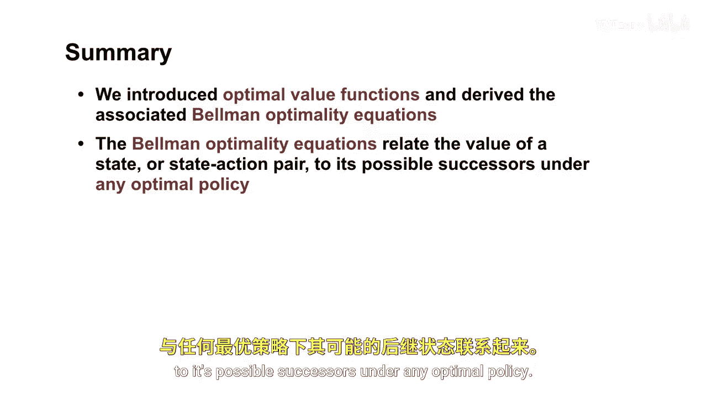

# 026：最优价值函数 🎯

在本节课中，我们将学习最优价值函数的概念，并推导与之相关的贝尔曼最优性方程。我们将从回顾最优策略的目标开始，逐步引出最优状态价值函数和最优动作价值函数的定义，并最终得到它们的数学表达式。

---

上一节我们介绍了最优策略如何实现强化学习的长期目标，即获得尽可能多的奖励。本节中，我们将探讨与之相关的**最优价值函数**的概念，并引入一组相关的**贝尔曼最优性方程**。

在本视频结束时，你将能够：
*   推导出状态价值函数的贝尔曼最优性方程。
*   推导出动作价值函数的贝尔曼最优性方程。
*   理解贝尔曼最优性方程与之前介绍的贝尔曼方程之间的关系。

---

### 最优价值函数的定义 📈

回顾一下，对于两个策略 π₁ 和 π₂，当且仅当在**所有状态**下，π₁ 的价值都大于或等于 π₂ 的价值时，我们认为 π₁ 与 π₂ 一样好或更好。

一个**最优策略**是比所有其他策略都同样好或更好的策略。因此，最优策略的价值函数在每个状态下都具有可能的最大价值。

我们可以用数学公式表达为：
**V*(s) = max_π V_π(s)**
这个等式对我们状态空间中的每一个状态 s 都成立。

对策略取最大值可能不够直观，让我们花点时间来分解它的含义。想象一下，我们考虑每一个可能的策略，并计算它们对于状态 s 的价值。最优策略的价值被定义为所有计算出的价值中最大的那个。我们可以对每个状态重复这个过程，最优策略的价值总是最大的。

所有最优策略都共享同一个最优状态价值函数，我们将其记为 **V***。

最优策略也共享同一个最优动作价值函数，它同样在每个“状态-动作”对上是可能的最大值。我们将其记为 **Q***。

---

### 推导贝尔曼最优性方程 🔄

回忆一下状态价值函数的贝尔曼方程：
**V_π(s) = Σ_a π(a|s) Σ_{s‘, r} p(s‘, r | s, a) [ r + γ V_π(s‘) ]**

这个方程适用于任何策略（包括最优策略）的价值函数。通过将最优策略 π* 代入这个贝尔曼方程，我们得到了 V* 的贝尔曼方程。到目前为止，我们还没有做任何特别的事情，这只是我们之前介绍的贝尔曼方程在最优策略这个特定情况下的应用。

然而，因为这是最优策略，我们可以将这个方程重写成一个特殊的形式，这个形式不再直接引用策略本身。

请记住，总是存在一个最优的**确定性策略**，即在每个状态下都选择一个最优动作。这样的确定性最优策略会给达到最高价值的动作分配概率 1，而给所有其他动作分配概率 0。

我们可以用另一种方式来表达这一点，即用对动作 a 取 **max** 来替换对 π* 的求和 Σ_a π*(a|s)。

注意，π* 不再出现在方程中。我们推导出了一个直接适用于 **V*** 本身的关系式。我们称这种特殊形式为 **V* 的贝尔曼最优性方程**：
**V*(s) = max_a Σ_{s‘, r} p(s‘, r | s, a) [ r + γ V*(s‘) ]**

---

我们可以在动作价值函数的贝尔曼方程中进行同样的替换。回顾动作价值函数的贝尔曼方程：
**Q_π(s, a) = Σ_{s‘, r} p(s‘, r | s, a) [ r + γ Σ_{a‘} π(a‘|s‘) Q_π(s‘, a‘) ]**

在这里，最优策略出现在内部求和 Σ_{a‘} 中。我们再次用对 a‘ 取 **max** 来替换对 π* 的求和 Σ_{a‘} π*(a‘|s‘)。

这就得到了 **Q* 的贝尔曼最优性方程**：
**Q*(s, a) = Σ_{s‘, r} p(s‘, r | s, a) [ r + γ max_{a‘} Q*(s‘, a‘) ]**

---

### 与贝尔曼方程的关系及求解挑战 ⚠️

在之前的课程中，我们讨论过贝尔曼方程如何形成一个线性方程组，可以通过标准方法求解。

贝尔曼最优性方程为我们提供了最优价值的类似方程组。一个自然的问题是：我们能否以类似的方式求解这个方程组来找到最优状态价值函数？

不幸的是，答案是否定的。对动作取最大值（max）不是一个线性操作，因此求解线性方程组的标准线性代数技术将不适用。在本课程中，我们不会以通常的方式建立和求解方程组。相反，我们将使用基于贝尔曼方程的其他技术来计算价值函数和策略。

你可能会想，为什么我们不能简单地在普通贝尔曼方程中使用 π* 来得到一个关于 V* 的线性方程组？答案很简单：我们**不知道 π***。如果我们知道，那么我们就已经实现了强化学习的基本目标。

如果我们能够设法求解出 V* 的贝尔曼最优性方程，我们就可以利用结果相当容易地得到 π*。我们将在下一个视频中看到如何做到这一点。

---

### 总结 📝

本节课中，我们一起学习了最优价值函数，并推导了相关的贝尔曼最优性方程。

贝尔曼最优性方程将一个状态或“状态-动作”对的价值，与在**任何最优策略**下其可能的后继状态的价值联系起来。

---

下次课见，我们将学习如何从最优价值函数中找到最优策略。