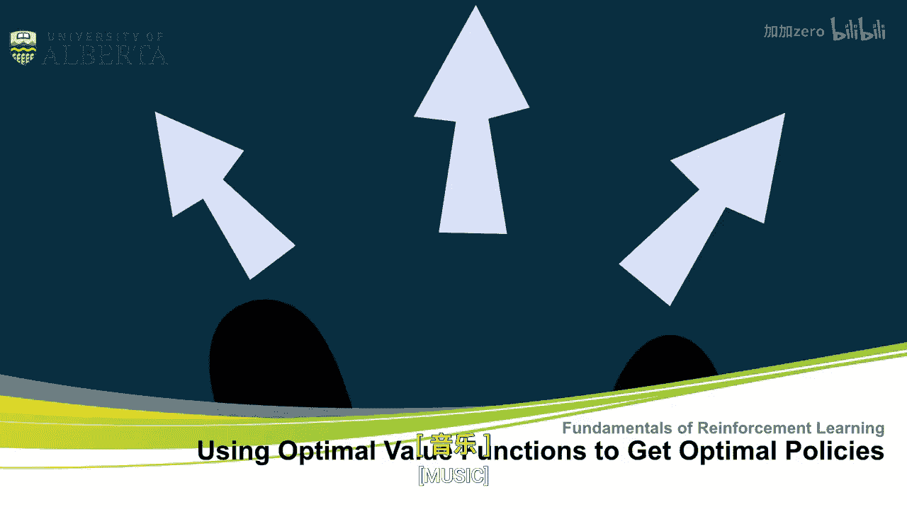
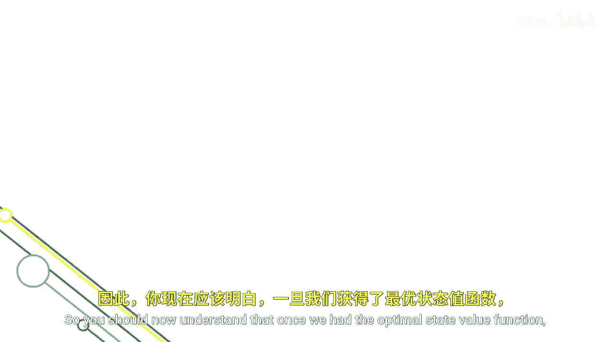

**强化学习专项课程：第3章：利用最优价值函数求解最优策略**



在本节课中，我们将学习如何利用已知的最优价值函数来推导出最优策略。我们将通过一个具体的网格世界示例，演示这一过程，并理解最优价值函数与最优策略之间的紧密联系。

上一节我们介绍了最优价值函数和贝尔曼最优方程。你可能会想，我们的最终目标是找到最优策略本身，而不仅仅是其价值函数，那么学习最优价值函数为何重要？本节中我们来看看，在给定最优价值函数的情况下，如何相对容易地找到与之关联的最优策略。

**从最优状态价值函数推导最优策略**

一般来说，只要我们同时拥有动态函数 **P**，利用最优状态价值函数 **V\*** 来推导最优策略就相对直接。对于任何状态 **s**，我们可以查看每个可用的动作 **a**，并评估以下框中的项（即贝尔曼最优方程的右侧）：

```
max over a [ Σ_{s', r} P(s', r | s, a) [ r + γ * V*(s') ] ]
```

总会存在某个（或某些）动作能使这个项达到最大值。一个确定性的策略 **π\***，如果为每个状态都选择这个最大化动作，那么它必然是最优的，因为它能获得最高的可能价值。

因此，**π\*** 的公式几乎与 **V\*** 的贝尔曼最优方程相同。**V\*** 是所有动作中该“框内项”的最大值。而 **π\*** 则是 **arg max**，即具体是哪个动作实现了这个最大值。

为了评估给定动作 **a** 的“框内项”，我们只需要向前看一步，考虑执行该动作后可能出现的下一个状态 **s'** 和奖励 **r**。这得益于我们已经拥有了 **V\*** 和 **P**。

**网格世界示例**

让我们通过课程早期介绍的网格世界示例来具体操作。在这个环境中：
*   在状态 **A**，所有动作都确定性地转移到 **A'**，并获得 +10 奖励。
*   在状态 **B**，所有动作都确定性地转移到 **B'**，并获得 +5 奖励。
*   其他状态转移的即时奖励为 0。
*   撞墙的奖励为 -1。
*   折扣因子 **γ = 0.9**。

假设我们已经计算出了每个状态的最优价值函数 **V\***（数值显示在网格中）。我们的目标是找出每个状态下的最优动作。

以下是推导最优策略的步骤：

1.  对于当前考察的状态，依次考虑每个可选动作。
2.  对于每个动作，计算其“框内项”：`r + γ * V*(s')`。由于此环境是确定性的，每个 `(s, a)` 只对应一个 `(s', r)`，因此计算简化为单一项。
3.  比较所有动作的计算结果，选择值最大的动作作为该状态的最优动作。如果多个动作的值相同且最大，则它们都是最优动作，可以随机选择。

**具体状态分析**

*   **示例状态 1**：考虑图中高亮的一个状态。
    *   动作`上`：转移到价值为 17.5 的状态，奖励为 0。计算结果：`0 + 0.9 * 17.5 = 15.75`。
    *   动作`右`：撞墙，奖励 -1，留在原状态（价值 16）。计算结果：`-1 + 0.9 * 16 = 13.4`。
    *   动作`下`：转移到价值为 14.4 的状态，奖励为 0。计算结果：`0 + 0.9 * 14.4 = 12.96`。
    *   动作`左`：转移到价值为 17.8 的状态，奖励为 0。计算结果：`0 + 0.9 * 17.8 = 16.02`。
    *   比较结果，`左`动作的值（16.02）最大，因此是该状态的最优动作。同时，这也验证了 **V\*** 在此状态满足贝尔曼最优方程：`V*(s) = 16 ≈ max(...) = 16.02`（计算舍入差异）。

*   **示例状态 2**：在另一个状态中，`上`和`左`动作都给出了相同的最大值 `0.9 * 19.8 = 17.82`。因此，在此状态下存在两个最优动作，最优策略可以以任意概率在两者间选择。

*   **示例状态 A**：在状态 **A**，无论选择哪个动作，都会转移到 **A'** 并获得 +10 奖励。因此，每个动作的“框内项”计算结果相同：`10 + 0.9 * V*(A')`。代入 `V*(A') = 16`，得到 `10 + 0.9 * 16 = 24.4`，这与图中记录的 **V\*** 值一致。因此，在状态 **A**，所有动作都是最优的。

通过对每个状态重复此过程，我们可以填满整个最优策略图。最终得到的策略本质上是引导智能体尽快走向状态 **A** 以获取 +10 奖励。

**从最优动作价值函数推导最优策略**

如果我们拥有的是最优动作价值函数 **Q\***，那么推导最优策略会更加简单。在这种情况下，我们完全不需要进行“向前看一步”的计算。

我们只需要为每个状态 **s**，选择任何能使 **Q\*(s, a)** 最大化的动作 **a** 即可：

```
π*(s) = arg max over a [ Q*(s, a) ]
```

动作价值函数 **Q\*** 已经为每个状态-动作对缓存了“向前看一步”的结果。在这个意义上，寻找最优动作价值函数的问题直接对应了寻找最优策略的目标。

**总结与过渡**



本节课中我们一起学习了如何利用最优价值函数求解最优策略。我们了解到：
1.  给定最优状态价值函数 **V\*** 和动态模型 **P**，可以通过对每个动作进行一步前瞻计算并取最大值，来找到最优策略 **π\***。
2.  给定最优动作价值函数 **Q\***，则可以直接通过选取使 **Q\*** 最大化的动作来得到最优策略，过程更为简便。

最优价值函数与最优策略之间的这种对应关系，将帮助我们推导后续专项课程中将要探索的许多强化学习算法。下一节，我们将开始探讨如何实际计算这些最优价值函数。