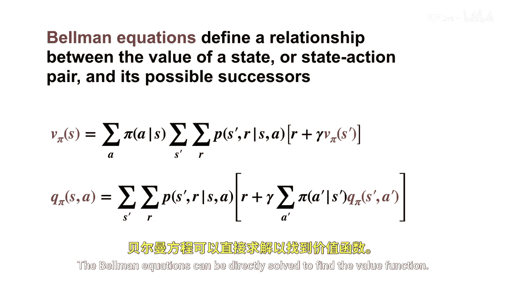

# 028：策略、价值函数与贝尔曼方程总结

在本节课中，我们将回顾并总结本周学习的核心内容：策略、价值函数以及它们之间的关系。我们将重点理解贝尔曼方程如何帮助我们评估策略，并初步探索如何寻找最优策略。

## 策略的定义与类型

上一节我们介绍了强化学习的基本框架，本节中我们来看看智能体如何做决策，即策略。

策略告诉智能体在特定状态下应如何行动。根据定义，策略仅依赖于当前状态，而不能依赖于时间或之前的状态。这应被视为对状态表示的要求，而非对智能体的限制。状态必须为智能体提供做出良好决策所需的全部信息。这是强化学习中许多技术的重要前提。

策略主要分为两类：

*   **确定性策略**：将每个状态映射到一个具体的动作。每次访问状态 `S` 时，策略都会选择关联的动作 `π(S)`。
*   **随机性策略**：将每个状态映射到所有可能动作的一个概率分布上。每次访问状态 `S` 时，策略会以概率 `π(a|S)` 从关联分布中随机抽取一个动作 `A`。

## 价值函数的作用

理解了策略后，我们来看看如何衡量一个策略的好坏，这就需要引入价值函数。

价值函数非常强大，它能**在特定策略下，汇总未来的总奖励**。我们讨论了两种价值函数：

*   **状态价值函数 `Vπ(s)`**：表示从当前状态 `s` 开始，遵循策略 `π` 所能获得的**期望回报**。
*   **动作价值函数 `Qπ(s, a)`**：表示从状态 `s` 开始，**首先选择动作 `a`**，然后遵循策略 `π` 所能获得的**期望回报**。

价值函数通过将众多可能的未来回报汇总为一个数字，极大地简化了问题。

## 贝尔曼方程

价值函数本身是如何计算的呢？这就要用到贝尔曼方程。

贝尔曼方程定义了**一个状态（或状态-动作对）的价值与其后继状态价值之间的关系**。以下是两种贝尔曼方程：

*   **状态价值函数的贝尔曼方程**：将当前状态的价值表示为所有可能的后继状态价值与即时奖励的加权和。
    `Vπ(s) = Σ_a π(a|s) Σ_s‘ P(s’|s,a) [ R(s,a,s‘) + γ * Vπ(s’) ]`
*   **动作价值函数的贝尔曼方程**：将一个状态-动作对的价值表示为所有可能的下一个状态-动作对价值与即时奖励的加权和。
    `Qπ(s, a) = Σ_s‘ P(s’|s,a) [ R(s,a,s‘) + γ * Σ_a’ π(a‘|s’) * Qπ(s‘, a’) ]`

贝尔曼方程可以直接求解，从而得到特定策略下的价值函数，这个过程称为**策略评估**。

## 最优策略与贝尔曼最优性方程

贝尔曼方程帮助我们评估给定策略，但我们的最终目标是找到能获得尽可能多奖励的策略。为此，我们定义了最优策略和相关的最优价值函数。

*   **最优策略 `π*`**：在每个状态下都能获得最高可能价值的策略。至少存在一个最优策略，也可能存在多个。
*   **最优状态价值函数 `V*(s)`**：等于每个状态下可能达到的最高价值。所有最优策略都共享同一个 `V*(s)`。
*   **最优动作价值函数 `Q*(s, a)`**：同理，所有最优策略也共享同一个 `Q*(s, a)`。

与所有价值函数一样，最优价值函数也有其贝尔曼方程，即**贝尔曼最优性方程**。这些方程的特点是**不引用任何特定策略**，其本质是将标准贝尔曼方程中对动作的期望（按策略加权）替换为对所有动作取**最大值**。这意味着最优策略必须始终选择可用的最佳动作。

*   **最优状态价值函数的贝尔曼方程**：
    `V*(s) = max_a Σ_s‘ P(s’|s,a) [ R(s,a,s‘) + γ * V*(s’) ]`
*   **最优动作价值函数的贝尔曼方程**：
    `Q*(s, a) = Σ_s‘ P(s’|s,a) [ R(s,a,s‘) + γ * max_a’ Q*(s‘, a’) ]`

## 从最优价值函数中提取策略

如果我们知道了最优价值函数，如何得到最优策略呢？

1.  **从 `V*(s)` 提取**：需要知道环境的单步动态模型（即转移概率 `P` 和奖励函数 `R`），然后在每个状态 `s` 选择能最大化 `Σ_s‘ P(s’|s,a) [ R(s,a,s‘) + γ * V*(s’) ]` 的动作 `a`。
2.  **从 `Q*(s, a)` 提取**：这要简单得多。我们只需在每个状态 `s` **选择具有最高 `Q*` 值的动作**即可：
    `π*(s) = argmax_a Q*(s, a)`

---

**本节课中我们一起学习了**：策略（确定性与随机性）的定义、状态与动作价值函数的作用、用于策略评估的贝尔曼方程、最优策略与最优价值函数的概念、以及用于寻找最优策略的贝尔曼最优性方程。下周，我们将学习如何利用这些贝尔曼方程来计算最优策略。