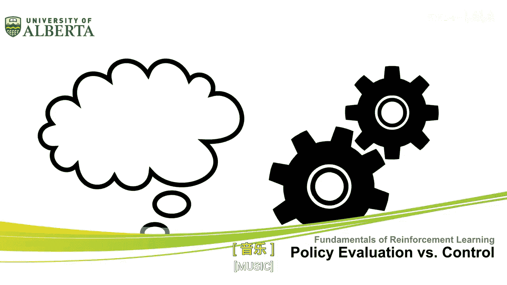
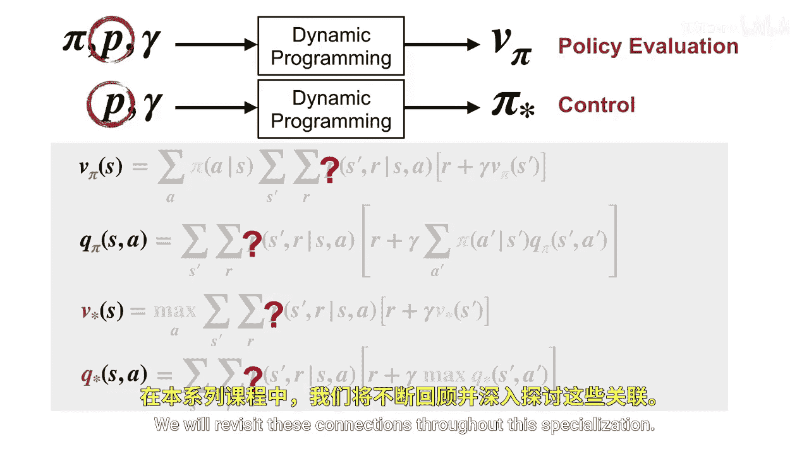

# 029：策略评估与策略控制

在本节课中，我们将学习强化学习中的两个核心任务：策略评估与策略控制。我们将了解它们的定义、区别，并介绍一种名为动态规划的求解方法及其适用场景。

我们经常讨论两个不同的任务：策略评估与控制。

策略评估是为一个特定策略确定其价值函数的任务。

控制是寻找一个策略以获得尽可能多奖励的任务。换句话说，是寻找一个能最大化价值函数的策略。

控制是强化学习的最终目标。

但策略评估任务通常是必要的第一步。

如果我们没有办法评估一个策略的好坏，就很难改进它。本周，我们将学习一系列称为动态规划的算法，用于解决策略评估和控制问题。

在本视频结束时，你将能够理解策略评估与控制之间的区别，解释动态规划可以应用的场景及其局限性。

## 策略评估详解

上一节我们介绍了两个核心任务，本节中我们来看看策略评估的具体含义。

想象有人给你一个策略，你的工作是确定这个策略有多好。策略评估是为特定策略π确定其状态价值函数Vπ的任务。

回想一下，在策略π下，一个状态的价值是如果我们按照π行动，从该状态开始的期望回报。回报本身是未来奖励的折扣总和。

我们已经看到贝尔曼方程如何将寻找Vπ的问题简化为一个线性方程组，每个状态对应一个方程。因此，策略评估问题就简化为求解这个线性方程组。

理论上，我们可以用线性代数的各种方法来解决这个任务。但在实践中，动态规划的迭代求解方法更适合于一般的马尔可夫决策过程。

## 控制任务详解

了解了如何评估策略后，我们来看看控制任务，即如何改进策略。

控制是改进策略的任务。回想一下，如果策略π2在每个状态下的价值都大于或等于策略π1下的价值，则认为π2与π1一样好或更好。

如果π2与π1一样好或更好，并且至少存在一个状态，π2下的价值严格大于π1下的价值，则我们说π2严格优于π1。

控制任务的目标是修改一个策略，以产生一个严格更好的新策略。

此外，我们可以尝试反复改进策略，以获得一系列越来越好的策略。当无法再改进时，意味着没有策略严格优于当前策略，因此当前策略必定等于最优策略，我们可以认为控制任务已完成。

## 动态规划方法

想象我们能够获知环境的动态特性P。本周的内容就是关于如何利用这些知识来解决策略评估和控制任务。

即使掌握了这些动态特性，我们仍需要仔细思考和巧妙的算法来计算价值函数和最优策略。在接下来的几个视频中，我们将研究一类称为动态规划的求解方法。

动态规划利用我们见过的各种贝尔曼方程，结合对P的了解，来计算价值函数和最优策略。

经典的动态规划完全不涉及与环境的交互；相反，我们使用动态规划方法，在给定MDP模型的情况下计算价值函数和最优策略。

尽管如此，动态规划对于理解其他强化学习算法非常有用。大多数强化学习算法都可以被视为没有模型情况下的动态规划近似。

这种联系在课程2中将介绍的基于时序差分的Dyna规划算法中最为显著。我们将在整个专项课程中重新审视这些联系。

## 总结

本节课中我们一起学习了强化学习的两个核心任务。

总结来说，策略评估是为策略π确定状态价值函数Vπ的任务。控制是改进现有策略的任务。

如果我们能够获知动态函数P，则可以使用动态规划技术来解决这两个任务。

下次课我们将学习如何使用动态规划进行策略评估。