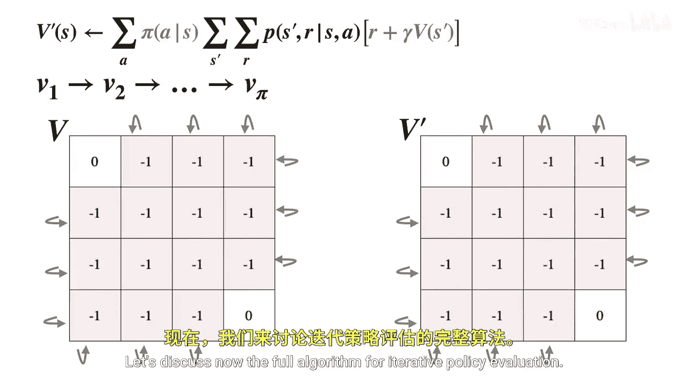
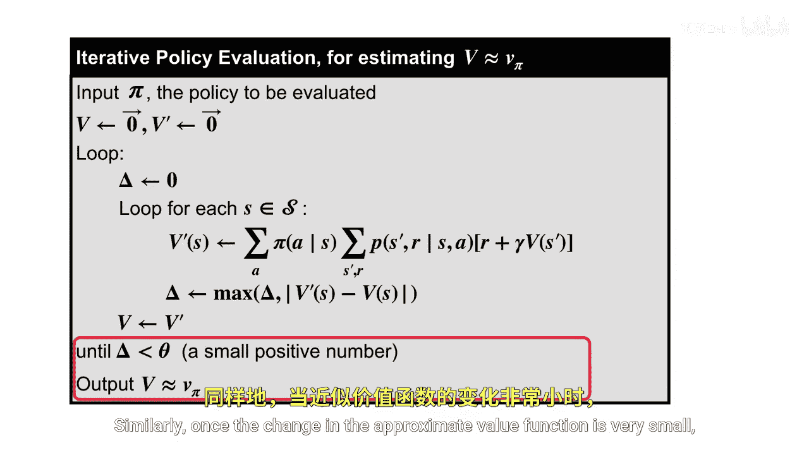
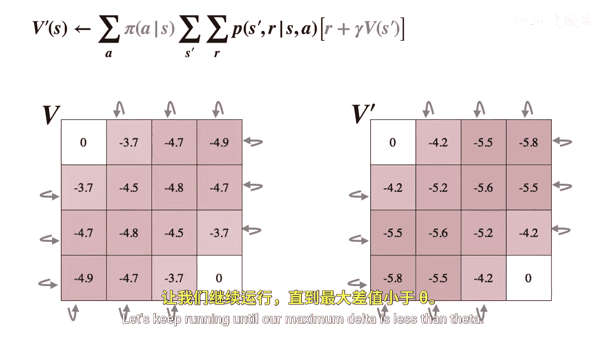
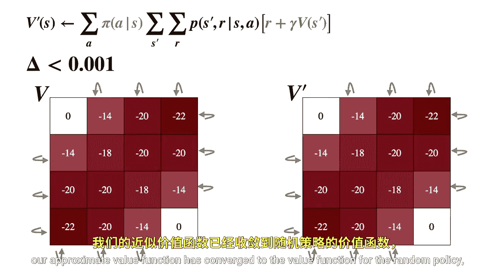

# 030：迭代策略评估 🧮

在本节课中，我们将学习如何将贝尔曼方程转化为更新规则，从而得到动态规划算法。我们将重点介绍第一个此类算法——**迭代策略评估**。通过本课，你将能够概述用于估计给定策略下状态价值的迭代策略评估算法，并将其应用于计算价值函数。

## 从方程到算法

上一节我们回顾了贝尔曼方程。本节中，我们来看看如何将其转化为一个实用的计算过程。

贝尔曼方程为价值函数 `V^π` 提供了一个递归表达式。迭代策略评估的核心思想非常简单直接：我们**直接将贝尔曼方程用作更新规则**。这样，我们就将一个关于真实价值函数的方程，变成了一个可以迭代优化价值函数估计值的**过程**。这个过程将产生一系列越来越接近真实价值函数的近似值。

让我们直观地看看这个过程是如何工作的。我们首先为近似价值函数 `V` 进行任意初始化（称为 `V0`）。然后，每一次迭代都会使用幻灯片顶部所示的更新规则，产生一个更好的近似值。每一次迭代都会对状态空间中的**每一个**状态 `s` 应用此更新，这被称为一次**扫描**。反复应用此更新，会得到越来越接近真实状态价值函数 `V^π` 的近似值。

如果某次更新后，价值函数近似值保持不变（即对所有状态，`V_{k+1} = V_k`），那么 `V_k` 就等于 `V^π`，我们就找到了价值函数。这是因为 `V^π` 是贝尔曼方程的**唯一解**。更新能使 `V_k` 保持不变的唯一情况，就是 `V_k` 已经满足贝尔曼方程。事实上，可以证明，对于 `V0` 的任意初始选择，当 `k` 趋近于无穷大时，`V_k` 都会收敛到 `V^π`。

## 算法实现细节

为了实现迭代策略评估，我们通常使用两个数组，每个数组为每个状态保留一个条目。
*   一个数组 `V` 存储当前的价值函数近似值。
*   另一个数组 `V‘` 存储更新后的值。

使用两个数组，我们可以逐个状态地根据旧值计算新值，而不会在计算过程中改变旧值。在一次完整的扫描结束后，我们将所有新值写入 `V` 数组，然后进行下一次迭代。

也可以实现只使用一个数组的版本。在这种情况下，某些更新将直接使用已经计算出的新值，而非旧值。这种单数组版本同样能保证收敛，并且通常会收敛得更快，因为它能更早地使用更新后的值。但为了简单起见，我们重点讨论双数组版本。

## 网格世界示例 🌐

让我们通过一个具体例子看看迭代策略评估是如何工作的。考虑这里所示的 4x4 网格世界。这是一个分幕式 MDP，终止状态位于左上角和右下角（形式上它们是同一个状态）。每次状态转移的奖励都是 `-1`。由于问题是分幕式的，我们考虑无折扣情况，即 `γ = 1`。

每个状态有四种可能的动作：上、下、左、右。每个动作都是确定性的。如果动作会使智能体移出网格，则智能体保持原地不动。

现在，我们来评估**均匀随机策略**，该策略以各 1/4 的概率选择四个动作。价值函数表示从给定状态出发到终止的**期望步数**。由于我们使用的是算法的双数组版本，遍历状态的顺序并不重要。假设我们按从左到右、从上到下的顺序扫描状态。我们从不更新终止状态的值，因为它被定义为 0。

我们将 `V` 中的所有值初始化为 `0`。`V‘` 中的初始值无关紧要，因为它们在使用前总会被更新。现在可以开始第一次迭代，首先更新状态 (1,1)。为了计算更新，我们必须对所有动作求和。以左动作为例，在均匀随机策略下其概率为 `1/4`。转移函数 `p` 在这里是确定性的，因此只有转移到状态 (1,1) 的奖励和状态价值对求和有贡献。求和项包括奖励 `-1` 和终止状态的价值 `0`。由于我们将所有状态价值初始化为 `0`，且每次转移的奖励都是 `-1`，其他所有动作的计算结果看起来都非常相似。结果是 `V‘` 中状态 (1,1) 的值被设为 `-1`。

接下来，我们移动到状态 (1,2)。我们首先计算求和式中左动作对应的项。同样，动作概率是 `1/4`，在这种情况下，下一个状态是状态 (1,1)。尽管我们已经更新了状态 (1,1) 的价值，但我们正在运行的算法版本将使用存储在 `V` 中的**旧值**。因此，更新中使用的状态 (1,1) 的价值仍然是 `0`。同样，所有其他动作的结果也类似。结果是 `V‘` 中状态 (1,2) 的值也被设为 `-1`。事实上，由于每个状态价值都初始化为 `0`，每个状态的价值在第一次扫描后都会被设为 `-1`。完成这次完整扫描后，我们将更新后的值从 `V‘` 复制到 `V`。这仅仅是一次扫描。

## 完整算法流程

以下是迭代策略评估的完整算法：

我们刚刚看到了单次扫描如何进行，现在来看看如何计算多次扫描以及算法如何停止。

外层循环持续进行，直到近似价值函数的变化变得足够小。我们跟踪单次迭代中状态价值的最大更新量，称之为 `Δ`。当这个最大变化量小于某个用户指定的常数 `θ` 时，外层循环终止。如前所述，一旦近似价值函数停止变化，我们就已收敛到 `V^π`。类似地，一旦近似价值函数的变化非常小，就意味着我们已非常接近 `V^π`。

## 示例续算与收敛

让我们回到网格世界示例中中断的地方，我们刚刚完成了第一次扫描。选择停止参数 `θ = 0.001`。我们选择的 `θ` 值越小，最终的价值估计就越精确。

我们已经完成了一次迭代，价值的最大变化量是 `1.0`。由于它大于 `0.001`，我们继续进行下一次迭代。在第二次扫描之后，请注意终止状态的影响如何首先传播到最近的状态。

让我们再运行一次扫描。现在可以看到终止状态的影响传播得更远了。再运行几次扫描，我们可以看到每个状态的价值与其到终止状态的接近程度之间的关系。让我们持续运行，直到最大 `Δ` 小于 `θ`。

这是我们最终得到的结果。我们的近似价值函数已经收敛到随机策略下的价值函数。

## 总结

本节课中，我们一起学习了如何将贝尔曼方程转化为更新规则，从而迭代地计算价值函数。我们详细介绍了**迭代策略评估算法**，包括其双数组实现原理，并通过一个网格世界的例子逐步演示了算法的执行过程。很快我们将看到，这些思想同样可以用于策略改进。下次见！