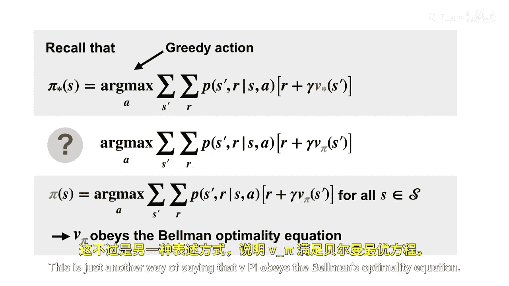
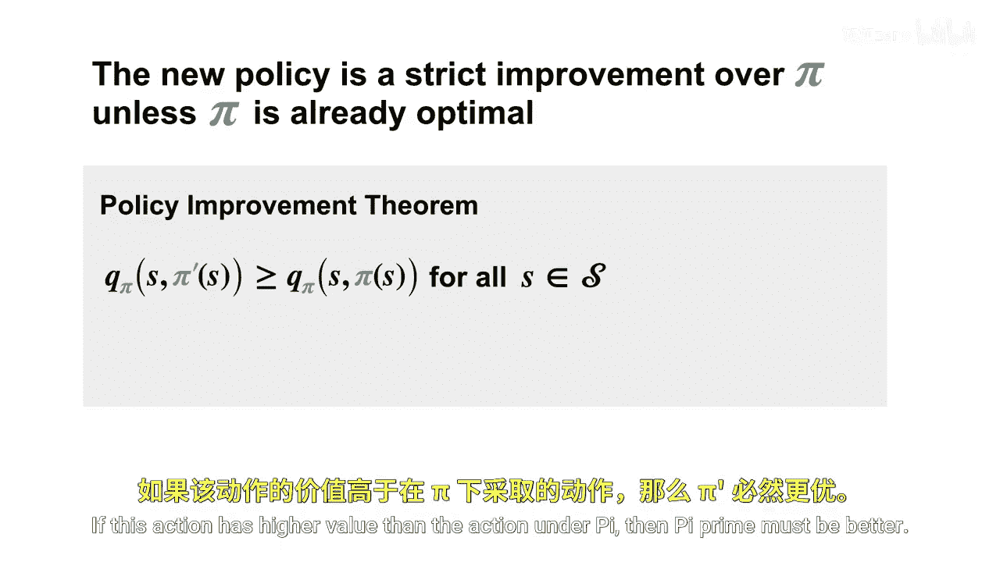
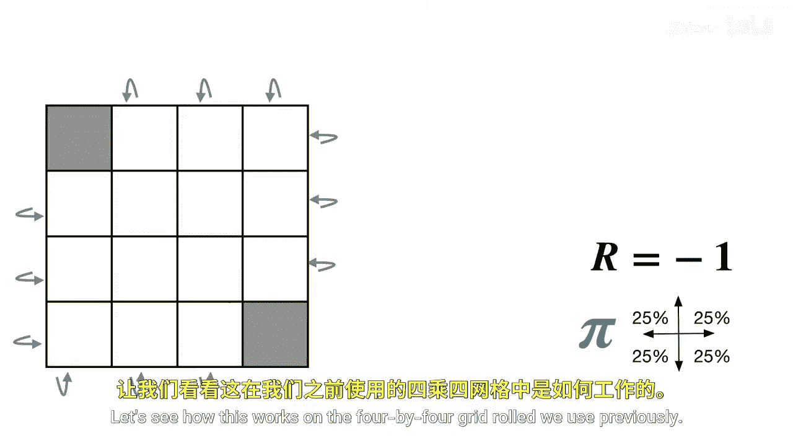
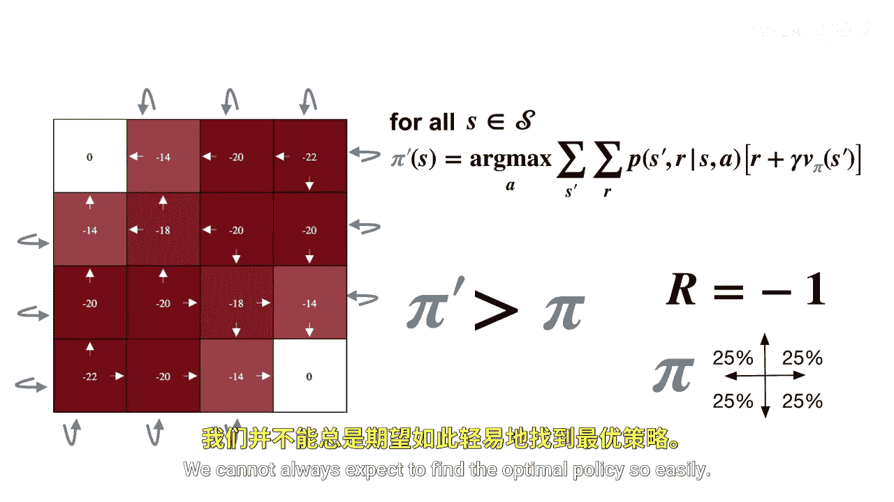

# 031：策略改进 🚀

在本节课中，我们将要学习如何利用动态规划评估得到的策略价值函数来改进策略。我们将深入理解**策略改进定理**，并掌握如何基于任意策略的价值函数，构造出一个更优的新策略。

上一节我们介绍了如何使用动态规划迭代地评估一个策略的价值函数。本节中我们来看看如何利用这个价值函数来改进策略本身。

## 策略改进定理

我们之前提到，如果已知最优价值函数 **V***，可以通过在每个状态选择**贪婪动作**来找到最优策略。贪婪动作即在每个状态下最大化贝尔曼最优方程的动作。

现在，假设我们面对的不是最优价值函数，而是任意一个策略 **π** 的价值函数 **Vπ**。如果我们根据 **Vπ** 选择一个贪婪动作，这个新策略会怎样？

首先，这个新策略 **π‘** 必然与 **π** 不同。如果贪婪化操作没有改变策略，那就意味着 **π** 已经相对于其自身的价值函数是贪婪的。这等价于说 **Vπ** 满足贝尔曼最优方程，此时 **π** 已经是最优策略。

实际上，以这种方式得到的新策略 **π‘** 必定严格优于原策略 **π**，除非 **π** 本身已经是最优的。这一结论源于一个一般性结果，即**策略改进定理**。

以下是策略改进定理的核心思想：

回忆 **Qπ(s, a)** 的定义，它表示在状态 **s** 采取动作 **a**，之后遵循策略 **π** 所能获得的价值。假设我们根据新策略 **π‘** 选择动作 **a**，然后继续遵循原策略 **π**。如果这个动作的价值高于在原策略 **π** 下所选动作的价值，那么策略 **π‘** 必然更好。

策略改进定理将这一想法形式化：
*   如果在**每个状态**下，策略 **π‘** 所选动作的价值都**大于或等于**策略 **π** 所选动作的价值，那么策略 **π‘** 至少和 **π** 一样好。
*   如果**至少在一个状态**下，策略 **π‘** 所选动作的价值**严格大于**策略 **π** 所选动作的价值，那么策略 **π‘** 严格优于 **π**。

## 网格世界示例

让我们通过之前使用的 4x4 网格世界来看策略改进是如何工作的。

上图是我们之前为**均匀随机策略**计算得到的最终价值函数 **Vπ**。

现在，基于这个 **Vπ** 的贪婪策略会是什么样子？我们需要在每个状态下，选择能通往**价值最高**（即负值最小）的下一个状态的动作。

以下是贪婪化后得到的新策略 **π‘**：

这个新策略与我们最初使用的均匀随机策略截然不同。根据策略改进定理，这个新策略 **π‘** 被保证优于我们最初使用的均匀随机策略 **π**。

事实上，仔细观察这个新策略，我们可以发现它实际上就是**最优策略**。在每个状态下，所选动作都位于通往终止状态的**最短路径**上。

请注意，我们开始时使用的价值函数 **Vπ** 并非最优价值函数，但相对于 **Vπ** 的贪婪策略却是最优的。更一般地说，策略改进定理只保证新策略是对原策略的改进，我们不能总是期望如此轻易地找到最优策略。

## 总结

本节课中我们一起学习了：
1.  **策略改进定理**：它告诉我们，基于任意策略价值函数 **Vπ** 进行贪婪化得到的新策略 **π‘** 是原策略 **π** 的一个严格改进，除非 **π** 本身已经是最优的。
2.  **策略改进方法**：我们掌握了如何利用给定策略下的价值函数，通过在每个状态选择价值更高的贪婪动作，来产生一个严格更优的策略。

下次课，我们将讨论如何利用这一结果，创建一个迭代的动态规划算法来寻找最优策略。