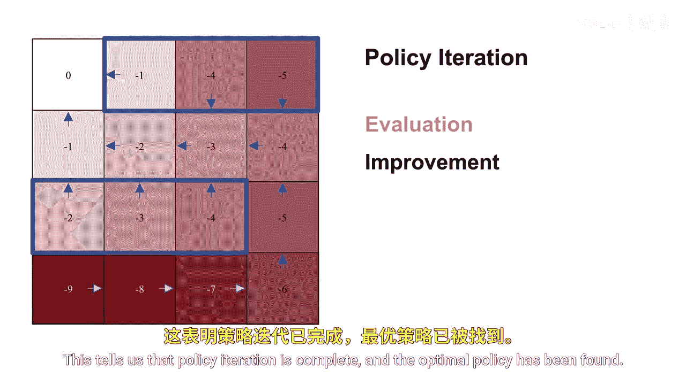

# 032：策略迭代 🎯


在本节课中，我们将学习如何通过策略迭代算法来寻找最优策略。我们将看到，通过交替执行策略评估和策略改进这两个步骤，可以系统地得到一个不断改进的策略序列，并最终收敛到最优策略。

## 概述

上一节我们介绍了如何利用给定策略的价值函数来找到一个更好的策略。本节中，我们将展示如何通过迭代地评估和改进一系列策略，最终找到最优策略。

## 策略迭代算法原理

策略改进定理告诉我们，除非给定策略已经是最优的，否则我们可以通过对其价值函数采取贪心行动来构造一个严格更好的策略。

假设我们从策略 **π₁** 开始。我们可以使用迭代策略评估来计算其状态价值 **V^π₁**。我们称这一步为**评估步骤**。

利用策略改进定理的结果，我们可以对 **V^π₁** 采取贪心行动，从而得到一个更好的策略 **π₂**。我们称这一步为**改进步骤**。

然后我们可以计算 **V^π₂**，并用它来获得一个更好的策略 **π₃**。这就产生了一个越来越好的策略序列。除非上一个策略已经是最优的，否则每个策略都保证比上一个策略有所改进。

因此，当我们完成一次迭代而策略保持不变时，我们就知道已经找到了最优策略。此时，我们可以终止算法。

以这种方式生成的每个策略都是确定性的，而确定性的策略数量是有限的。所以这种迭代改进最终必然会达到一个最优策略。这种寻找最优策略的方法被称为**策略迭代**。

## 策略与价值的“舞蹈”

策略迭代由两个不同的步骤重复进行：**评估**和**改进**。

我们首先评估当前策略 **π₁**，这为我们提供了一个新的价值函数，它准确地反映了 **π₁** 的价值。改进步骤然后使用 **V^π₁** 来产生一个贪心策略 **π₂**。此时，**π₂** 相对于 **π₁** 的价值函数是贪心的，但 **V^π₁** 不再准确地反映 **π₂** 的价值。

下一个评估步骤使我们的价值函数相对于策略 **π₂** 变得准确。一旦我们这样做了，我们的策略就不再是贪心的了。

这种策略与价值的“舞蹈”来回进行，直到我们达到唯一一个相对于其自身价值函数是贪心的策略——即**最优策略**。此时，也只有此时，策略是贪心的，并且价值函数是准确的。


我们可以将这种“舞蹈”可视化为在两条线之间来回反弹：一条线是价值函数准确，另一条线是策略贪心。这两条线只在最优策略和价值函数处相交。策略迭代总是通过首先投影到 **V = v^π** 这条线，然后再投影到 **π** 相对于 **V** 是贪心的那条线，从而朝着交点前进。

当然，策略和价值函数空间的真实几何结构更为复杂，但相同的直觉是成立的。

## 算法伪代码

以下是策略迭代过程的伪代码描述：

```
初始化 V(s) 和 π(s)，可以任意初始化
重复
    // 策略评估
    重复
        Δ ← 0
        对于每个状态 s：
            v ← V(s)
            V(s) ← Σ_{a} π(a|s) Σ_{s‘, r} p(s‘, r|s, a) [r + γ V(s‘)]
            Δ ← max(Δ, |v - V(s)|)
    直到 Δ < θ (一个小的正数)

    // 策略改进
    policy_stable ← true
    对于每个状态 s：
        old_action ← π(s)
        π(s) ← argmax_a Σ_{s‘, r} p(s‘, r|s, a) [r + γ V(s‘)]
        如果 old_action ≠ π(s)， 则 policy_stable ← false
直到 policy_stable 为 true
```


算法步骤如下：
1.  初始化价值函数 **V** 和策略 **π**。
2.  调用迭代策略评估，使 **V** 准确反映 **π** 的价值。
3.  在每个状态 **s**，将 **π(s)** 设置为在当前价值函数下能最大化未来回报的动作。
4.  如果在任何状态选择的动作发生了改变，则策略尚未稳定。
5.  检查策略是否稳定。如果不稳定，则返回步骤2，评估这个新策略。

## 网格世界示例


让我们通过一个简单的网格世界问题来直观理解策略迭代是如何工作的。

我们修改之前使用的4x4网格世界示例，使其控制任务更具挑战性：
*   移除其中一个终止状态，使得只有一种方式结束回合。
*   添加一些特别“坏”的状态（图中蓝色标记）。进入这些状态会获得-10的奖励。
*   其他非终止状态的转移奖励为-1。

最优策略应该沿着白色的低代价路径蜿蜒前进，到达终止状态，并避开蓝色坏状态。

以下是策略迭代的过程演示：

1.  **初始化**：我们选择均匀随机策略，并将所有状态的价值估计初始化为0。
2.  **第一次评估**：评估均匀随机策略。评估后，所有状态的价值都为负，但靠近目标的状态负值稍小。
3.  **第一次改进**：对评估后的价值函数进行贪心改进。靠近终止状态的政策正确地沿着低代价路径前进。然而，在底行的状态，策略选择了更直接但会经过坏状态的路径。
4.  **第二次评估**：评估这个新策略。经过一次改进后，价值函数看起来更合理了。
5.  **第二次改进**：再次贪心改进。根据策略改进定理，这个新策略比上一个更好。具体来说，右下角的状态现在直接沿着低代价路径向上走。
6.  **后续迭代**：我们继续交替进行评估和改进。每次评估都反映了策略改变带来的价值变化，每次改进都优化了动作选择。经过数次迭代后，策略收敛到了最优策略：沿着白色路径前进，避开所有蓝色坏状态。
7.  **终止**：当我们再次尝试贪心改进时，策略不再改变。这表明策略迭代已完成，最优策略已被找到。



这个例子展示了策略迭代的强大之处：它保证我们可以遵循一个越来越好的策略序列，直到达到最优策略。当最优策略不直接明了时（在这个例子中，路径是曲折的），策略迭代能够有效地在搜索空间中穿行。我们真正关心的问题中也会出现类似的复杂性。

## 总结

本节课中，我们一起学习了策略迭代算法。我们了解到：
*   策略迭代通过交替进行**策略评估**和**策略改进**来工作。
*   它遵循一个策略和价值函数不断改进的序列，直到达到**最优策略**和**最优价值函数**。
*   当一次迭代后策略不再改变时，算法终止，此时已找到最优解。

策略迭代是强化学习中寻找最优策略的一种系统而有效的方法。