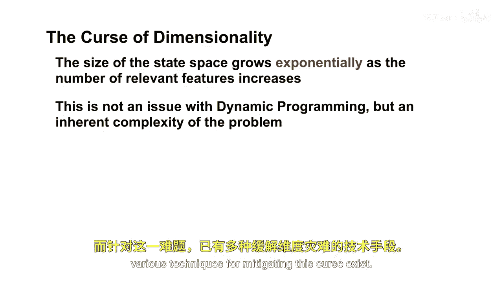

# 034：动态规划的效率

在本节课中，我们将探讨动态规划方法在解决马尔可夫决策过程问题时的效率。我们将了解两种替代方法——蒙特卡洛采样和暴力搜索，并通过对比，理解动态规划及其核心思想“自举”所带来的显著优势。

## 动态规划与替代方法概述

在之前的课程中，我们讨论了动态规划方法如何帮助我们计算价值函数和策略。但这些方法究竟有多大用处？与简单的替代方案相比如何？本节视频将探讨其他可能的求解策略。通过比较，你会发现动态规划实际上出奇地高效。

## 策略评估：动态规划 vs. 蒙特卡洛方法

上一节我们介绍了迭代策略评估，它是解决预测或策略评估问题的动态规划方案。本节中，我们来看看一种基于采样的替代方案——蒙特卡洛方法。

在蒙特卡洛方法中，每个状态的价值被视为一个完全独立的估计问题。其核心是，状态价值是从该状态出发的期望回报。具体步骤如下：
1.  在策略 π 下，从目标状态收集大量回报样本。
2.  计算这些回报的平均值。

这个平均值最终会收敛到该状态的真实价值。然而，这种方法可能需要从每个状态收集大量回报。每个回报都依赖于策略 π 选择的许多随机动作，以及MDP动态特性导致的许多随机状态转移。因此，每个回报可能与真实状态价值相差很大，我们需要平均大量回报才能使估计收敛，并且必须对**每一个**状态重复此过程。

动态规划的关键洞见在于，我们不必将每个状态的评估视为独立的问题。我们可以利用已经辛苦计算出的其他状态的价值估计。这种利用后续状态的价值估计来改进当前状态价值估计的过程，被称为**自举**。与独立估计每个价值的蒙特卡洛方法相比，自举通常效率更高。

## 策略优化：动态规划 vs. 暴力搜索

策略迭代用于计算最优策略。一种可能的替代方法是**暴力搜索**。

这种方法简单地逐一评估每一个可能的确定性策略，然后选择价值最高的那个。确定性策略的数量是有限的，并且总是存在一个最优的确定性策略，因此暴力搜索最终能找到答案。然而，确定性策略的数量可能极其庞大。一个确定性策略为每个状态选择一个动作，因此确定性策略的总数是状态数量的指数级函数。即使对于一个相当简单的问题，这个数字也可能是天文数字，导致求解过程耗时极长。

相比之下，策略改进定理保证了策略迭代能找到一系列越来越好（价值单调递增）的策略。这比穷举尝试每一个策略的效率有显著提升。

## 动态规划的效率分析

那么，与这些朴素的替代方法相比，动态规划的效率如何？

策略迭代保证能在与**状态和动作数量成多项式关系**的时间内找到最优策略。因此，动态规划比在策略空间上进行暴力搜索要快**指数级**。在实践中，动态规划通常比这个最坏情况下的理论保证还要快得多。例如，在最初的4x4网格世界问题中，策略迭代仅一步就收敛了。即使我们通过添加“坏状态”使问题变得更复杂，它也仅在五次迭代内收敛。

有人可能会觉得，必须在策略迭代的每一步都运行完整的策略评估，这显得很受限。但在实践中，这并不糟糕。随着迭代进行，策略的改变会越来越小，策略评估步骤对价值函数的改变也随之减小，因此评估步骤通常能快速终止。

## 维度灾难与挑战

通常，随着状态数量的增长，解决MDP问题会变得更难。**维度灾难**指出，状态空间的大小会随着状态变量数量的增加而呈指数级增长。一个智能体在网格世界中移动尚可处理，但如果我们想协调一个由数百个地点之间移动的数千名司机组成的交通网络呢？对可能状态进行原始枚举会导致状态数量指数级爆炸。

显然，如果我们试图通过遍历所有状态来执行策略迭代，这会导致问题。事实上，这不是动态规划本身的问题，而是我们试图解决的复杂问题本身固有的难度。存在各种技术来缓解这种诅咒，在后续的学习中，我们将继续与这个挑战作斗争。

## 总结

本节课中，我们一起学习了动态规划方法的效率。最重要的收获是：**自举**通过利用一个状态的价值与其可能后续状态价值之间的联系，使我们免于执行大量不必要的工作，从而极大地提升了计算效率。动态规划在策略评估和策略优化方面，相比蒙特卡洛采样和暴力搜索，都具有指数级或显著的速度优势，是解决中等规模MDP问题的强大工具。