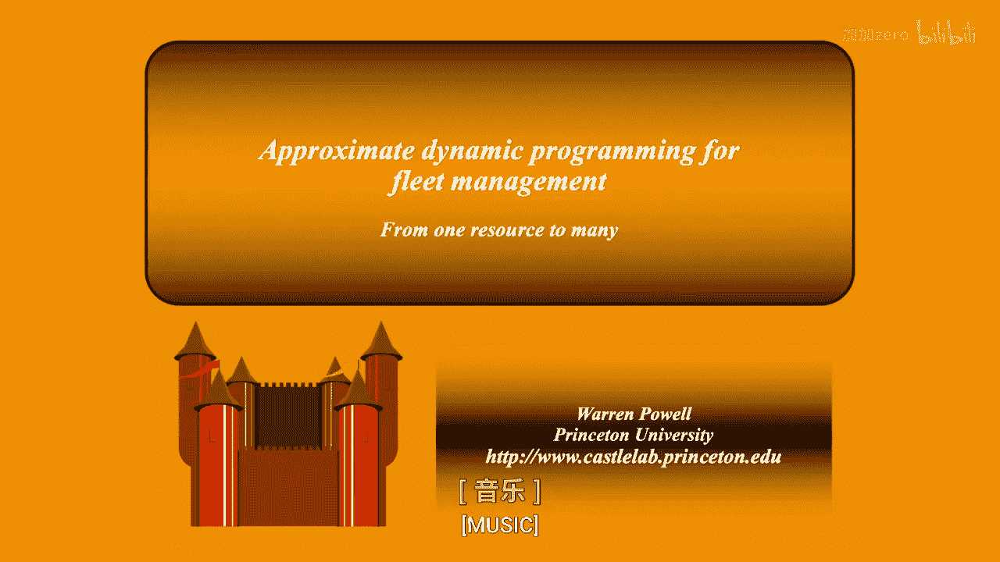

# 035：车队管理中的近似动态规划简论 🚚

在本节课中，我们将学习如何运用近似动态规划与强化学习来解决高维度的资源分配问题，特别是以卡车车队管理为例。我们将从单辆卡车的简单场景开始，逐步扩展到整个车队的复杂管理，并介绍核心的计算方法。

---

## 单辆卡车的决策过程 🚛

上一节我们介绍了课程背景，本节中我们来看看如何为单辆卡车做决策。想象你是一名刚入职的卡车司机，起点在德克萨斯州。

系统向你展示了四批待运货物，每批货物将运往不同的目的地。由于你是新手，对所有目的地的未来价值估计均为零。因此，你将选择当前运费最高的货物。

*   运往纽约的货物：$450
*   运往加州的货物：$600
*   运往明尼苏达的货物：$400
*   运往德州的货物：$350

你选择了运费$450的货物前往纽约。在出发前，你将“位于德克萨斯州”的价值更新为$450，因为这是你本次的收益（$450）加上你对纽约的未来价值估计（$0）。

到达纽约后，你重复此过程。此时，若选择返回德州的货物（$350），你需要将其与德州的现有价值（$450）相加，总收益为$800。但有一批运往加州的货物出价$600，且你对加州的未来价值估计为$0，因此你选择了前往加州。

现在，你位于加州。有一批$400的货物前往明尼苏达，但你从未去过那里，对其价值估计为$0。同时，一批$350的货物返回德州，结合德州的现有价值$450，总收益为$800。因此，你选择返回德州。

当你再次回到德州时，面临新的选择。一批$800的货物前往科罗拉多州，但你从未去过那里。此时，你需要更新“位于德克萨斯州”的价值。旧估值是$450，新观察到的潜在收益是$800。

以下是更新价值估计的平滑公式：

`新估值 = (1 - α) * 旧估值 + α * 新观察值`

我们使用学习率（或步长）α = 0.1 进行计算：

`新估值 = 0.9 * $450 + 0.1 * $800 = $485`

于是，“位于德克萨斯州”的价值估计被更新为$485。这就是经典的近似动态规划/强化学习方法。

---

## 扩展到车队管理：维数灾难 🚚🚚

上一节我们处理了单辆卡车，本节中我们来看看管理一个车队会带来什么挑战。假设你是一家卡车公司，拥有多辆卡车。

如果只有一辆卡车，其状态可以简单地用其所在位置（如25个地点中的一个）表示。但对于两辆卡车，系统状态需要描述两辆车位置的所有可能组合。随着车队规模扩大，状态数量会呈组合爆炸式增长。

车队可能状态数量的计算公式如下：

`状态总数 = (位置总数 + 车队规模 - 1)! / (车队规模! * (位置总数 - 1)!)`

当车队规模从1增加到5、50，或卡车属性（如车型、状态）增多时，状态空间会变得极其庞大。传统的、基于离散状态表示的强化学习方法将无法应对这种“维数灾难”。

---

## 车队管理的解决方案：基于边际价值的近似动态规划

那么，如何将方法扩展到整个车队呢？核心思路是解决一个**驾驶员与货物的分配问题**，并利用**边际价值**来近似未来收益。

我们面临一个持续的动态任务：驾驶员不断加入或离开系统，新货物订单随时出现。我们需要在考虑未来不确定事件的前提下，做出当前时刻的最佳分配决策。

对于单辆卡车，我们可以比较两个选择：将当前收益与对目的地的未来价值估计相加，然后选总价值最高的。对于整个车队，这就变成了一个**网络流分配问题**，可以建模为一个**线性规划**问题。

以下是解决此类问题的常用工具：

*   **Gurobi**
*   **CPLEX**

这些工具在Python中可用，大学用户通常可以免费获取，并能快速求解大规模问题。

---

## 计算驾驶员的边际价值

关键问题在于：如何获得每个目的地的“下游价值”或每个驾驶员的“未来价值”估计？

我们为整个车队求解一次分配问题（线性规划），得到系统总贡献值。然后，我们“拿走”一名特定属性的驾驶员（例如在位置A1的司机），重新求解分配问题，得到新的系统总贡献值。

该驾驶员的**边际价值**计算公式为：

`V̂ = 有该驾驶员时的总贡献 - 无该驾驶员时的总贡献`

这个 `V̂` 代表了该驾驶员对系统的边际贡献。就像更新单辆卡车的价值一样，我们用平滑公式来更新对驾驶员边际价值的估计：

`V̄_new = (1 - α) * V̄_old + α * V̂`

我们需要对车队中的每位驾驶员都进行这样的更新。幸运的是，在求解线性规划时，许多求解器可以直接提供这些边际价值（在优化中称为**对偶变量**），无需手动进行数值差分计算，这使得方法具有高度的可扩展性。

---

## 整体算法流程

整个算法的流程可以概括为以下三步迭代：

1.  **求解线性规划（绿色部分）**：基于当前对所有驾驶员边际价值 `V̄` 的估计，求解最优分配方案 `x`，并得到本次迭代中观察到的边际价值 `V̂`。
2.  **更新价值估计（蓝色部分）**：使用平滑公式，用新观察到的 `V̂` 更新平滑估计 `V̄`。
3.  **模拟推进（红色部分）**：根据当前决策，将系统状态向前模拟一步（例如，到下一小时或下一天），产生新的驾驶员和货物状态，然后回到步骤1。

通过多次迭代，我们对驾驶员边际价值的估计会越来越准确，整体解决方案的质量也会逐步提升。虽然过程中可能会有波动，但总体趋势是向上的。

---

## 总结与资源

本节课中，我们一起学习了如何用近似动态规划处理高维度资源分配问题。我们从单辆卡车的价值迭代入手，揭示了直接扩展到车队时面临的“状态爆炸”挑战。接着，我们引入了基于**线性规划**和**边际价值**的解决方案，通过迭代地求解分配问题、更新价值估计和模拟推进，来高效管理大规模车队。

如果你想深入了解或动手实践，可以访问以下资源：

*   **网站**：访问 [jungle.princeton.edu](http://jungle.princeton.edu)，在“Educational Materials”部分查找更多资料。
*   **代码**：在我的GitHub仓库中查找Python模块，特别是名为“**blood management problem**”的示例，它提供了一个很好的同类问题（医疗资源分配）的编程范例。

通过本教程，你应该对如何将强化学习思想应用于实际的大规模调度问题有了一个初步而清晰的认识。