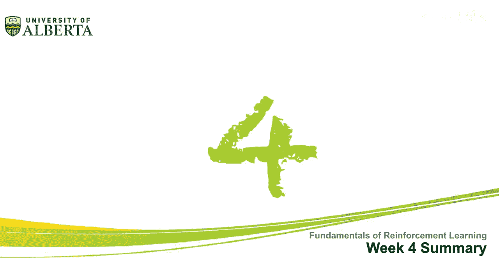
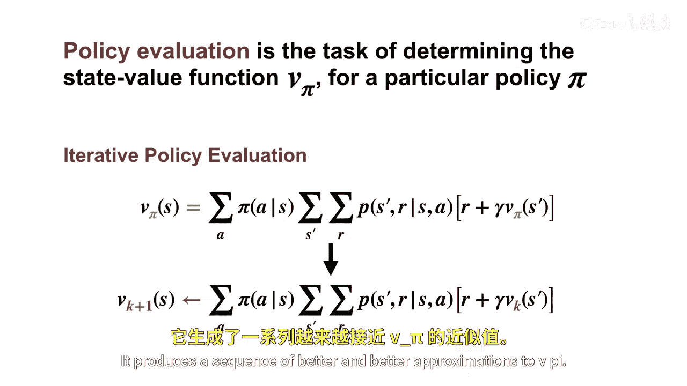
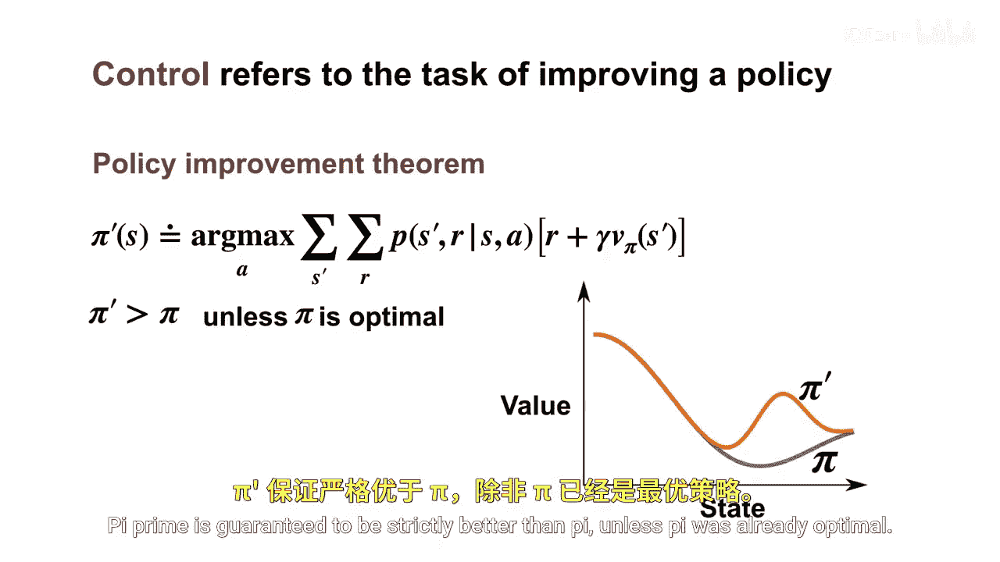
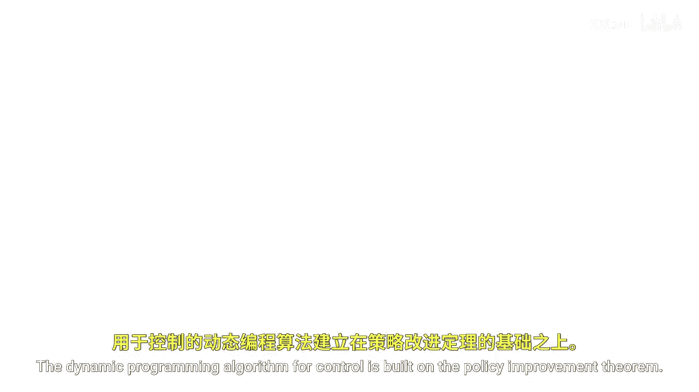

# 037：动态编程方法总结 🧠

在本节课中，我们将回顾第四周学习的核心内容：动态编程。动态编程是解决马尔可夫决策过程（MDP）中策略评估与控制任务的基础方法，为后续更复杂的强化学习算法奠定了基石。

## 策略评估 📊

上一节我们介绍了动态编程的基本概念，本节中我们来看看策略评估的具体方法。

策略评估的任务是确定特定策略 **π** 下的状态价值函数 **Vπ**。

迭代策略评估将 **Vπ** 的贝尔曼方程转化为一个更新规则。它通过迭代计算，产生一系列对 **Vπ** 越来越精确的近似值。

以下是其核心更新公式：
`V_{k+1}(s) = Σ_a π(a|s) Σ_{s‘, r} p(s‘, r | s, a) [ r + γ * V_k(s‘) ]`

## 策略改进与控制 🎯

在理解了如何评估一个策略的价值后，我们接下来探讨如何改进策略，即控制任务。

控制指的是改进策略的任务。策略改进定理告诉我们如何从一个给定的策略构造出一个更好的策略。

新策略 **π‘** 的构造方法很简单：基于当前的价值函数进行贪心选择。除非原策略 **π** 已经是最优的，否则 **π‘** 保证严格优于 **π**。

## 策略迭代算法 🔄

基于策略改进定理，我们得到了用于控制的动态编程算法，称为策略迭代。

策略迭代由两个步骤循环构成：
1.  **策略评估**：找到当前策略的价值函数。
2.  **策略改进**：基于当前价值函数，通过贪心操作生成新策略。

这两个步骤不断重复，直到策略不再发生变化，此时该策略被保证是最优的。

## 广义策略迭代 ⚙️

我们还讨论了广义策略迭代的框架。在广义策略迭代中，评估和改进步骤不需要运行到完全收敛。

广义策略迭代的一个例子是**价值迭代**。此外，它还包括**异步动态编程**方法。

以下是同步与异步方法的对比：
*   **同步方法**：反复遍历整个状态空间进行更新。
*   **异步方法**：更新顺序更灵活，可以按任何顺序更新状态。它能更高效地传播价值信息，这在状态空间非常大时尤其有用。异步方法可以设计为专注于少数相关状态。

## 总结与展望 🌟

本节课中我们一起学习了动态编程的核心思想与应用。在动态编程中，我们假设已知MDP的完整模型（即环境动态），即便如此，高效计算最优策略仍需精巧的算法设计。

我们在本周课程中的思考与算法设计，将为后续本课程中将要学习的大多数算法带来持续的好处。