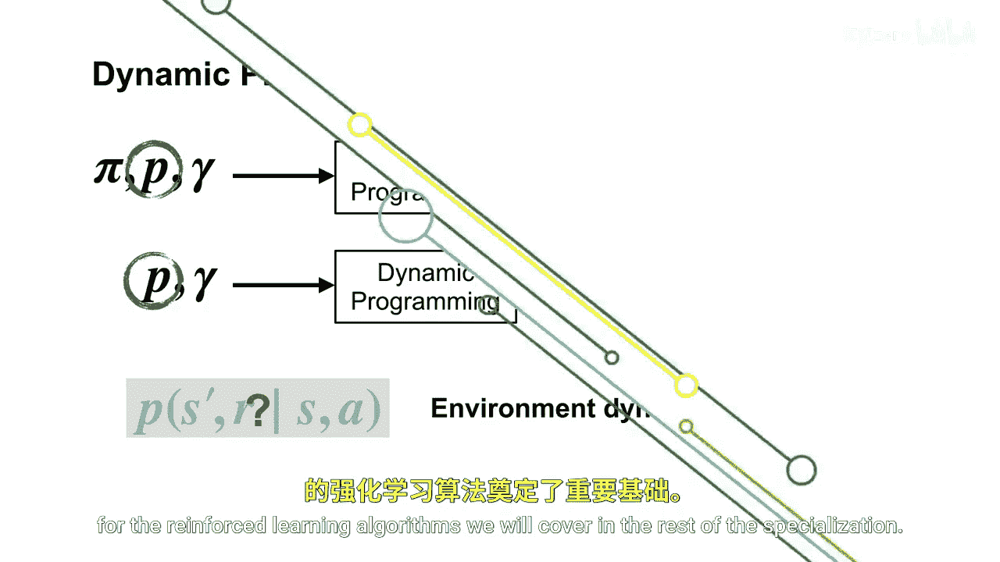

# 038：课程总结与展望 🎉

在本节课中，我们将对强化学习基础课程进行总结，回顾所学核心概念，并展望后续课程内容。

---

## 课程回顾

上一节我们介绍了动态规划算法，本节中我们来整体回顾本课程的知识体系。

我们首先从**多臂老虎机**问题入手，引入了选择动作以最大化奖励的核心思想。

在多臂老虎机中，我们面对一组固定的动作（或称“摇臂”）可供选择。每个动作会根据某个未知的分布产生一个奖励。我们的目标是始终选择平均奖励最高的那个摇臂。由于我们最初并不知道奖励分布，因此必须多次尝试每个摇臂以了解其平均奖励。

这引出了**探索与利用的权衡**。如果过于频繁地利用当前看起来最好的摇臂，可能会错过另一个因信息不足而暂时显得较差、但实际上更好的摇臂。反之，如果花费过多时间探索所有可能性，则可能牺牲了利用一个有充分理由相信其价值更高的摇臂的机会。

我们讨论了处理这种权衡的各种策略。

处理老虎机问题引出了许多有趣的问题，例如如何处理探索与利用的权衡。然而，老虎机问题并未涵盖所有情况。K臂老虎机问题在每个时间步向智能体呈现相同的情境。它只有一个最佳动作，无需将不同的动作与不同的情境关联起来。智能体动作选择的影响是即时的，奖励也没有延迟。

为了更好建模现实世界问题的复杂性，我们引入了**马尔可夫决策过程**。在MDP中，智能体选择的动作不仅影响即时奖励，还影响下一个状态。这进而影响了未来获得奖励的潜力。因此，动作可能具有长期后果。

我们引入了**回报**的概念，它是未来奖励的（可能经过折扣的）总和。MDP形式化框架可用于建模许多有趣的现实世界问题。我们在本专项课程中探讨的解决方法将适用于广泛的问题。

第一步始终是将你的问题构建为一个MDP。

在介绍MDP之后，我们开始描述强化学习的一些基本概念。

*   **策略**告诉智能体在每个状态下如何行动。
*   **价值函数**估计在特定策略下，每个状态或每个“状态-动作”对的预期未来回报。
*   **贝尔曼方程**将每个状态或“状态-动作”对的价值与其可能的后继状态的价值联系起来。

最后，我们介绍了**动态规划算法**。这些算法提供了解决**预测**和**控制**两大任务的方法，前提是我们能直接获取环境动态模型。

在强化学习问题中，我们通常不假设已知动态模型。毕竟在现实世界中，我们不能总是期望在尝试每个动作之前就知道其效果。动态规划算法为我们将在后续课程中介绍的强化学习算法奠定了重要基础。

---

## 总结与展望

恭喜你完成了所有内容的学习。你现在已经具备了理解强化学习设定所需的所有背景知识。

在下一门课程中，我们将讨论直接从经验中估计价值函数和策略的算法。这些基于样本的学习算法不需要、甚至不估计状态转移动态。期待在那里与你相见。