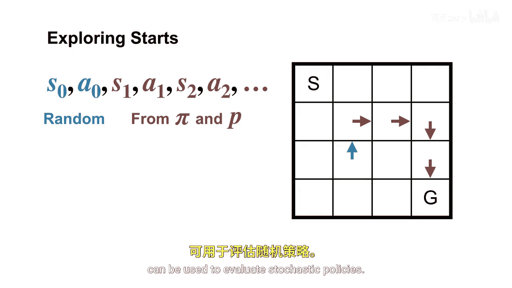

# 043：使用蒙特卡洛方法计算动作值 🎲

在本节课中，我们将要学习如何使用蒙特卡洛方法来估计动作价值函数。我们将了解其基本过程，并探讨在算法中保持探索性的重要性。

上一节我们介绍了如何使用蒙特卡洛方法学习固定策略下的状态价值函数。本节中我们来看看如何学习动作价值函数。学完本视频后，你将能够使用蒙特卡洛方法估计动作价值函数，并理解在蒙特卡洛算法中保持探索的重要性。

## 学习动作价值的基本过程

学习动作价值的过程与学习状态价值几乎完全相同。回想一下，我们通过平均从某个状态出发的样本回报来学习该状态的价值。方便的是，同样的过程也适用于动作价值。我们收集遵循策略、从某个“状态-动作对”出发的回报，然后取它们的平均值。

## 为何需要学习动作价值？

那么，我们为什么需要学习动作价值呢？动作价值对于学习策略非常有用。它们允许我们在同一状态下比较不同的动作。如果存在更好的动作，我们就可以切换到它。然而，这只有在我们能估计其他动作的价值时才可能实现，但这可能有些棘手。

## 探索的必要性

让我们考虑为一个确定性策略学习动作价值函数。想象一个永远不会被该策略选中的动作。智能体将永远观察不到与该动作对应的回报，因此我们将无法形成准确的蒙特卡洛估计。智能体必须在每个状态中尝试所有动作，才能学习它们的价值。这就是强化学习中“保持探索”的问题。

让我们思考一个现实世界的例子。想象你沿着通常走的路回家。最近，附近修了一条新路。如果我们从不尝试新路，就无法知道它是否真的更好。

## 保持探索的方法

保持探索的一种方法叫做“探索性起点”。在探索性起点中，我们必须保证每个“状态-动作对”都能作为情节的起点。之后，智能体只需遵循其策略即可。考虑屏幕上显示的网格世界。

让我们看看探索性起点如何与图中用红色箭头表示的策略一起工作。探索性起点会在一个情节开始时随机采样一个状态和动作，如图中蓝色箭头所示。在这种情况下，蓝色动作与红色策略建议的动作不同。在初始动作之后，智能体将遵循红色策略直到情节结束。

我们必须能够以这种方式设置起始状态，才能评估像这个网格世界中这样的确定性策略。但这并非总是可行的。其他探索策略，如 **ε-贪心** 策略，可用于评估随机策略。

我们将在后面详细讨论这一点。

## 总结

本节课中我们一起学习了蒙特卡洛算法用于估计动作价值函数的基本步骤，并深入讨论了在强化学习过程中保持充分探索的重要性。理解如何准确评估不同动作的价值，是后续改进策略、实现更优决策的关键基础。