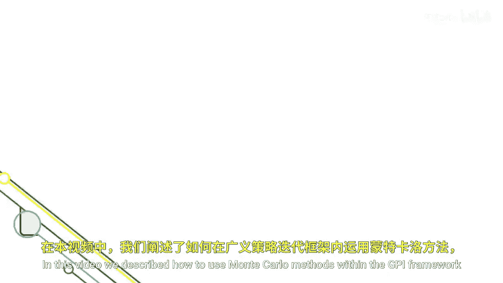

强化学习专项课程：第44讲：使用蒙特卡洛方法进行广义策略迭代 🎯

在本节课中，我们将学习如何将蒙特卡洛方法融入广义策略迭代框架，以构建一个完整的强化学习算法。我们将从回顾广义策略迭代的基本概念开始，然后详细讲解一个名为“带探索性起点的蒙特卡洛”的具体算法。

---

### 概述

我们已经掌握了使用蒙特卡洛方法估计动作价值。下一步是构建一个广义策略迭代算法。本节课将介绍如何实现这一目标。课程结束时，你将理解如何利用蒙特卡洛方法实现一个GPI算法。

---

### 广义策略迭代回顾

广义策略迭代包含**策略评估**和**策略改进**两个步骤。GPI算法能够生成一系列策略，并且后续的策略至少不会比之前的策略差。

*   对于**策略改进**步骤，我们可以使策略相对于智能体当前的动作价值估计变得**贪婪**。
*   对于**策略评估**步骤，我们将使用**蒙特卡洛方法**来估计动作价值。

需要记住的是，在GPI框架中，价值估计只需要得到**一定程度的改进**，而无需一步到位达到完全正确的动作价值。算法收敛的唯一要求是估计值能够持续改进。

蒙特卡洛控制方法将策略改进和策略评估结合在**逐个片段**的基础上进行。

---

### 算法构建：带探索性起点的蒙特卡洛

现在，让我们将这两个步骤整合到一个算法中。

上一节我们回顾了GPI的核心步骤，本节中我们来看看如何用蒙特卡洛方法具体实现它。

我们从用于学习动作价值的蒙特卡洛方法开始。算法使用**探索性起点**，这意味着每个片段都从一个随机选择的状态和动作开始。然后，智能体遵循其当前策略生成一个完整的片段，并沿途记录状态、动作和奖励。一旦片段完成，算法从片段的末尾开始计算每个状态-动作对的回报。接着，它将回报添加到相应的列表中。最后，通过对列表中的回报取平均值来更新每个状态-动作对的动作价值估计。至此，策略评估步骤完成。

在策略评估之后，便进行策略改进。我们只需将策略更新为相对于我们更新后的动作价值估计的**贪婪动作**。我们在片段中观察到的每个状态都执行此操作。

以下是该算法的核心步骤总结：

1.  **初始化**：对所有状态`s`和动作`a`，初始化`Q(s, a)`（动作价值函数）和`π(s)`（策略），并创建一个空的回报列表`Returns(s, a)`。
2.  **循环（对每个片段）**：
    *   **生成片段**：使用探索性起点，遵循当前策略`π`生成一个状态、动作、奖励序列：`S0, A0, R1, S1, A1, R2, ..., ST-1, AT-1, RT`。
    *   **计算回报**：初始化`G = 0`，从最后一个时间步向前遍历片段：
        *   `G = γ * G + R_{t+1}` （其中γ是折扣因子）
        *   将`G`添加到`Returns(S_t, A_t)`列表中。
        *   更新动作价值估计：`Q(S_t, A_t) = average(Returns(S_t, A_t))`。
    *   **策略改进**：对片段中访问过的每个状态`S_t`，更新策略：`π(S_t) = argmax_a Q(S_t, a)`。

这个过程比我们在动态规划中执行此步骤的方式要简单得多。至此，我们就完成了广义策略迭代算法——带探索性起点的蒙特卡洛。

---

### 总结

本节课中，我们一起学习了如何在GPI框架内使用蒙特卡洛方法，并讨论了一个名为“带探索性起点的蒙特卡洛”的GPI算法示例。该算法通过交替进行基于经验片段的策略评估和贪婪策略改进，逐步优化策略，是解决无模型强化学习问题的基础方法之一。