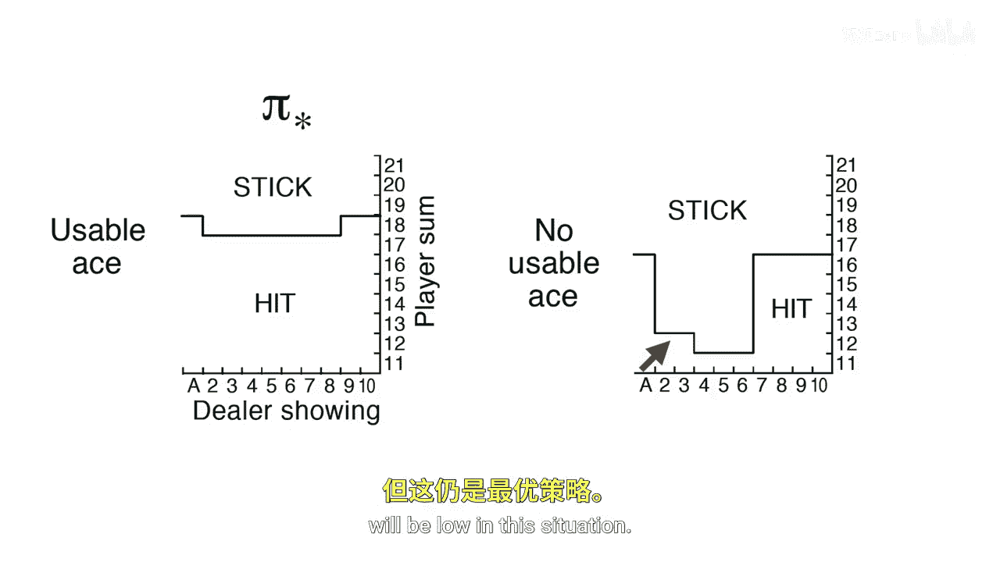

**强化学习专项课程：P45：解决二十一点示例 🃏**

在本节课中，我们将学习如何将带有探索性起点的蒙特卡洛控制方法应用于一个具体示例。我们将训练一个智能体玩二十一点游戏，并观察算法如何通过经验学习最优策略。

---

上一节我们介绍了广义策略迭代的蒙特卡洛控制方法。本节中，我们来看看如何将其应用于解决二十一点游戏这个马尔可夫决策过程示例。

我们的目标是使用**带有探索性起点的蒙特卡洛方法**来学习策略。探索性起点要求每个回合从一个随机的状态和动作开始。在我们的二十一点游戏中，初始发牌自然提供了随机状态。因此，我们只需在每个回合的第一步随机选择动作。这意味着，智能体在第一个状态会忽略其认为的最佳动作，而是随机选择“要牌”或“停牌”。

我们设定初始策略为：当智能体手牌点数总和小于20时选择“要牌”，当总和为20或21时选择“停牌”。

让我们逐步模拟一局游戏，看看算法会如何运作。

假设智能体的手牌点数为13（没有可用的A牌），庄家明牌是8。根据随机采样的第一个动作，智能体选择“要牌”。

智能体得到一张7，点数总和变为20。在下一步，智能体根据其策略选择动作，因此选择“停牌”。现在轮到庄家。

庄家抽到一张9，点数超过21，输掉游戏，智能体获得+1的奖励。

很好。现在让我们回顾游戏过程中遇到的状态-动作对，从回合的末尾开始向前回溯。

在最后一个非终止状态，智能体点数为20，没有可用A牌，庄家明牌为8。从这个状态，智能体选择了“停牌”。智能体将+1添加到该状态-动作对对应的回报列表中。该状态下“停牌”动作的估计值就是1。

让我们看看此状态下两个动作的价值。智能体从未尝试过“要牌”动作，所以其价值为0。“停牌”动作的价值是1（我们刚刚计算得出）。因此，相对于动作价值函数Q，此状态下的贪婪动作是“停牌”，因为它具有最高的估计价值。

让我们再向前回溯一步，回到起始状态。智能体点数为13，没有可用A牌，庄家明牌为8。随机选择的动作是“要牌”。同样，智能体将+1添加到该状态-动作对对应的回报列表中。列表的平均值构成了该动作价值的估计。

最后，在此状态下更新策略，使其相对于动作价值估计是贪婪的。在此状态下，我们从未尝试过“停牌”动作，其价值为0。但“要牌”动作带来了+1的回报，所以贪婪动作是“要牌”，策略也相应更新以反映这一点。

我们将这个过程重复许多回合。动作价值和策略将逐渐逼近其最优值。

以下是智能体经过长时间训练后找到的最优策略。

请注意当智能体持有可用A牌时的玩法。对于庄家的大多数明牌，智能体会持续“要牌”直到点数接近19。由于有可用A牌，智能体在计算手牌点数总和时有更大的灵活性，因此策略更具攻击性。

在没有可用A牌的情况下，策略更依赖于庄家展示的牌。当智能体点数总和为13或更高，且庄家明牌点数较低（如2或3）时，智能体会选择“停牌”。这是最优的，尽管在这种情况下获胜的机会看起来可能较低。

---

本节课中，我们一起学习了如何将带有探索性起点的蒙特卡洛方法应用于一个示例MDP，即二十一点游戏。我们看到了算法如何通过从随机起点开始探索、收集回报并更新策略来逐步逼近最优玩法。