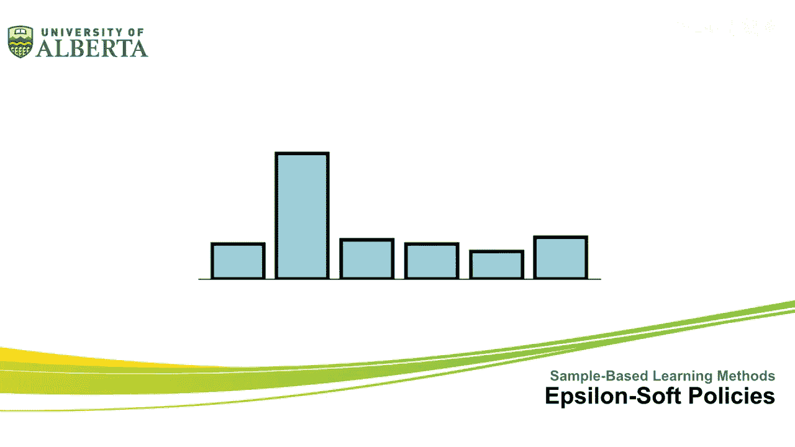
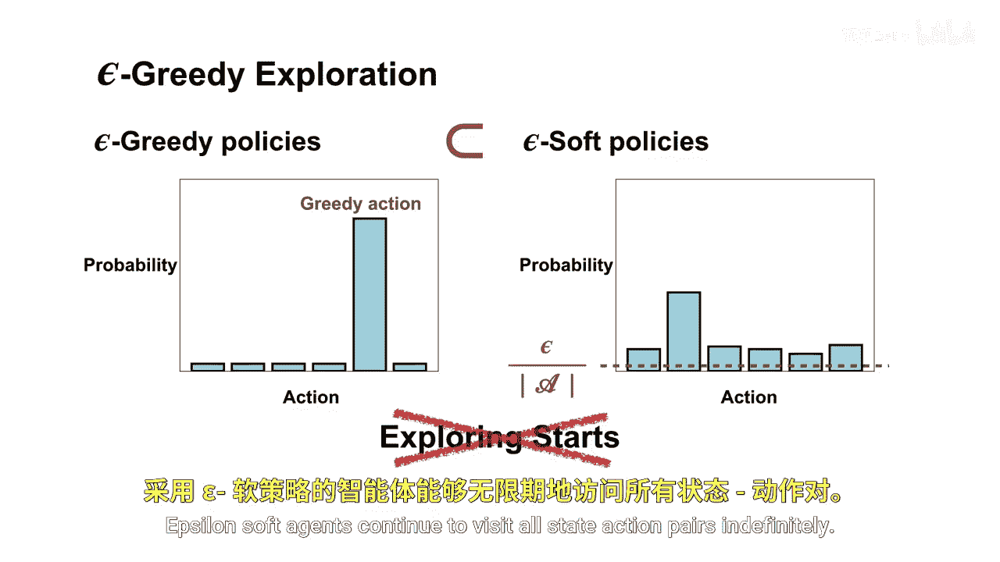
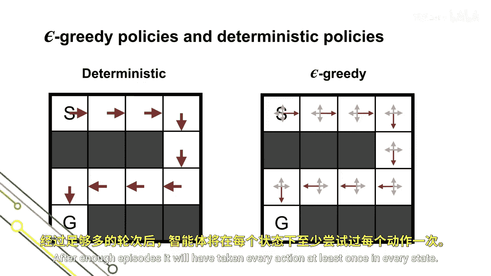
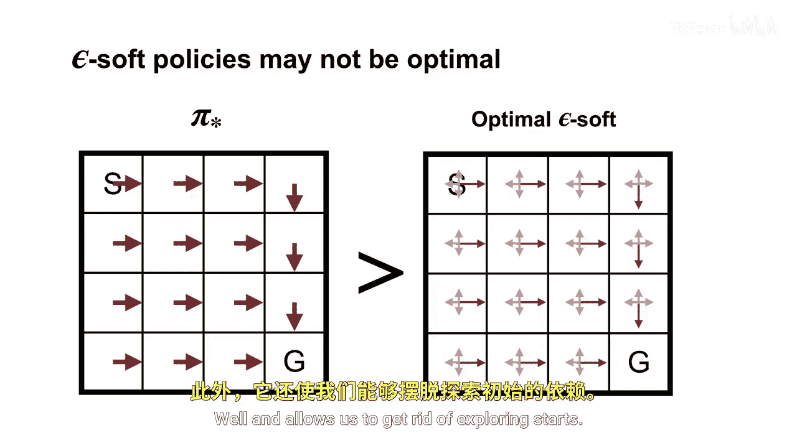
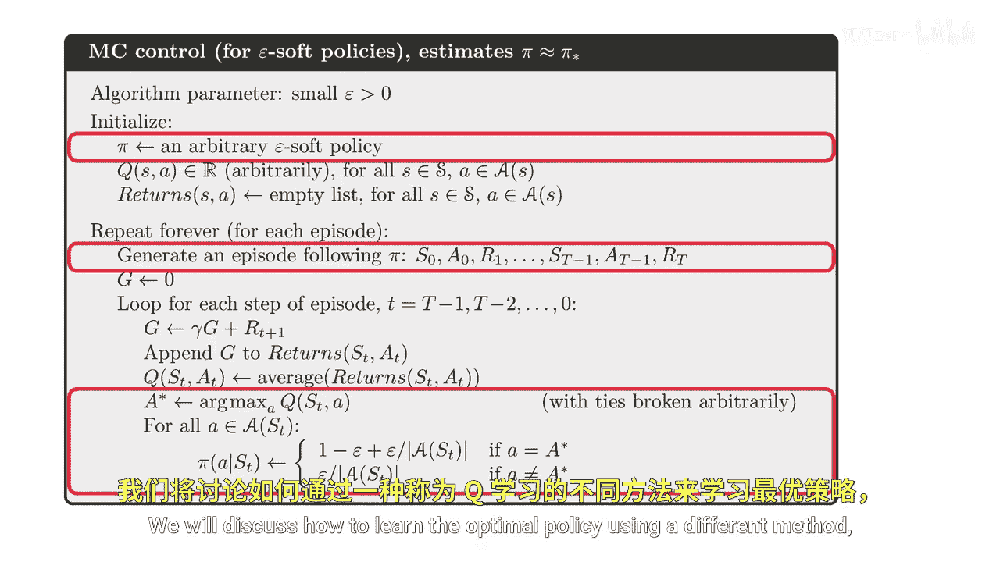

强化学习专项课程：P46：ε-软策略

在本节课中，我们将学习探索性起始假设的局限性，并了解如何将ε-贪心探索与蒙特卡洛控制结合，以学习近似最优的策略。课程结束时，你将理解为何探索性起始在实际问题中可能不适用，并能描述一种替代的探索方法。

### 探索性起始的局限性

上一节我们介绍了基于探索性起始的蒙特卡洛控制。本节中我们来看看这种方法的潜在问题。

探索性起始要求算法必须能够从每一个可能的状态-动作对开始。否则，智能体可能探索不足，从而收敛到一个次优解。在许多实际问题中，随机采样初始状态-动作对可能非常困难或不切实际。

例如，对于一辆自动驾驶汽车，如何随机采样其初始状态和动作？要确保智能体能在所有可能的状态下开始，就需要将汽车置于繁忙高速公路的各种不同配置中，这既危险又不现实。

### ε-软策略：一种替代探索方案

既然探索性起始不总是可行，我们该如何在没有它的情况下学习所有动作的价值呢？答案是使用**ε-贪心探索**。我们在多臂老虎机讲座中讨论过这个简单有效的方法，它同样可以与蒙特卡洛方法结合。

快速回顾一下，ε-贪心策略是一种随机策略。它通常采取贪心动作（即当前估计价值最高的动作），但偶尔会以概率 ε 随机选择一个动作。

ε-贪心策略属于一个更大的策略类别，称为 **ε-软策略**。ε-软策略确保在每个状态下，每个动作被选择的概率至少为 **ε / |A(s)|**，其中 |A(s)| 是该状态下可选动作的数量。

以下是ε-软策略的两个关键特性：
*   **持续探索**：由于每个动作都有非零概率被选中，智能体会持续探索所有状态-动作对。
*   **随机性**：ε-软策略总是随机的。与之相对，确定性策略在每个状态下只指定一个要执行的动作。

### ε-软策略 vs. 确定性策略

让我们通过一个网格世界的例子来直观理解两者的区别。

假设有一个确定性策略，由箭头表示。从起始状态开始，智能体每次都会遵循完全相同的轨迹穿过网格世界。

而一个ε-贪心策略（一种ε-软策略）会有更多箭头，因为每个动作都有较小的概率被选中。因此，智能体在每一幕中可能遵循的轨迹都会略有不同。经过足够多的幕之后，它将在每个状态中至少尝试过每个动作一次。

### 最优ε-软策略

这种探索方式的差异也影响了我们能找到的解的性质。

如果我们的策略始终为每个动作分配至少 ε 的概率，那么它就不可能收敛到一个确定性的最优策略。探索性起始可以用来找到**最优策略**，但ε-软策略只能用来找到**最优ε-软策略**。

最优ε-软策略是所有ε-软策略中在每个状态具有最高价值的那个。虽然它通常比真正的最优策略表现稍差，但其性能往往足够好，并且允许我们摆脱对探索性起始的依赖。

### 基于ε-软策略的蒙特卡洛控制算法

理解了概念后，我们来看看基于ε-软策略的蒙特卡洛控制伪代码。通过对比它与探索性起始版本的不同，可以很容易理解这个算法。

主要区别有三处：
1.  **初始化**：初始策略 π 必须是ε-软策略（例如均匀随机策略）。
2.  **策略评估（数据生成）**：由于策略本身就是ε-软的，我们不再需要探索性起始来保证探索。智能体只需遵循其当前的ε-软策略生成一幕数据。
3.  **策略改进**：基于当前的动作价值估计 Q(s, a)，将策略改进为与之对应的ε-贪心策略。

你可能会想，改进后的策略也应该是ε-软策略，而不仅仅是ε-贪心。然而，这是合理的，因为**最优ε-软策略就是一个ε-贪心策略**。即使这个算法找不到全局最优策略，它也能找到最优ε-软策略。

### 总结

本节课中，我们一起学习了探索性起始在实际应用中的局限性，并深入探讨了如何利用ε-软策略进行蒙特卡洛控制。我们了解到，ε-软策略通过保证持续的随机探索，使我们能够在无需不切实际的探索性起始条件下，学习到一个性能良好的近似最优策略——即最优ε-软策略。在未来的课程中，我们将讨论另一种名为Q学习的方法，它能够学习到真正的全局最优策略。