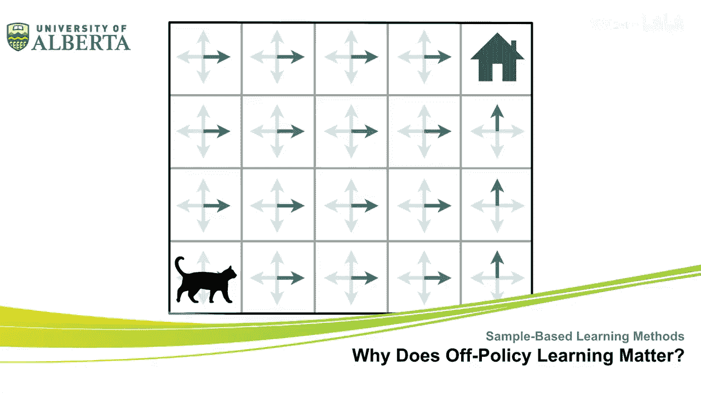

# 047：为什么离策略学习很重要 🎯

在本节课中，我们将探讨强化学习中的一个核心概念：离策略学习。我们将了解它如何帮助智能体解决探索与利用的权衡问题，并区分目标策略和行为策略这两个关键角色。

## 概述

我们已经讨论过探索与利用的权衡问题。其关键在于，智能体必须偶尔采取次优的探索性行动，这可能会获得较少的奖励。但或许我们根本不需要进行这种权衡。在本视频中，我们将讨论一种学习价值函数的新方法，称为**离策略学习**。

通过本课的学习，你将能够理解离策略学习如何帮助处理探索问题，并能举例说明目标策略和行为策略。

## 探索策略的局限性

上一节我们介绍了探索的必要性。本节中，我们来看看常用探索策略的不足。

ε-贪心策略通过在每一步都有一个小概率进行探索，有助于解决持续探索的问题。然而，ε-贪心策略的缺点是，它在行动和学习两方面都是次优的。ε-贪心策略既不是获取奖励的最优策略，也不是寻找最佳行动的探索最优策略。

## 从同策略到离策略

到目前为止，在整个课程中，我们一直在隐式地讨论**同策略学习**，尽管我们还没有正式强调这个名称。在同策略学习中，智能体学习的是用于生成数据的策略本身。

“学习一个策略”意味着什么？在策略评估中，它仅指学习价值函数；在控制中，它指学习最优策略。

在**离策略学习**中，智能体从遵循**不同**策略所生成的数据中学习一个策略。也就是说，我们正在学习的策略（目标策略）与我们用于选择行动的策略（行为策略）是分离的。例如，你可以在遵循完全随机策略的同时，学习最优策略。

## 目标策略与行为策略

我们称智能体正在学习的策略为**目标策略**，因为它是智能体学习的目标。目标策略通常用 **π** 表示。智能体正在学习的价值函数是基于目标策略的。目标策略的一个例子就是最优策略。

我们称智能体用于选择行动的策略为**行为策略**，因为它定义了智能体的行为。行为策略通常用 **b** 表示。行为策略负责为智能体选择行动。下图所示的行为策略是均匀随机策略。

## 为何分离策略？

那么，我们为什么要将行为与目标策略分离开呢？因为它提供了另一种持续探索的策略。

如果我们的智能体按照目标策略行动，它可能只会经历少数状态；如果我们的智能体能够按照一个倾向于探索的策略行动，它就能经历更多状态。离策略学习实际上还有其他一些有用的应用，例如从演示中学习和并行学习，但促进探索是其主要动机之一。

## 覆盖条件

离策略学习的一个关键规则是：**行为策略必须覆盖目标策略**。换句话说，如果目标策略表示在给定状态 **s** 下选择动作 **a** 的概率大于0，那么行为策略也必须表示在该状态下选择该动作的概率大于0。

这背后有重要的数学原因，我们将在后续视频中讨论。但这里也有一个直观的原因。考虑这样一个状态：行为策略总是向上走，但目标策略是向右走。智能体无法学习该状态下正确的动作价值，因为它从未观察到如果向右走会发生什么。也许它能获得+100万的奖励，但它永远不会知道。

值得注意的是，离策略学习是同策略学习的严格泛化。同策略是目标策略等于行为策略的特例。

## 总结

本节课中，我们一起学习了离策略学习。关键要点是：离策略学习是获得持续探索的另一种方式。我们正在学习的策略称为**目标策略**，而我们从中选择行动的策略称为**行为策略**。理解这两者的区别是掌握高级强化学习算法的基础。