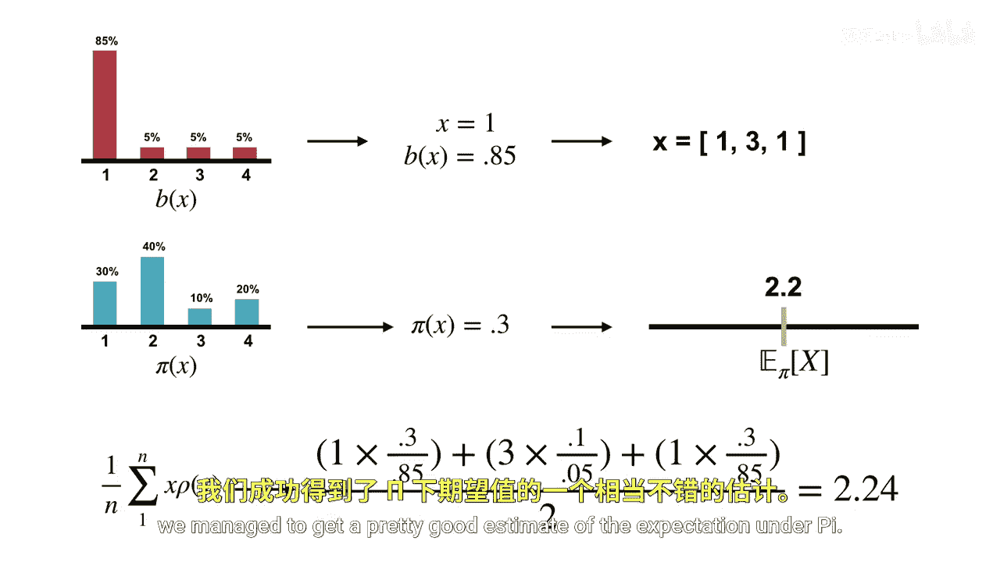

强化学习专项课程：P48：重要性采样 🎯

在本节课中，我们将要学习**重要性采样**。正如我们将在后续视频中看到的，重要性采样使我们能够进行**离策略学习**，即在遵循一个策略的同时学习另一个策略。在本视频中，我们将首先描述重要性采样的工作原理。通过本视频的学习，你将能够使用重要性采样，利用来自不同分布的样本来估计目标分布的期望值。

---

### 问题定义

让我们从明确重要性采样所要解决的问题开始。

我们有一个随机变量 **X**，它从一个概率分布 **B** 中被采样。我们想要估计 **X** 的期望值，但这是相对于**目标分布 π** 的期望。

因为 **X** 是从 **B** 中抽取的，我们不能简单地使用样本平均值来计算在 **π** 下的期望。样本平均值给出的是在 **B** 下的期望值。

---

### 数学推导

我们从期望值的定义开始。对于所有可能的结果 **x**，其期望值公式为：

**E_π[X] = Σ_x x * π(x)**

接下来，我们可以在公式中乘以 **b(x) / b(x)**，因为这一项等于 1。其中，**b(x)** 是在分布 **B** 下观察到结果 **x** 的概率。

重新排列分子，我们最终会得到一个 **π** 和 **B** 之间的比率：

**E_π[X] = Σ_x [x * (π(x) / b(x))] * b(x)**

这个比率对我们来说非常重要，被称为**重要性采样比率**。我们通常将重要性采样比率记为 **ρ(x)**。

现在，让我们更进一步。如果我们把 **x** 乘以重要性采样比率看作一个新的随机变量，再乘以观察到 **x** 的概率 **b(x)**，那么我们可以将这个求和重写为在分布 **B** 下的期望：

**E_π[X] = E_B [ X * (π(X) / b(X)) ] = E_B [ X * ρ(X) ]**

注意，我们的期望现在是在 **B** 下，而不是在 **π** 下。

---

### 从数据中估计期望

我们已经知道如何使用重要性采样来修正期望，但如何利用数据来估计这个期望呢？这实际上非常简单。

我们只需要计算一个**加权样本平均值**，以重要性采样比率作为权重，如下面的公式所示：

**估计值 = (1/N) * Σ_{i=1}^{N} [ x_i * (π(x_i) / b(x_i)) ]**

请注意，这些样本 **x_i** 是从分布 **B** 中抽取的，而不是从 **π** 中抽取的。这样，我们现在就可以使用从分布 **B** 中抽取的样本平均值来估计在分布 **π** 下 **X** 的期望值了。

---

### 示例演示

让我们看一个使用重要性采样来估计期望的小例子。我们有两个相当不同的分布：**B** 和 **π**。

我们将根据 **B** 抽取样本，并尝试估计在 **π** 下的期望值。在右侧，我们将跟踪当前对 **π** 下期望值的估计。作为参考，我们在线的中间显示了真实的期望值。

以下是估计过程的步骤：

1.  **第一次抽样**：从 **B** 中抽取一个样本，得到 **x = 1**，这在 **B** 下发生的概率是 0.85。如果从 **π** 中抽样，得到 **x = 1** 的概率是 0.3。代入重要性采样公式，我们得到的估计值是 0.35。
2.  **第二次抽样**：再次从 **B** 中抽取样本，这次 **x = 3**，在 **B** 下的概率是 0.05，在 **π** 下的概率是 0.1。我们将新的观测值代入公式，并与前一次估计取平均，得到新的估计值 3.18。
3.  **第三次抽样**：最后一次从 **B** 中抽取样本，代入公式计算，得到估计值 2.2。

仅仅使用来自 **B** 的样本，我们就成功地获得了在 **π** 下期望的一个相当好的估计。

---

### 总结

本节课中，我们一起学习了如何使用**重要性采样**来估计一个分布（π）下的期望值，而数据却是从另一个分布（B）中采样得到的。其核心在于计算**重要性采样比率 ρ(x) = π(x) / b(x)**，并利用它来修正从行为分布 **B** 中获得的样本平均值，从而得到目标分布 **π** 下期望的无偏估计。这是实现离策略学习的关键基础。我们下次再见。