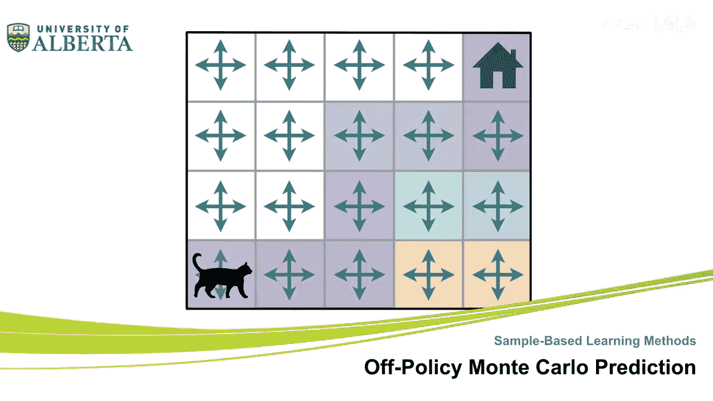
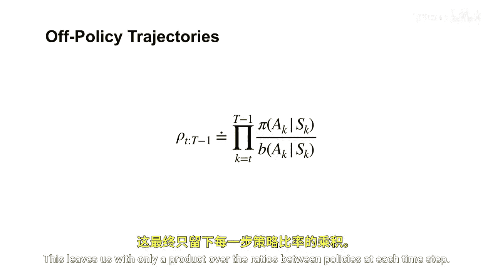
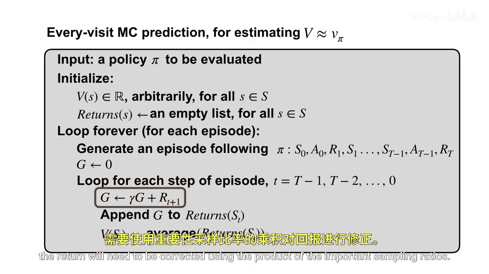
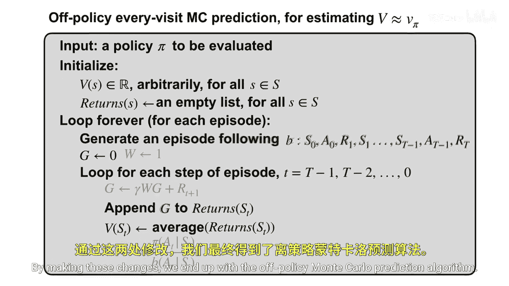
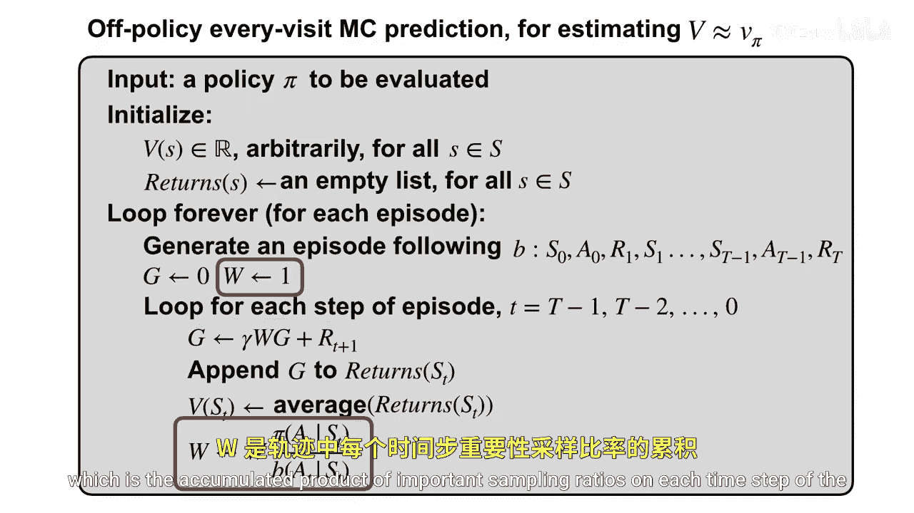
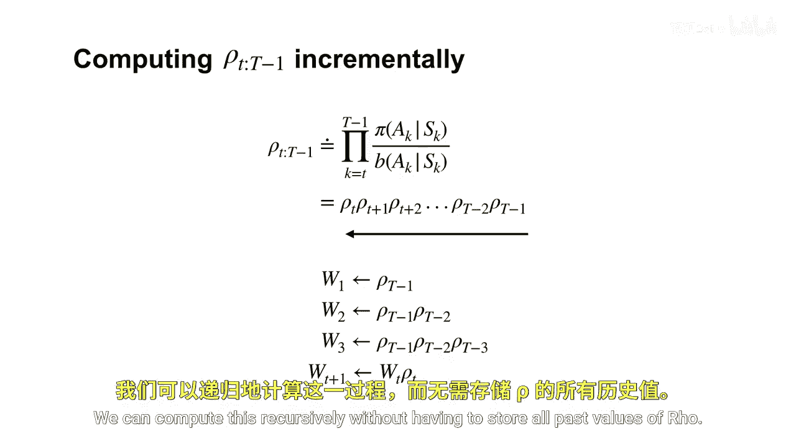

# 049：离策略蒙特卡洛预测 🎯



在本节课中，我们将学习如何利用蒙特卡洛方法进行离策略预测。我们将重点理解如何使用重要性采样来修正回报，并了解如何修改蒙特卡洛预测算法以适应离策略学习。

## 概述 📋

在之前的视频中，我们讨论了离策略学习。本节我们将具体探讨如何结合蒙特卡洛方法实现离策略预测。核心在于，当我们使用遵循行为策略 `B` 产生的回报来估计目标策略 `π` 下的状态价值时，不能直接对回报进行平均，而必须使用重要性采样比率 `ρ` 对每个回报进行修正。

## 蒙特卡洛估计的目标 🎯

蒙特卡洛估计的目标是通过计算从某个状态开始的所有回报的样本平均值，来估计每个状态的价值。公式表示如下：

**V(s) = (1/N) * Σ G_t**

然而，当我们尝试使用遵循行为策略 `B` 产生的回报来估计目标策略 `π` 下的价值时，会遇到问题。如果我们简单地平均在行为策略 `B` 下从状态 `S` 观察到的回报，将无法得到正确的答案。我们必须对平均中的每一个回报进行修正。

这正是重要性采样的用武之地。我们需要做的就是为每个采样到的回报计算出 `ρ` 值。

## 重要性采样比率 ρ 📊

`ρ` 的定义是轨迹在目标策略 `π` 下的概率除以该轨迹在行为策略 `B` 下的概率。

**ρ = (P(轨迹 | π)) / (P(轨迹 | B))**

这个 `ρ` 修正了整个轨迹的分布，从而修正了回报的分布。使用这个修正，我们就能得到我们想要的——在策略 `π` 下回报的期望值。

为了计算 `ρ`，我们需要知道如何计算一个轨迹在某个策略下的概率。

## 轨迹的概率分布 🔄

考虑轨迹的概率分布。这个概率可以理解为：给定智能体处于某个状态 `S_t`，它采取行动 `A_t`，然后转移到状态 `S_{t+1}`，接着采取行动 `A_{t+1}` 并转移到 `S_{t+2}`，以此类推，直到在时间 `T` 终止的概率。所有的行动都是根据行为策略 `B` 采样的。

由于马尔可夫性质，我们可以将这个概率分布分解成更小的部分。第一部分是智能体在状态 `S_t` 选择行动 `A_t` 的概率，乘以环境转移到状态 `S_{t+1}` 的概率。第二部分给出了下一个时间步经验的概率，依此类推。

我们可以使用连乘符号重写这个概率乘积列表。轨迹在策略 `B` 下的概率 `P(轨迹 | B)` 可以表示为：

**P(轨迹 | B) = Π_{t=0}^{T-1} B(A_t | S_t) * P(S_{t+1} | S_t, A_t)**

类似地，可以定义轨迹在目标策略 `π` 下的概率 `P(轨迹 | π)`。

## 计算重要性采样比率 🧮

现在，我们将这些概率代入 `ρ` 的定义中。正如我们在之前的视频中看到的，我们可以取这些概率并将它们乘以重要性采样比率。环境的状态转移动力学在每一步都相互抵消，只留下每一步策略比率的乘积。

**ρ = Π_{t=0}^{T-1} [π(A_t | S_t) / B(A_t | S_t)]**

这个简化的形式非常关键，它意味着我们只需要知道每个时间步上目标策略和行为策略选择特定行动的概率之比，而无需知道环境模型。



## 离策略估计 V(π) 📈

现在回到离策略估计 `V(π)`。智能体观察到许多遵循行为策略 `B` 产生的回报。我们可以通过用 `ρ` 修正每个回报来估计 `V(π)`。

**V(π)(s) ≈ (1/N) * Σ [ρ * G_t]**

接下来，我们看看如何实现这一点。

## 从同策略到离策略的算法修改 ⚙️

首先，回顾一下同策略蒙特卡洛预测算法。我们需要在这里做两个修改：
1.  情节将不再遵循 `π` 生成，而是遵循行为策略 `B` 生成。
2.  回报需要使用重要性采样比率的乘积进行修正。



通过进行这些更改，我们得到了离策略蒙特卡洛预测算法。



以下是算法的核心步骤：




```
初始化：
    对于所有 s ∈ S：
        V(s) ← 任意值
        Returns(s) ← 空列表
循环（对每个情节）：
    使用行为策略 B 生成一个情节：S0, A0, R1, S1, A1, R2, ..., S_{T-1}, A_{T-1}, R_T
    G ← 0
    W ← 1  # 重要性采样权重乘积
    对于 t = T-1 到 0（倒序循环）：
        G ← γ * G + R_{t+1}
        将 G 加入到 Returns(S_t) 中
        V(S_t) ← 平均值(Returns(S_t))
        W ← W * [π(A_t | S_t) / B(A_t | S_t)]
        如果 W == 0：
            跳出内层循环（提前终止）
```

请注意，情节现在是遵循行为策略生成的。回报被一个新项 `W` 修正，`W` 是情节中每个时间步重要性采样比率的累积乘积。

## 增量计算 ρ 📝

我们可以从时间 `t` 到 `T-1` 增量地计算 `ρ`（即算法中的 `W`）。原因如下：让我们写出每个时间步的乘积。回想一下，蒙特卡洛算法是反向遍历时间步的。

在算法的第一步，`W` 被设置为最后一个时间步的 `ρ`。在下一个时间步，`W` 是倒数第二个 `ρ` 乘以最后一个 `ρ`，依此类推。每个时间步在乘积中增加一个额外的项，并重用所有先前的项。



我们可以递归地计算这个值，而无需存储所有过去的 `ρ` 值。在算法中，这体现为 `W ← W * [π(A_t | S_t) / B(A_t | S_t)]`。

## 总结 🏁

本节课中，我们一起学习了离策略蒙特卡洛预测。我们掌握了如何使用重要性采样比率来修正由行为策略产生的回报，并成功修改了同策略蒙特卡洛预测算法，使其适用于离策略学习。关键点在于理解轨迹概率的分解、重要性采样比率 `ρ` 的计算及其在算法中作为权重 `W` 的增量更新方式。这为我们在无法直接遵循目标策略时评估其价值提供了有效工具。