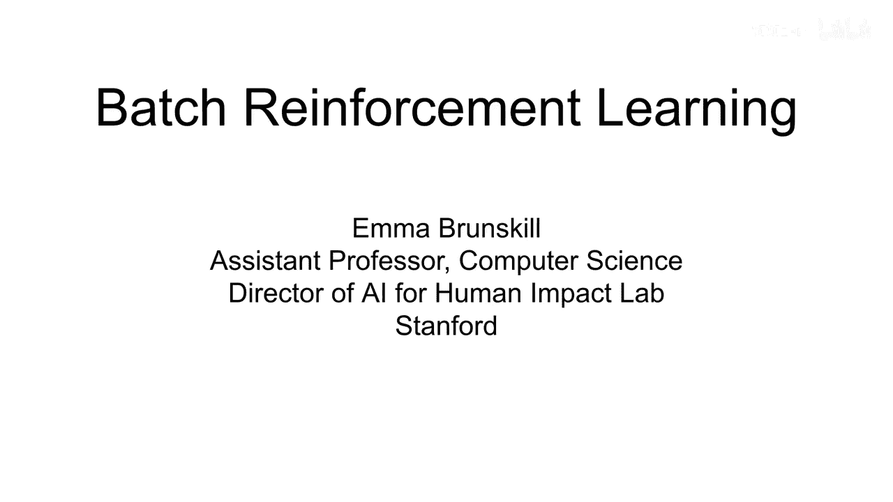
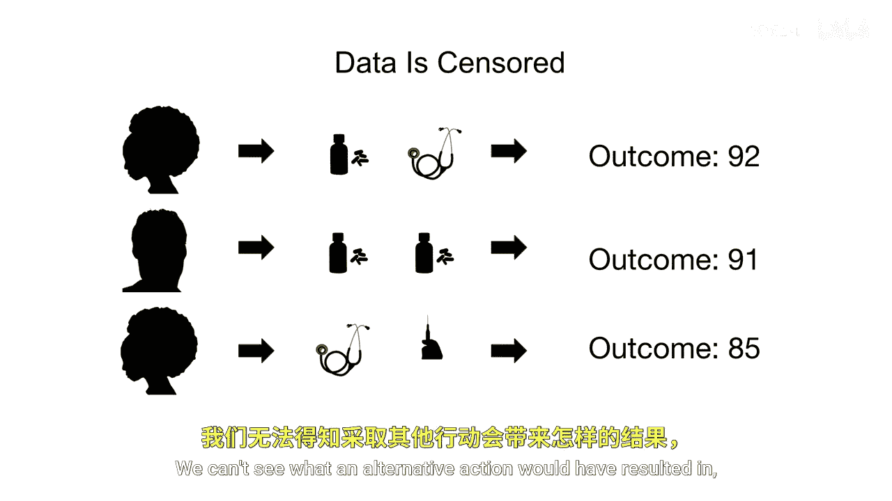
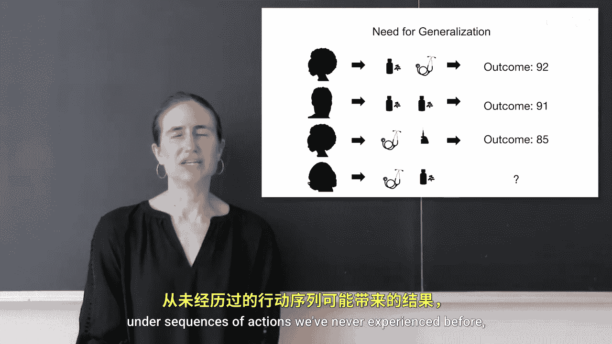
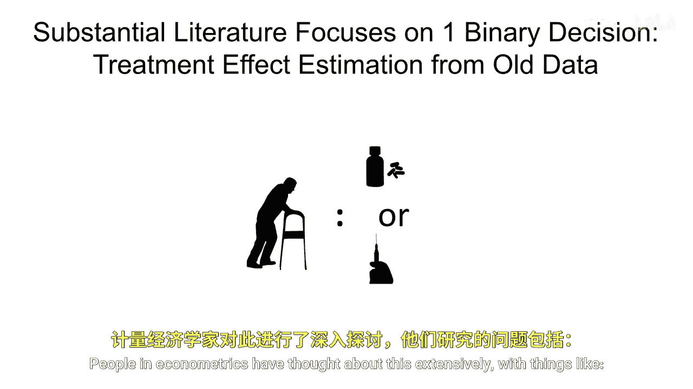
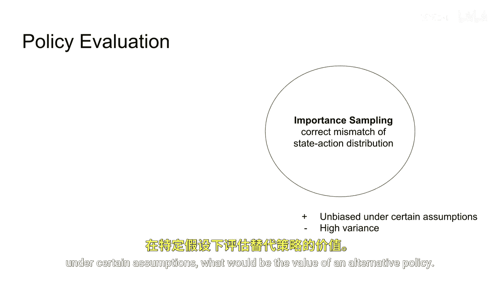
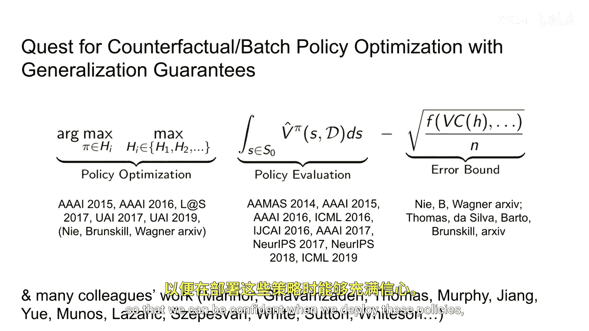

# 050：批量强化学习 🧠

在本节课中，我们将学习**批量强化学习**的核心概念。这是一种利用历史数据来学习新策略的方法，尤其适用于无法进行大量在线交互的场景，例如教育或医疗领域。

大家好，我是艾玛·布伦斯基尔，斯坦福大学计算机科学系的助理教授。我的研究方向是高风险场景下的强化学习，尤其关注那些有望造福社会的应用。

我今天要和大家讨论的主题是批量强化学习。

在开始之前，我想先讲一个有趣的故事作为引子。在20世纪80年代，美国有一家名为A&W的快餐连锁店，试图与麦当劳的“四分之一磅”汉堡竞争。他们推出了“三分之一磅”汉堡，口味测试结果很好，牛肉品质也不错。然而，产品上市后却失败了。尽管“三分之一磅”汉堡的价格与“四分之一磅”汉堡大致相当，但顾客认为他们得到的牛肉更少，因为“三”小于“四”。

这个故事说明了数学教育的重要性。当我开始思考强化学习及其对社会应用的潜力时，教育成为了一个极具吸引力的例子。我和我的同事以及研究生们一起，思考如何能更好地教授分数知识，希望找到一种既吸引人又高效的教学方式。

你现在看到的这个游戏叫做“折射”，已有数十万学生玩过。但我们面临的一大挑战是：如何设计一系列活动，既能保持学生的参与度和积极性，又能确保他们真正学到知识。

我们可以将此视为一个决策策略问题：根据学生迄今为止与游戏的互动序列，我们应提供什么下一个活动，以最大化我们所关心的某个结果（奖励函数）。这个奖励函数可以是学生的坚持程度，或者是他们的学习量。

在我们的案例中，这些是可选的学习环境，因此我们非常关注如何最大化学生的坚持度。大约五年前我们开始思考这个问题，这让我对今天要简要介绍的问题产生了浓厚兴趣。

但我想强调，我绝不是第一个思考将强化学习应用于造福社会的人。实际上，从强化学习的起源（可以追溯到20世纪40年代的**多臂老虎机**问题）开始，就有一条并行的脉络在思考如何用强化学习帮助人类，从早期的“教学机器”到后来的“适应性临床试验”等。

我认为这在社会影响方面非常令人兴奋，但也为强化学习带来了许多基础性问题。特别是，当前强化学习取得的一些非凡成功，往往集中在机器人或游戏等领域。在这些场景中，我们通常可以访问模拟器进行尝试，即使智能体长时间学习失败，只要最终能学会，我们就满意了。

相比之下，在涉及与人交互的领域中，我们目前还没有很好的人类学习或行为模拟器。这意味着我们必须依赖真实数据，但这也带来了挑战，因为收集真实数据涉及与真人互动，我们必须谨慎对待。

因此，我和我的学生们在实验室里思考的一个关键问题是：如何开发强化学习技术，以尽量减少智能体学习所需的数据量？以及任何智能体要做出良好决策所需信息量的基本极限是什么？我认为，如果我们能回答这些问题，不仅能在强化学习的基础层面取得进步，还能帮助更多的人。

首先，我想简要回顾一下**马尔可夫决策过程**的背景知识。大家应该已经熟悉状态、动作、下一状态、动态模型和奖励等概念。

今天我们要思考的是**反事实**情况。我们将从过去的数据中学习，这些数据可能来自某个特定的行为策略，我们想利用这些数据来制定未来更好的决策。

这是一个充满挑战的问题，原因有很多，特别是它涉及到**反事实推理**。你可以想象，我们有一个智能体在过去做出了一系列决策并得到了一些结果，而且它可能不止一次地这样做。

挑战之一在于，你永远无法知道如果你现在不看这个视频，你的生活会是什么样子——那是一个反事实，你永远无法体验它。因此，当我们试图利用旧数据来思考未来做出不同、更好的决策时，这是一个关键挑战。

具体来说，就像在多臂老虎机中一样，我们面临**数据截断**问题：我们无法看到替代动作会带来什么结果，无法获得那些本应得到的奖励。即使在多臂老虎机中，这也是一个挑战。但当我们考虑使用旧数据进行强化学习时，我们实际上还面临一个额外的挑战：**泛化**问题。

如果你考虑一个智能体不是做一次决策，而是做一系列决策，那么策略的组合可能性会随着决策**时间步长**的增加而急剧增加。

因此，如果我们希望从过去的数据中泛化，去思考我们从未经历过的动作序列可能会发生什么，我们就需要某种泛化的方法。

现在，我们中有很多人对“如何利用旧数据做出未来更好的决策”这个问题感到兴奋。这与**因果推理**和**反事实推理**等领域密切相关。这些领域在统计学、流行病学和其他计算机科学领域有着悠久的历史。但近年来，人们非常热衷于尝试将这些思想与机器学习方法和强化学习相结合，以产生更大的影响。

我认为，我们许多人都非常希望能够进行所谓的**反事实强化学习**或**批量强化学习**。我们获取旧数据，从中学习一个新策略，并且能够知道这个策略在未来部署时的价值。这既涉及**策略评估**（我们评估替代策略好坏的能力），也涉及**策略优化**（我们在可能的策略集合上取最大值或最优值）。

我想先简要谈谈策略评估问题。需要指出的是，有大量文献研究这个问题，在其他领域常被称为**处理效应估计**。计量经济学领域的人们通过思考“如何评估一个治疗方案是否优于对照决策”等问题，对此进行了广泛研究。

然而，当我们考虑序列决策时，我们又遇到了挑战。

这是一篇来自我同事们的近期优秀论文，它说明了当我们开始使用旧数据尝试制定新决策时出现的一些挑战。

具体来说，假设你有一组以特定方式治疗过的病人，现在你想考虑一种特定的治疗序列。随着我们做出决策（例如选择是否给病人使用呼吸机或镇静剂），那些接受过特定干预序列或特定动作序列的先前病人的数量会变得非常少。因此，即使我们一开始有相当大量的数据（比如十万名病人，这是一个合理的数字），最终可能只有几百名病人实际接受了与我们想要评估的策略相匹配的治疗。

本质上，我们可以将此视为**协变量偏移**的挑战。当我们有不同的策略时，这些策略通常会采取不同的动作，而这些不同的动作会导致不同的状态分布。我们真正需要思考的是，在我们预期会遇到的那些不同的状态和动作分布下，会产生什么样的奖励结果。

为了应对这种**分布不匹配**的问题，一个重要工具是**重要性采样**。作为复习，在重要性采样中，我们可以将一个策略的价值视为观察到特定轨迹的概率（这里我考虑的是有限时间步长的情况）。我们可以考虑生成特定状态和动作轨迹的概率，乘以该特定轨迹的奖励，然后对所有可能接收到的轨迹进行平均。

重要性采样允许我们使用从不同策略生成的数据，并对其进行重新加权，从而得到正确的期望值。其中一个美妙之处在于，我们实际上不需要知道世界的动态模型，因为世界的动态模型在分子和分母中是相同的，所以会相互抵消。

自这种方法被引入强化学习以来，这个领域出现了许多令人兴奋的工作。它是策略评估的关键工具，因为我们可以用它来利用现有的旧数据，并在某些假设下评估替代策略的价值。

现在我想指出，使用重要性采样进行策略评估也存在一些挑战。

重要性采样为我们提供了一个**无偏估计量**，但通常可能具有非常高的**方差**。事实上，在我们之前的一些工作中，我们说明了方差有时会随着时间步长呈指数级增长。这意味着如果我们没有大量数据，或者时间步长很长，这些估计量可能对未来新策略的表现做出非常差的近似。

另一种方法是使用**参数化模型**，就像在MDP规划部分听到的那样。这些模型可能存在**偏差**，因为我们使用的函数近似器或选择的模型规格可能不正确，与数据生成的真实世界不匹配。但作为回报，它们可以具有非常低的方差。因此，过去几年一个令人兴奋的创新是**双重稳健估计量**的思想。这个思想源于统计学，在过去十年中被引入到强化学习和老虎机问题中。其核心思想是结合基于模型的估计量和重要性采样的优点，以获得更低的方差和更低的偏差。

因此，这是我们尝试进行策略评估的一种方式。我们真正想做的是在此基础上进行**策略优化**。我们近期的研究表明，我们可以利用重要性采样这类思想，来实际制定未来更好的决策。

这里我展示了一个来自**CartPole**环境的示例。底线显示了当前行为策略的好坏。通过使用基于重要性采样的先进技术，我们实际上可以进行策略优化，并学习到比用于收集数据的策略好得多的策略。我认为，通过使用这类技术可能带来的性能提升，是非常令人兴奋的。

我认为这只是第一步。关于如何真正解决这个问题，特别是在我们希望对性能有正式保证的情况下，还有大量的增长空间和开放性问题。在我的实验室里，我们做了很多关于策略评估、策略优化以及尝试推导正式界限的工作，以便在部署这些策略时能有信心。我的同事们在这些领域也正在进行许多非常令人兴奋的工作。

所以我认为我们还有很长的路要走。但在结束之前，我想给出一个乐观的理由。如果我们回到一开始提到的“折射”游戏例子，我们的目标是利用大约11,000名学生的旧数据，找出是否有更好的教学方法来保持学生的参与度。

我们使用了一种基于重要性采样的方法，得到了一个我们认为能将坚持度提高约30%的策略。我们随后对另外2000名学生进行了研究，发现坚持度确实提高了约30%到32%。

因此，我认为这非常令人兴奋，它证明了有时我们可以用这类方法准确预测未来，并且我们真的可以带来改变。谢谢。

---

**本节课总结**

在本节课中，我们一起学习了**批量强化学习**的核心概念。我们了解到，这是一种利用历史数据（通常来自旧的行为策略）来学习新策略的方法，尤其适用于无法进行大量在线实验的领域（如教育、医疗）。我们探讨了其中的关键挑战：**反事实推理**、**数据截断**和**泛化**问题。我们介绍了**重要性采样**作为策略评估的重要工具，它能处理数据分布不匹配的问题，但也存在高方差的挑战。我们还提到了结合模型与重要性采样的**双重稳健估计量**，以及如何利用这些方法进行策略优化。最后，通过一个教育领域的成功案例，我们看到了批量强化学习在实际应用中创造积极影响的潜力。