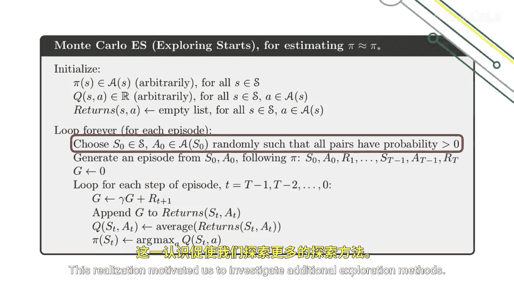
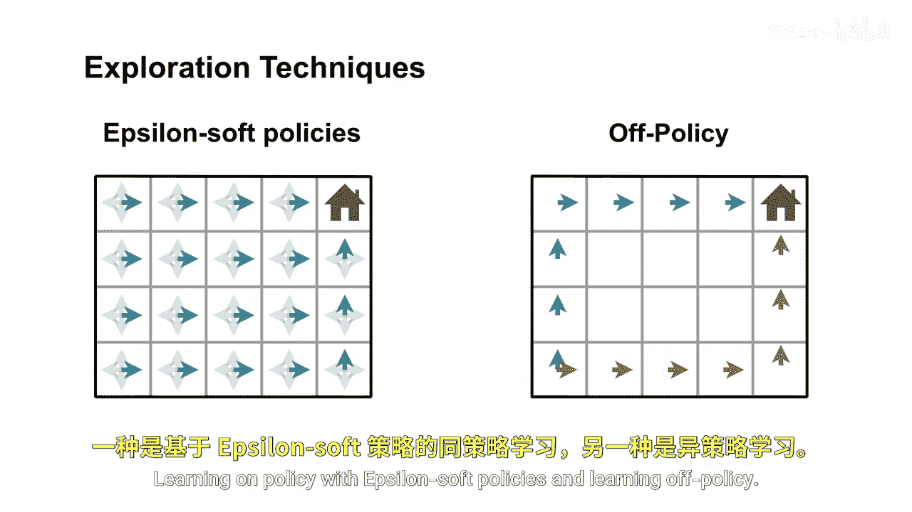
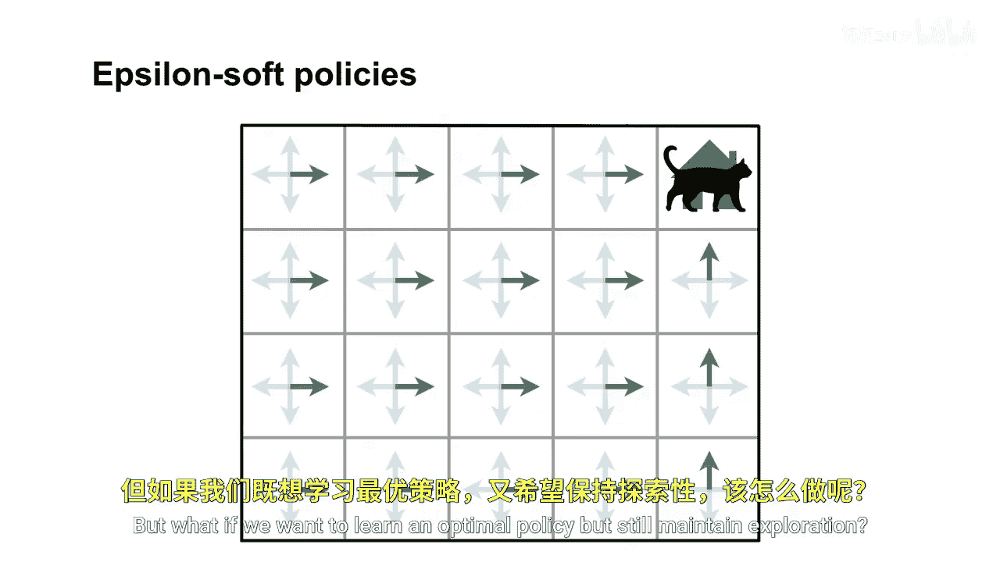
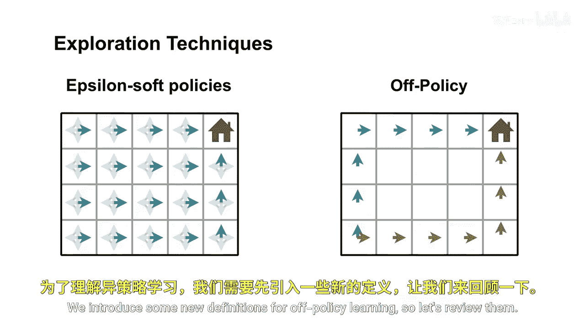

# 051：第一周总结 🎯

在本节课中，我们将对第一周关于蒙特卡洛方法的学习内容进行回顾与总结。我们将梳理从价值函数估计到探索策略的核心概念，并明确不同算法之间的区别与联系。

---

恭喜你完成了第一周课程的学习。

本周的核心内容是利用从环境中获得的经验来估计价值函数并寻找最优策略。

我们学习了同策略和异策略的蒙特卡洛方法，并重新审视了多臂老虎机中的探索问题。

现在，让我们回顾一下目前学过的材料。

## 蒙特卡洛算法回顾

蒙特卡洛算法是基于样本的方法。当环境模型未知或难以建模时，可以使用这类方法。

蒙特卡洛算法通过对多个观察到的回报进行平均来估计价值函数。它们需要等待一个完整的回报序列结束后才更新价值估计。因此，**蒙特卡洛方法仅适用于分幕式马尔可夫决策过程**。

我们讨论了蒙特卡洛方法如何应用于广义策略迭代框架。这引出了我们的第一个基于样本的控制算法：**带探索性开端的蒙特卡洛控制**。

与动态规划不同，蒙特卡洛算法不会遍历整个“状态-动作”空间。因此，它们需要一个探索机制来确保能够学习到每一个“状态-动作”对。

## 探索策略的演进

我们首先考虑了“探索性开端”。这种方法要求每个幕开始时，第一个状态和动作都是随机选择的。然而，探索性开端并非总是可行或安全的。例如，很难想象在自动驾驶汽车上使用这种方法。

这一认识促使我们去研究其他的探索方法。

我们介绍了解决探索问题的另外两种策略：**使用ε-软策略的同策略学习**和**异策略学习**。

### 同策略：ε-软策略

对于第一种策略，智能体遵循并学习一个随机策略。它大部分时间采取贪婪动作，但有一小部分时间会随机选择动作。通过这种方式，所有“状态-动作”对的价值估计都能随着时间的推移持续得到改进。这种同策略方法迫使我们学习一个**接近最优的策略**，而非绝对最优的策略。

那么，如果我们既想学习最优策略，又想保持探索性，该怎么办呢？

### 异策略学习

答案在于异策略学习。我们为异策略学习引入了一些新的定义，现在来回顾一下。

*   **行为策略**：智能体用来选择动作的策略。
*   **目标策略**：智能体在其价值函数中学习的目标策略。

通过设定一个合适的、具有探索性的行为策略，智能体可以学习任何确定性的目标策略。

一种在遵循一个策略的同时学习另一个策略的方法是使用**重要性采样**。重要性采样允许智能体根据从行为策略下采样的经验，来估计目标策略下的期望回报。

重要性采样比率对样本进行重新加权。它增加了在目标策略 `π` 下更可能出现的回报的重要性，并降低了那些不太可能出现的回报的重要性。样本平均值有效地包含了每个回报的正确比例，使得在期望上，**这些回报就像是从目标策略 `π` 下采样得到的一样**。

---

本节课中，我们一起学习了蒙特卡洛方法的核心思想及其在无模型强化学习中的应用。我们比较了同策略与异策略学习的区别，并深入探讨了重要性采样这一关键技术，它使得从行为策略的经验中学习目标策略成为可能。

本模块的内容到此结束。接下来，我们将讨论强化学习中最基本的概念之一：**时序差分学习**。下次见。