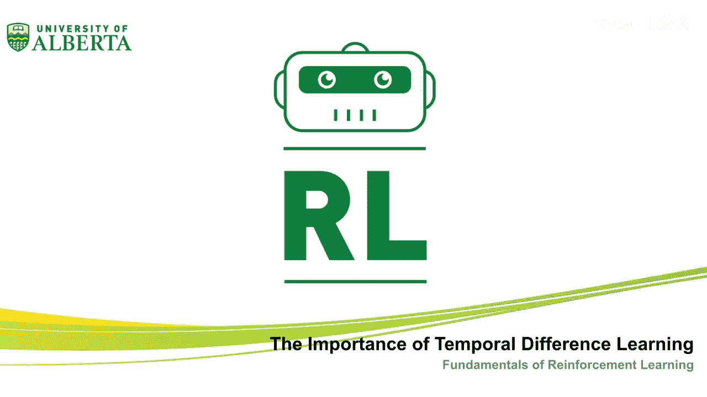

# 053：理查德·萨顿论时序差分学习的重要性 🧠

在本节课中，我们将学习理查德·萨顿教授关于时序差分学习重要性的核心观点。时序差分学习是一种专门用于预测学习的方法，被认为是本世纪人工智能领域最关键的技术之一。

我的名字是理查德·萨顿。我是一名科学家，一生都在研究强化学习。我在阿尔伯塔大学和DeepMind Alberta工作。我的名字拼写是SUTTON，理查德·S·萨顿。今天我来讲述时序差分学习的重要性。

时序差分学习是一种专门用于预测学习的方法。这使其成为本世纪人工智能领域最重要的事物。我们知道，我们专注于那些能随计算能力扩展的方法。近年来，计算能力大幅提升，因此这些方法的影响力也大得多。在各种学习类型中，最能彻底、最广泛地随计算能力扩展的，就是预测学习。预测学习意味着你试图预测接下来会发生什么。你做出一个预测，然后等待并观察实际发生的情况，接着根据结果进行学习。由于你只需要等待，因此不需要训练数据集，也不需要人们做大量准备工作。学习预测是**最具扩展性**的学习类型。

时序差分学习是一种专门为学习预测而设计的学习方法。那么，预测学习有什么特别之处呢？首先，时间在流逝，你会做出一系列预测。在每个时刻，你都会做出一个又一个预测。然后，当你知道实际发生了什么时，你就得到了所有这些预测的正确答案。为了处理这种时间结构带来的影响，你需要专门的学习规则，这就是我们有时序差分学习的原因。

现在，我相信你已经学习或听说过监督学习方法。监督学习意味着有某种“监督者”告诉你正确答案是什么。在学校里可能会发生这种情况，但在正常生活中，并没有监督者或指导者告诉我们该做什么。然而，在预测学习中，我们确实有“监督”。你做出预测，然后只需等待，就会发现发生了什么。这非常特别。

你可能会说，预测学习是**有监督的**，因为你等待并发现了结果，这指导了你。但你也可以说它是**无监督的**，因为你不需要一个监督者，你只是等待，并通过事件的自然进程发现了你应该说什么。因此，我有时喜欢认为预测学习是**无监督的监督学习**。

请记住，时序差分学习是一种专门用于**多步预测学习**的方法。关于监督学习，我还想再说一点。你可能经常听到监督学习被描述为预测学习，在某种意义上确实如此。但在最重要的意义上，它不是。监督学习是你做出预测，然后被告知答案是什么，而不是你实际必须等待观察会发生什么。监督学习完全基于训练集。而预测学习在一种特殊情况下——即你只尝试预测一步时——你可以将其视为传统的监督学习问题：做出预测，等待一步，看到结果。然而，我们的大多数预测都不是一步预测。一步是什么？一步可能被认为是十分之一秒。当然，我们会在十分之一秒的尺度上做预测，但在我们的生活中，**长期预测**更为重要。因此，预测学习和时序差分学习是一种重要的学习类型。

你可能会预期，这种学习方式可能出现在自然系统、动物和人类中。这几乎是我们人工智能领域发展的附带产物，但确实如此：时序差分学习在动物学习理论，特别是奖励系统理论中扮演了主要角色。时序差分模型现在是大脑奖励系统的标准模型。我们可以在大脑中观察到与**时序差分误差**对应的信号，这些信号驱动着学习，正如时序差分学习模型所预测的那样。

你可能听说过多巴胺。在哺乳动物中，传递时序差分误差信号的物质就是多巴胺神经递质。在其他动物中，则是不同的递质。例如，在蜜蜂中，携带时序差分误差的信号被称为章鱼胺，但本质是相同的。即使在动物、昆虫、哺乳动物、灵长类动物，甚至海蛞蝓这些非常不同的系统中也是如此。

我想再多说一点关于工程学或人工智能学习模型与自然学习系统的心理学模型之间的关系。这种联系可能被过度解读，但我仍然为时序差分学习在人工智能和心理学、神经科学中都是一个严肃而重要的话题感到自豪。因为它在这些各自独立的领域中都因其领域内成功所依据的**完全不同**的标准而受到重视。在人工智能领域，我们推崇时序差分学习，因为它是一种强大且广泛适用的学习方法。在神经科学领域，他们推崇时序差分学习，因为它能准确建模和预测动物行为。

所有这些的核心都是预测学习。**预测学习是人工智能的关键**。预测学习是最重要的单一学习类型。而时序差分学习是一种专门的方法，它利用了学习预测所具有的**时间结构**优势。

非常感谢。还有一些材料。

---

**本节课总结**

在本节课中，我们一起学习了理查德·萨顿教授阐述的时序差分学习的重要性。我们了解到：
*   时序差分学习是专门为**预测学习**设计的方法。
*   预测学习因其只需等待观察结果，无需人工标注数据，是**最具扩展性**的学习范式。
*   时序差分学习通过利用预测问题中的**时间结构**，能高效处理多步预测。
*   这种方法不仅在人工智能领域至关重要，其原理也与大脑中基于多巴胺的**奖励学习机制**相吻合，在神经科学和心理学中得到了验证。
*   预测学习可以被视为一种**无监督的监督学习**，是连接人工智能与自然智能学习原理的关键桥梁。