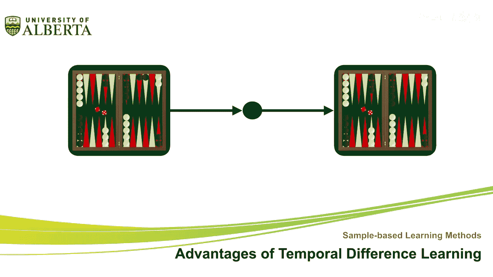

**强化学习专项课程：P54：时序差分学习的优势**

在本节课中，我们将学习时序差分学习方法，并重点探讨其相较于动态规划和蒙特卡洛方法的独特优势。我们将通过一个日常生活中的例子来直观理解这些优势。

---

在上一节视频中，我们介绍了时序差分学习。TD方法巧妙地结合了动态规划和蒙特卡洛方法的核心思想。与动态规划类似，TD方法使用**自举**。与蒙特卡洛方法类似，TD可以直接从经验中学习。这种结合产生的效果比单独使用任何一种方法都更强大。

通过本节学习，你将能够理解使用TD进行在线学习的益处，并识别TD方法相对于动态规划和蒙特卡洛方法的关键优势。

---

让我们考虑一个下班开车回家的例子。每天你都会预测到家需要多长时间。你的预测基于时间、星期几、天气和其他因素。假设你已经多次开车回家，对于从途中可能遇到的各种情况到家所需的时间，你有一个不错的估计。

让我们来看一次回家旅程的估计值。一天晚上，你离开办公室时，预测需要30分钟到家。大约5分钟后，你驶出停车场，注意到正在下雨。雨天交通较慢，因此你估计从此刻起还需要35分钟。又过了15分钟，你比预期更早地驶出高速公路，并估计现在还需要15分钟到家。旅程进行到30分钟时，你被一辆慢速卡车挡住，预测还需要额外10分钟。10分钟后，你驶入家所在的街道，通常从这里到家需要3分钟。3分钟后，你到家了。

圆圈中的数字代表我们对剩余驾驶时间的预测。我们如何改进这些预测呢？为了理解如何更新预测，我们需要指定奖励。让我们使用所花费的时间作为奖励。你花了5分钟驶出停车场，我们可以给这个转移标上奖励值5。你又花了15分钟驶出高速公路，依此类推。你预测需要30分钟到家，但实际上花了43分钟。或许你可以从这次经历中学习。

---

首先，我们来看一种蒙特卡洛方法，具体来说，我们将使用alpha等于1的恒定alpha蒙特卡洛方法。在蒙特卡洛方法中，你将估计值更新朝向**回报**，而回报只有在回合结束时才可获得。只有当我们到家后，才能更新每个状态的估计值。

我们可以从离开办公室时开始。从办公室出发，你总共花了43分钟到家。因此，在时间零点的回报是43。由于alpha为1，我们将估计值完全移向实际回报。从你驶出停车场时起，你花了38分钟到家，我们相应地更新估计值。我们以同样的方式更新剩余状态的估计值。

但是，在学习开始之前，真的有必要等到最终结果已知吗？

---

让我们重置时钟，看看如何使用TD进行更新。从办公室出发，你花了5分钟驶出停车场，从那里你做出了35分钟的预测。根据退出状态，你可以更新办公室的估计值。

你从办公室的当前估计是30分钟。你获得了5的奖励。下一个状态的值是35。因此，我们将估计值更新为40分钟。

让我们考虑下一个状态。你的当前估计是35分钟。从停车场到驶出高速公路，你花了15分钟。当你驶出高速公路时，到家的估计时间也是15分钟。因此，我们将驶出停车场时的估计剩余时间减少到30分钟。这是合理的，因为我们比预期更早地驶出了高速公路。

我们类似地更新剩余状态的估计值。在我们回家的路上，我们可以**在线学习**，而无需像蒙特卡洛方法那样等待知道最终结果。

---

现在，让我们总结使用TD的优势。

*   **无需环境模型**：与动态规划不同，TD方法不需要环境的模型，它们可以直接从经验中学习。
*   **在线更新**：与蒙特卡洛不同，TD可以在每一步进行更新。自举允许我们基于其他估计来更新当前估计。
*   **收敛性**：TD渐近地收敛到正确的预测。此外，TD方法通常比蒙特卡洛方法收敛得更快，我们将在下一个视频中看到一个例子。

---

在本节课中，我们一起学习了时序差分学习的优势。我们通过一个开车回家的例子，对比了蒙特卡洛方法和TD方法的更新过程，直观地理解了TD能够进行在线、增量式更新的特点。最后，我们总结了TD方法相对于动态规划和蒙特卡洛方法的核心优势：无需模型、在线学习以及更快的收敛速度。