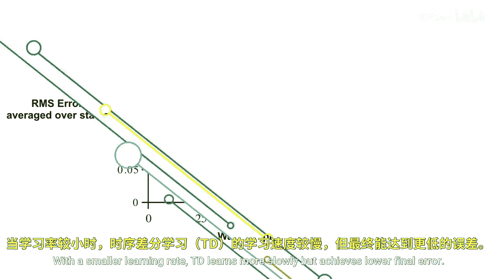

# 055：时序差分与蒙特卡洛方法对比

在本节课中，我们将深入比较时序差分学习与蒙特卡洛方法。通过一个精心设计的实验，我们将直观地展示两种方法在估计价值函数时的差异，并帮助你理解时序差分学习的经验优势。

## 实验环境介绍 🧪

在之前的视频中，我们介绍了时序差分方法，并讨论了它相对于动态规划和蒙特卡洛方法的优势。

本节中，我们将通过一个科学实验来更深入地比较时序差分和蒙特卡洛方法。

考虑一个简单的马尔可夫决策过程。我们有五个非终止状态。在每个状态，我们有两个确定性动作：向左和向右。我们的目标是评估一个均匀随机策略，并估计其价值函数。

所有片段都从状态 C 开始。片段在左侧或右侧终止。所有状态转移的奖励都是零，除了在右侧终止时奖励为 +1。

我们将此问题的折扣因子设为 1。此时，价值具有直观的含义：每个状态的价值是从该状态出发，最终在右侧终止的概率。

起始状态 C 的价值是 0.5。这意味着从中心开始随机游走，有50%的概率在右侧终止。这很合理。

## 实验设置 🤖

我们在幻灯片顶部标注了MDP的真实价值。我们的智能体（一个可爱的小机器人）将使用时序差分方法来估计价值函数。在底部，另一个智能体使用蒙特卡洛方法。

我们将两个智能体的近似价值函数初始值都设为 0.5。

## 第一轮片段分析 🔍

让我们观察两个智能体在第一个片段中的表现。

请注意，时序差分智能体只更新了状态 E 的价值。要理解这一点，可以考虑从状态 C 到 D 的转移。时序差分误差等于转移的奖励，加上下一个状态 D 的价值，减去状态 C 的价值。

由于这是一个非终止转移，奖励为零。状态 C 和 D 的价值都是 0.5，因此时序差分误差为 0，我们不对 C 的估计值进行任何更改。

除了从状态 E 进入终止状态的转移外，每一步都发生同样的情况。

相比之下，蒙特卡洛智能体更新了机器人在该片段中访问的所有状态的价值。

## 后续片段与渐进性能 📈

让我们观察下一个片段。注意在片段中价值是如何更新的。

最终，时序差分智能体在每一步都进行了价值更新。相比之下，蒙特卡洛智能体等到片段结束后才进行更新。

让我们再看几个片段。时序差分智能体的价值估计似乎正在向真实价值移动。

这个过程耗时较长，让我们直接跳到后面评估其渐进性能。

我们绘制了学习过程中几个时间点的估计价值。X 轴代表 MDP 中的每个状态。Y 轴代表估计价值。图中也标出了真实价值和初始价值估计（回忆一下，我们将其初始化为 0.5）。

红色曲线显示了第一个片段结束后的学习价值。正如我们讨论过的，在第一个片段结束时，时序差分方法只更新了一个状态的价值。

100 个片段后的估计值已经接近它们能达到的最佳水平。记住，我们使用了恒定的步长 0.1。这意味着价值会根据最近片段的输出而波动。如果我们使用更小的学习率，或者更好的衰减学习率，我们可能会得到更好的估计。

## 性能比较：时序差分 vs. 蒙特卡洛 ⚖️

一个很自然的问题是：时序差分学习是否比蒙特卡洛更快？

让我们在我们的示例问题上比较时序差分和蒙特卡洛的性能。这里，X 轴代表片段数量。Y 轴代表价值函数与学习估计值之间的均方根误差。

红色学习曲线代表了蒙特卡洛方法在几个不同 alpha（学习率）值下的性能。每条曲线是超过 100 次独立运行的平均值。例如，这个点代表了学习率为 0.01 时，经过 50 个片段后达到的平均误差。

现在让我们看看时序差分的性能。我们看到时序差分的表现始终优于蒙特卡洛。

让我们更仔细地观察。注意，学习率为 0.15 时误差下降更快，但最终导致更高的最终误差。使用较小的学习率时，时序差分学习速度较慢，但能达到更低的最终误差。

## 总结 📝

本节课中，我们一起进行了一个严谨的实验来比较时序差分和蒙特卡洛方法。

实验结果表明，在这个特定问题中，时序差分方法收敛更快，并且能达到更低的最终误差。

我们下次再见。