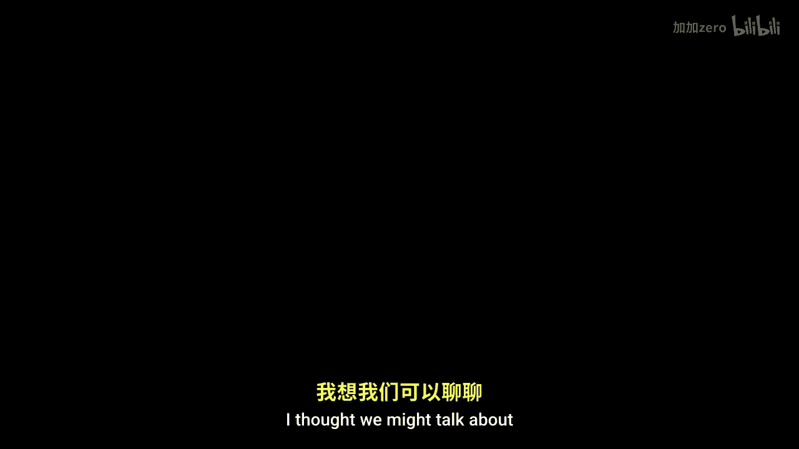

# 056：安迪·巴托与理查德·萨顿访谈补遗

在本节课中，我们将回顾强化学习领域的早期发展历程，了解它如何从一个不被重视的概念演变为今天的热门学科。我们将跟随两位先驱者——安迪·巴托和理查德·萨顿的对话，探索该领域形成过程中的关键转折点、核心思想的演变，以及他们坚持研究的内在动力。

## 早期研究的开端

上一节我们介绍了本次访谈的背景，本节中我们来看看强化学习作为一个独立研究领域是如何被确立的。

当最初决定将强化学习作为一个独立的研究领域时，我们并未立即获得广泛认可。我想谈谈那些早期岁月，因为其中发生了一些引人注目的事情。

理查德是我的第一个研究生。哈里·克洛什在麻省大学签订了一份合同，旨在研究他关于“享乐主义神经元”的假说是否有意义，因此我被聘为博士后。根据迈克尔（另一位首席研究员）后来发表的回忆录所述，哈里要求他们必须聘用我，否则他们将无法获得资金支持。

## 互补的研究风格

我认为我们合作如此成功的一个原因是，我天性**风险规避**，而理查德是**风险寻求**型的人。他敢于与鲨鱼共泳，这与我截然不同。风险寻求意味着你不愿随大流，这解释了为何在强化学习变得如此流行时，你几乎不会亦步亦趋。我选择进入一个正交（不同）的方向，仅仅是因为我无法跟上主流领域的文献，所以寻找一个覆盖稀疏的领域以便做出贡献。不过，既然我已经退休，目前并未朝任何正交方向前进。

我对大家目前在强化学习领域所做的工作感到惊叹。我很庆幸不必身处工业级强化学习研究的激烈竞争之中。现在有大量有趣的论文涌现，但我并未完全跟进。

## 领域形成的挑战与坚持

我想讨论的是，这种风险寻求的特质促使你离开了终身教职岗位，去研究一个当时不受欢迎的领域。我不建议任何人离开一个稳定的职位去研究冷门领域，所以我知道你并不认为这是风险寻求，但我认为任何其他普通人都会这么看。你只是想追求你认为重要的事情。

实际上，我更想谈谈这个领域本身。当时，整个领域对学习感兴趣，但并非强化学习，而是**监督学习**。在60年代的第一波神经网络和机器学习浪潮中，研究转向了监督学习。50年代的早期研究者讨论过类似奖励的概念，但最终却研究起了监督学习。

这种现象在历次浪潮中反复出现。总有新事物出现，但总存在一点监督学习与强化学习的较量。我曾在当前文献中看到，一些资深学者误解了**误差修正**与**试错学习**之间的区别。这种误解贯穿了整个历史，贯穿了早期的三次浪潮。

我们当时受命评估哈里的想法是否值得研究。我们回溯并审视了一切，发现确实有一些人在进行真正的强化学习研究，但整个领域却聚焦于监督学习。这些区别对当时的人们来说并不清晰，这真是一个重大的发现。我记得我早期的系列讲座就是关于这个主题，强调存在**试错学习**，而非仅仅是监督学习。这确实令人惊讶。

我最近写了一篇AI杂志文章，梳理了其中一些令人惊讶的发现，这（监督学习的主导地位）就像是头号发现。当然，这吸引了我，因为也许我们可以做一些创新性的工作。因为大多数人没有这么做，除了工程领域的随机控制研究者，他们一直在做类似的事情，但人工智能社区并未真正接纳这一点。

我记得我们查阅了所有不同的领域，找不到有谁在研究为了优化某个信号而进行的学习，除了**学习自动机**。但几乎没人知道它，而且它是非关联性的。基本上，文献非常稀少，只有少数关于**多臂赌博机**的工作。这很奇怪，因为这是一种重要的学习类型。现在，我们正在推出该领域的教科书第二版，并开设相关课程，但在1980年，它还不是一个独立的主题。它被淹没、吞噬、掩盖，因为监督学习占据了主导地位。

## 与行为主义的关系

行为主义是当时最不时髦的理论之一。强化学习包含了行为主义的元素，但并非全部。我们认为，人们在拒绝行为主义时，也抛弃了常识性的强化学习原则，这是把孩子和洗澡水一起倒掉了。但即使在今天，它有时被称为“新行为主义”，这令人不快，因为强化学习包含模型、价值函数等概念，这是纯粹行为主义所不允许的。强化学习关注的是头脑中算法内部发生了什么，而纯粹行为主义至少会反对这种不可观察的内部状态。

我从行为主义中学到了很多，它变得不受欢迎实在可惜，许多知识因此丢失。另一方面，这又像给了我一件秘密武器，因为我理解了行为主义者学到的东西，而许多其他人没有费心去学习。**时序差分学习**就来源于此。

## 内在动机与长期坚持

我指的是内在动机，心理学家称之为**内在动机**，即你为了事情本身而做某事，而非为了某种外在奖励。我认为这非常强大。我对此感兴趣是因为我认为，并且仍然认为，这是创造未来可能有用（也可能没用）的技能或“选项”的好方法，就像基础研究一样。基础研究是由内在动机驱动的，无论其是否有直接效用。事实证明，它产生了巨大的效用，但这并非驱动力，这与明确的项目驱动研究不同。我认为动物也会经历一个由内在动机驱动的阶段，它们学习各种技能，变得能够熟练应对世界。然后当它们遇到必须解决的问题时，它们就拥有了可以运用的技能储备，我认为这是一个重要原则。

我认为理查德也对这些现在属于强化学习范畴的议题有着内在动机。对我来说，它们就是有趣。它们有效并带来回报，但这至少对我来说，并非主要的驱动力。

安迪，我们在强化学习领域取得了巨大成功，我只想祝贺你，与你一同庆祝，并给你一个击掌。