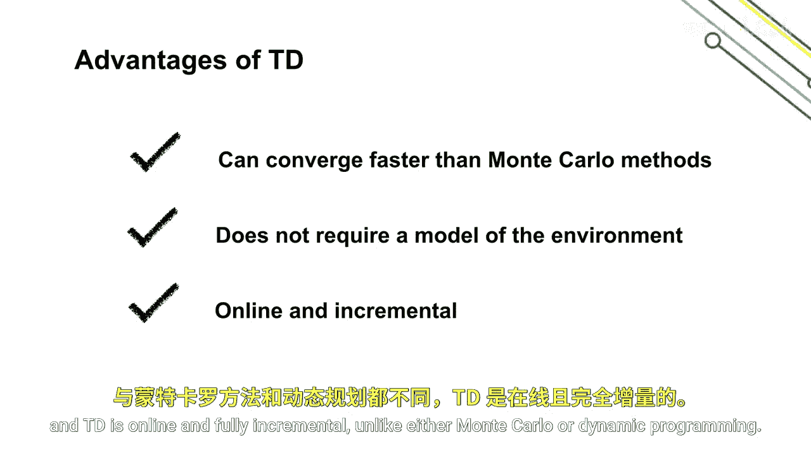

强化学习专项课程：第二周：时序差分学习总结

在本节课中，我们将对第二周学习的时序差分学习方法进行总结。我们将回顾TD学习的核心思想，比较其与动态规划和蒙特卡洛方法的异同，并通过一个预测回家时间的例子和一个随机游走实验来加深理解。

上一节我们介绍了蒙特卡洛方法，本节中我们来看看如何结合动态规划和蒙特卡洛的优点，形成时序差分学习。

### 🎯 TD学习的核心：自举法

TD学习借鉴了动态规划中一个重要的概念——**自举法**。TD更新朝着一个“自举回报”的目标进行。我们可以将时间步T之后的回报，替换为即时奖励加上对下一个状态价值的估计。

用公式表示，TD的更新目标为：
`G_t = R_{t+1} + γ * V(S_{t+1})`
其中，`V(S_{t+1})`是对下一个状态的估计值。

我们说TD是“用一个猜测去更新另一个猜测”，它将其价值估计朝着下一个状态的价值进行自举更新。

### 📊 表格型TD(0)算法

我们讨论了表格型TD(0)算法。这里的核心要点是，TD可以在情节的每一步都更新其价值估计。

以下是TD(0)算法的关键特性：
*   **在线更新**：无需等待整个情节结束。
*   **记忆需求低**：只需记住前一个状态。

### ⚖️ TD与其他方法的比较

那么，TD与蒙特卡洛和动态规划相比如何呢？以下是三者的主要区别：

*   **与蒙特卡洛相比**：TD通常收敛得更快。
*   **与动态规划相比**：TD不需要环境模型。
*   **综合优势**：TD是在线且完全增量的，这一点蒙特卡洛和动态规划都不具备。

### 🔍 TD的预测更新机制

我们学习了TD如何根据接收到的新信息来更新其预测。我们通过预测下班回家所需时间的例子演示了这一点。

我们使用TD在开车回家的每个阶段，持续优化预测的到达时间。预测随着每一步的实际经历而不断调整。

### 🧪 实验：TD与蒙特卡洛在随机游走中的对比

最后，我们进行了一个实验，在随机游走问题上比较TD和蒙特卡洛方法。

以下是实验的主要发现：
*   **TD的更新方式**：在每次状态转移后，TD都会更新价值函数以反映最新信息。
*   **蒙特卡洛的更新方式**：蒙特卡洛仅在每个情节结束时更新其价值函数。
*   **结果**：从长期来看，TD比蒙特卡洛学习得更快，并且达到了更低的最终误差。

### 📝 总结

本节课中我们一起学习了时序差分学习方法。我们了解了TD如何通过自举法结合动态规划和蒙特卡洛的优点，实现了在线、增量式的学习。通过比较和实验，我们看到TD在无需模型的情况下，往往能比蒙特卡洛更快地收敛。在接下来的课程中，我们将基于TD来构建控制算法。