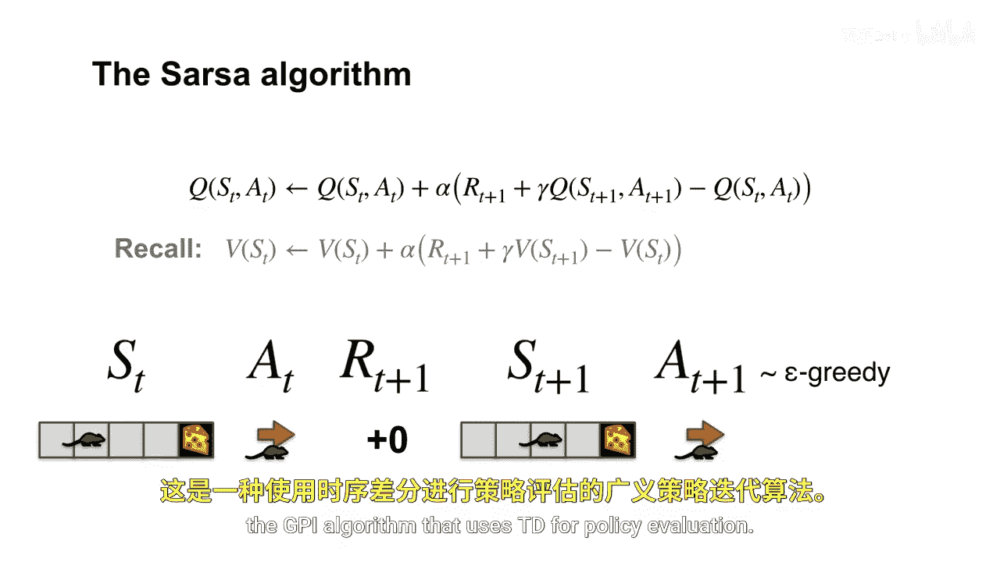
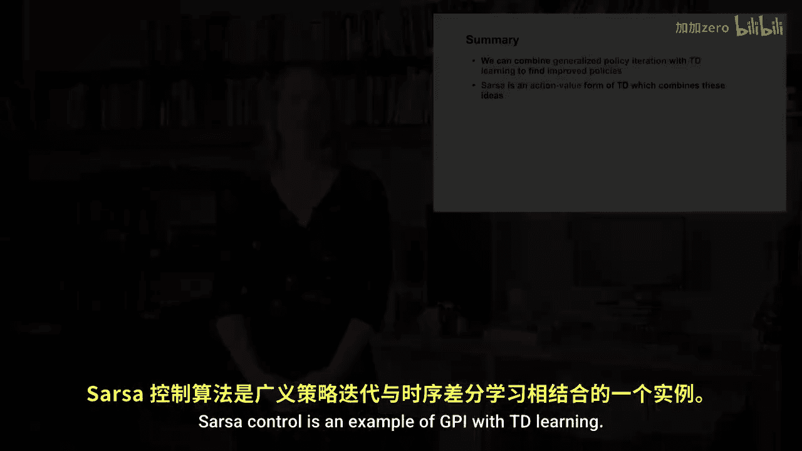

# 058：基于时序差分的SARSA通用策略迭代 🧠

在本节课中，我们将学习如何将时序差分（TD）学习融入通用策略迭代（GPI）框架，并详细介绍SARSA控制算法。我们将从回顾GPI的基本概念开始，逐步过渡到使用TD进行策略评估，最终理解SARSA如何通过每一步的更新来实现策略优化。

## 概述

在之前的课程中，我们讨论了如何使用通用策略迭代来寻找最优策略。我们也介绍了使用时序差分方法来估计价值函数。那么，如果我们在通用策略迭代的策略评估步骤中使用时序差分方法，会是什么样子呢？本节课结束时，你将能够解释如何将通用策略迭代与时序差分结合以寻找改进的策略，并描述SARSA控制算法。

## 通用策略迭代回顾

通用策略迭代结合了两个部分：**策略评估**和**策略改进**。我们看到的第一个采用这种形式的算法是策略迭代。策略迭代在策略改进之前，会运行策略评估直至收敛。

随后，我们看到了结合蒙特卡洛方法的通用策略迭代，它在每个回合结束后执行一次策略评估和改进的循环。

为了更好地记忆结合蒙特卡洛的通用策略迭代，可以想象一只老鼠在一个四状态的走廊里，尽头有奶酪。老鼠最初一无所知，遵循一个随机策略。最终，老鼠会通过随机移动偶然碰到奶酪。在那一刻，老鼠会更新其动作价值函数。然后，它根据其动作价值函数进行策略改进。随着这个过程重复，它最终将学会最优策略。

请注意，结合蒙特卡洛的通用策略迭代在改进之前并不执行完整的策略评估步骤。相反，它在每个回合后进行评估和改进。更进一步，我们甚至可以在仅仅一次策略评估步骤后就改进策略。我们将使用时序差分方法来实现这一点。

## 在GPI中使用TD学习

为了在通用策略迭代中使用时序差分，我们需要学习一个动作价值函数。因此，我们需要看一个与你过去所见略有不同的时序差分版本。

我们不再关注从状态到状态的转移并学习每个状态的价值，而是关注从“状态-动作对”到下一个“状态-动作对”的转移，并学习每个“状态-动作对”的价值。这个算法被称为**SARSA预测**。

让我们更详细地看一下它。

## SARSA预测算法详解

SARSA这个缩写描述了更新中所使用的数据：**状态**、**动作**、**奖励**、**下一个状态**和**下一个动作**。SARSA对“状态-动作对”的价值进行预测。

以下是算法的步骤：
1.  智能体在初始状态选择一个动作，从而创建第一个“状态-动作对”。
2.  接着，它在当前状态下执行该动作，并观察即时奖励 **R_{t+1}** 和下一个状态 **S_{t+1}**。
3.  在SARSA中，智能体在更新其价值估计之前，需要知道下一个“状态-动作对”。这意味着它必须在更新前确定下一个动作。
4.  由于我们的智能体正在为特定策略学习动作价值，它使用该策略来采样下一个动作。

完整的更新公式如下：
`Q(S_t, A_t) ← Q(S_t, A_t) + α [R_{t+1} + γ Q(S_{t+1}, A_{t+1}) - Q(S_t, A_t)]`

这个公式看起来与状态价值的时序差分更新非常相似，只是状态价值 **V(S)** 被替换为了动作价值 **Q(S, A)**。

我们刚刚描述的算法是用于**策略评估**的，它为某个特定的固定策略学习动作价值。然而，得益于通用策略迭代框架，我们可以将其转变为一个**控制算法**。这次，我们将在每个时间步改进策略，而不是在一个回合后或收敛后才改进。

## 从评估到控制：SARSA算法

将SARSA预测嵌入通用策略迭代框架，就得到了SARSA控制算法。其核心思想是：在每一步，我们使用当前的策略（通常是ε-贪婪策略）来采样动作，执行该动作并观察结果，然后使用上述SARSA更新公式来更新动作价值函数 **Q**。紧接着，我们基于更新后的 **Q** 值来改进策略（例如，调整ε-贪婪策略中的贪婪动作选择）。

这个过程在每一步交互中同时进行，实现了评估与改进的紧密交织。

## 总结

本节课中，我们一起学习了如何将通用策略迭代与时序差分学习相结合以寻找改进的策略。SARSA控制算法是结合时序差分的通用策略迭代的一个典型例子。它通过在每一步交互中利用当前策略采样到的“状态-动作-奖励-下一个状态-下一个动作”序列来更新动作价值，并即时改进策略，从而能够在线、增量式地学习最优策略。