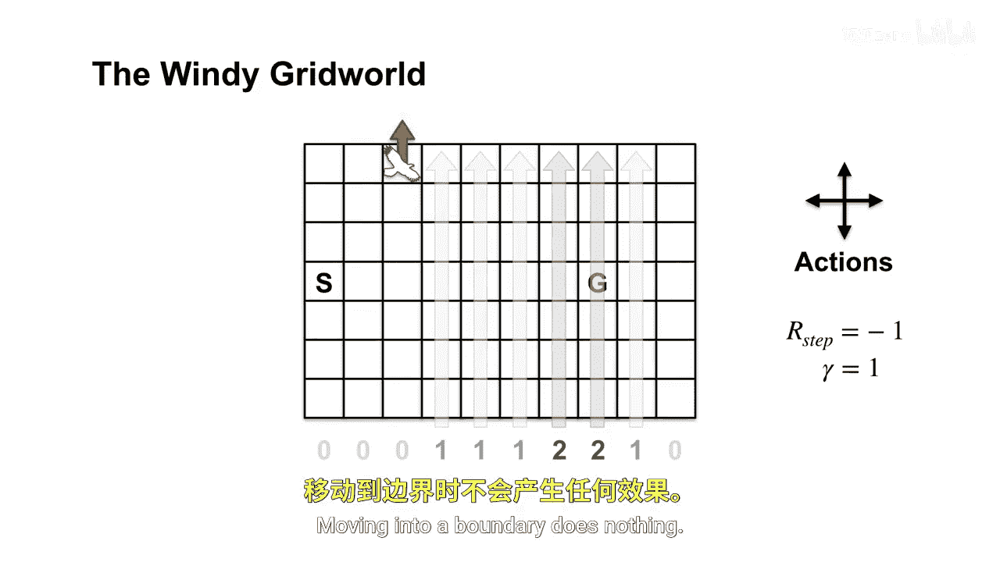
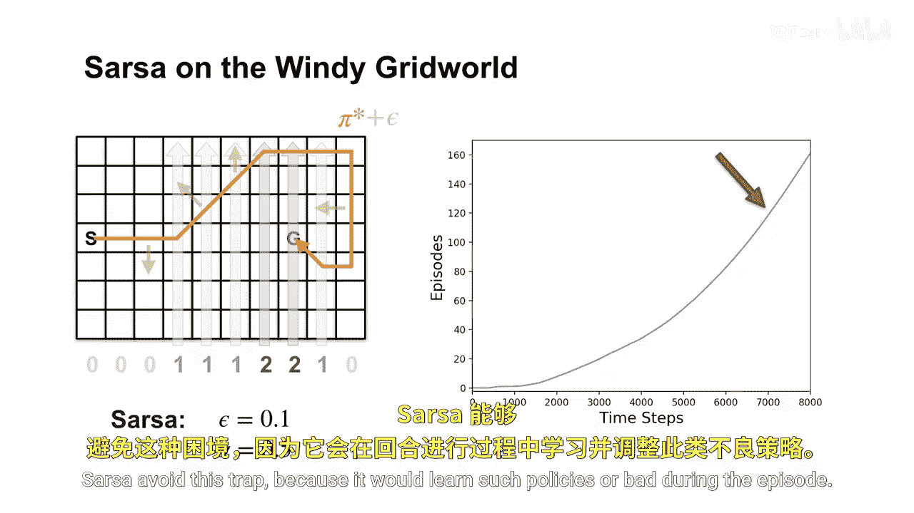

# 059：风世界网格中的SARSA算法

在本节课中，我们将学习SARSA控制算法在一个具体示例——风世界网格中的实际运行过程。通过分析其性能，我们将更好地理解该算法的学习机制。

## 算法回顾与任务引入

上一节我们介绍了SARSA算法的基本概念。本节中，我们来看看该算法在一个名为“风世界”的网格环境中的具体应用。

风世界是一个有特殊规则的网格环境。状态构成一个网格，其中包含一个起始状态和一个终止状态。智能体可以按通常的四个方向移动。每走一步，智能体会收到-1的奖励，这激励智能体尽快找到出口。由于这是一个分幕式任务，折扣因子γ设为1。

此环境的特殊之处在于“风”：当智能体从某些特定状态移动时，风会将其向上吹。每个状态的风力强度取决于其所在的列。例如，如果智能体处于风力强度为1的列中并执行向左的动作，它将先向左移动一格，然后被风向上吹一格。若移动会撞墙，则动作无效。

## 应用SARSA算法

现在，我们将SARSA算法应用于此任务。我们将使用ε-贪心策略进行动作选择。在此示例中，参数设置如下：
*   ε = 0.1
*   α = 0.5
*   初始动作价值Q(s, a)初始化为0

ε=0.1意味着每10步中约有1步会随机选择动作。初始价值设为0是乐观的，这鼓励了系统性的探索。

以下是算法运行结果的性能图，显示了随时间步增加所完成的总幕数，结果是100次运行的平均值。

可以观察到，最初的几幕需要数千步才能完成。随后曲线逐渐变陡，表明完成每幕所需的时间步数在减少。大约在7000步之后，贪心策略停止改进，幕完成率停止增长。这意味着智能体的策略在最优策略附近徘徊，但由于探索的存在，不会完全收敛到最优策略。

## 与蒙特卡洛方法的对比

值得注意的是，蒙特卡洛方法在此环境中可能不太适用。这是因为许多策略无法到达终止状态。蒙特卡洛方法只在幕终止时才进行学习，因此一个糟糕的策略可能使智能体陷入困境，永远无法在此网格世界中学习到好的策略。

例如，如果策略在起始状态总是选择向左的动作，智能体将永远无法到达终点。SARSA算法避免了这种陷阱，因为它能在幕中进行学习，及时认识到不良策略的价值很低，从而切换到其他策略，不会一直被困住。

## 总结

本节课中，我们一起学习了SARSA控制算法在一个具体风世界MDP示例中的运行过程。我们分析了算法的学习曲线，并将其与蒙特卡洛方法进行了对比，从而更深入地理解了SARSA在线学习、避免策略陷入局部困境的优势。