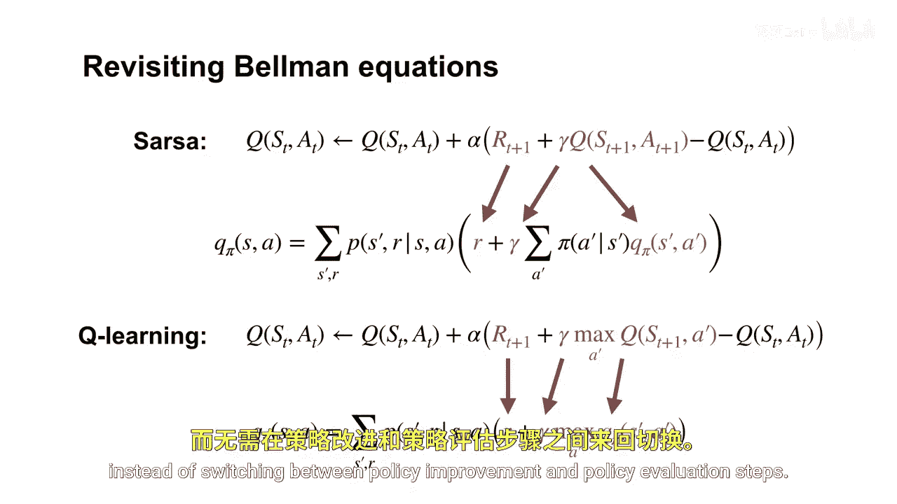

强化学习专项课程：P60：什么是Q学习

在本节课中，我们将学习Q学习算法。这是一种重要的在线强化学习算法，已被成功应用于玩Atari游戏、控制交通信号灯乃至自动配置网络系统等多个领域。课程结束时，你将能够描述Q学习算法，并解释它与贝尔曼最优方程之间的关系。

Q学习算法于1989年被提出，是最早的重要在线强化学习算法之一。

让我们先看一下它的伪代码。这个格式我们之前见过：智能体在某个状态下选择一个动作，执行该动作，然后观察下一个状态和奖励。接着，智能体进行一次更新，循环往复。

在众多熟悉的元素中，Q学习的新颖之处是什么？Q学习的新元素在于其动作价值更新。其更新目标为：**Rt+1 + γ * max_a Q(St+1, a)**。这与SARSA算法不同，SARSA在其更新目标中使用的是下一个“状态-动作”对的价值。

为什么Q学习使用最大值，而不是下一个“状态-动作”对的价值？这种联系可以追溯到动态规划的内容。观察SARSA的更新方程，会发现它与动作价值的贝尔曼方程惊人地相似。事实上，SARSA正是基于样本来求解动作价值贝尔曼方程的算法。

Q学习同样利用环境样本来求解一个贝尔曼方程。但它使用的不是标准的贝尔曼方程，而是**动作价值的贝尔曼最优方程**。最优方程使得Q学习能够直接学习最优动作价值函数Q*，而无需在策略改进和策略评估步骤之间切换。

尽管SARSA和Q学习都基于贝尔曼方程，但它们基于的是截然不同的贝尔曼方程。

SARSA是策略迭代的样本化版本，它使用的是依赖于某个固定策略的动作价值贝尔曼方程。

Q学习则是价值迭代的样本化版本，它迭代地应用**贝尔曼最优方程**。应用贝尔曼最优方程会严格改进价值函数，除非它已经是最优的。因此，价值迭代持续改进其价值函数估计，并最终收敛到最优解。

基于同样的原因，只要智能体持续探索并对所有“状态-动作”空间区域进行采样，Q学习也会收敛到最优价值函数。

本节课中，我们一起学习了Q学习算法，并描述了它与贝尔曼最优方程之间的联系。