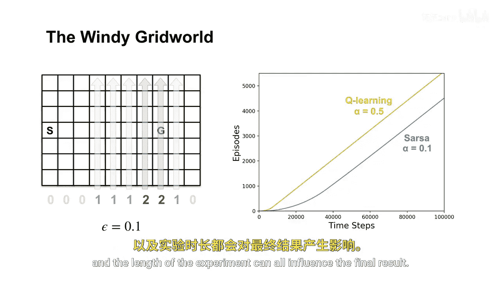

# 061：风世界网格中的Q学习

在本节课中，我们将学习如何在“风世界网格”环境中应用Q学习算法，并将其与SARSA算法的性能进行比较。通过一个具体的实验，我们将直观地理解两种算法的差异以及参数选择对学习效果的影响。

上一节我们介绍了Q学习的基本概念。你可能对其为何有效还缺乏直观的理解。

本节中，我们将在风世界网格环境中演示Q学习的应用并讨论结果。通过本视频，你将了解Q学习在一个示例马尔可夫决策过程中的表现，并洞察Q学习与SARSA算法之间的差异。

让我们回到风世界网格世界。这是一个无折扣的网格世界，其中存在“风”，当智能体经过有风的状态时，会被向上吹动。网格每一列下方显示的风力强度代表了该列的风力。智能体可以向四个方向移动，每一步都会获得-1的奖励。

为了进行比较，以下是SARSA算法在ε=0.1、α=0.5参数下的表现。和之前一样，这张图的Y轴表示完成的幕数，X轴表示时间步数。回忆一下，SARSA在前几幕学习缓慢，随后呈指数级改进，最后趋于平缓。

现在，让我们使用相同的参数设置来运行Q学习。

在展示结果之前，我们先思考一下可能会发生什么。也许SARSA的策略会表现得更好，因为它的价值函数考虑到了其ε-贪婪行为。也许Q学习会学得更快，因为它直接学习最优策略的价值函数。你认为会发生什么？

以下是实验结果。在开始时，两种算法以相似的速度学习。到了后期，Q学习似乎学到了一个更好的最终策略。

为什么Q学习在这里表现得更好？在没有进行更有针对性的实验之前，我们无法确定。也许Q学习的更新目标更稳定。Q学习对下一个动作的价值取最大值，因此只有当智能体学习到某个动作优于另一个时，它才会改变。相比之下，SARSA使用下一个动作价值的估计值作为其目标，每当智能体采取探索性动作时，这个目标就会改变。

也许你可以设计一个实验来彻底弄清这个问题。现在，让我们继续。

我们如何能让SARSA表现得更好呢？对于这个实验，步长参数α=0.5可能有点太高了。当智能体采取探索性动作时，这些大的更新可能会给SARSA带来麻烦。SARSA的最终策略显然不是最优的。

让我们将实验运行得更久一些，这次将α设为0.1。我们预计SARSA在较小的α下学习会更慢，但会找到一个更好的策略。看看发生了什么。

预测得到了证实。SARSA最终学到了与Q学习相同的策略，但速度更慢。我们知道两种算法都收敛到了相同的策略，因为两条线的斜率相等。斜率相等意味着两个智能体以相同的速率完成每一幕。

这个实验也凸显了强化学习中参数选择的影响。α、ε、初始值以及实验的长度都可能影响最终结果。

在本节课中，我们评估了Q学习在风世界网格中的表现，并深入了解了在这个简单的MDP上Q学习与SARSA的差异。我们看到了参数调整如何显著影响学习速度和最终策略的质量。