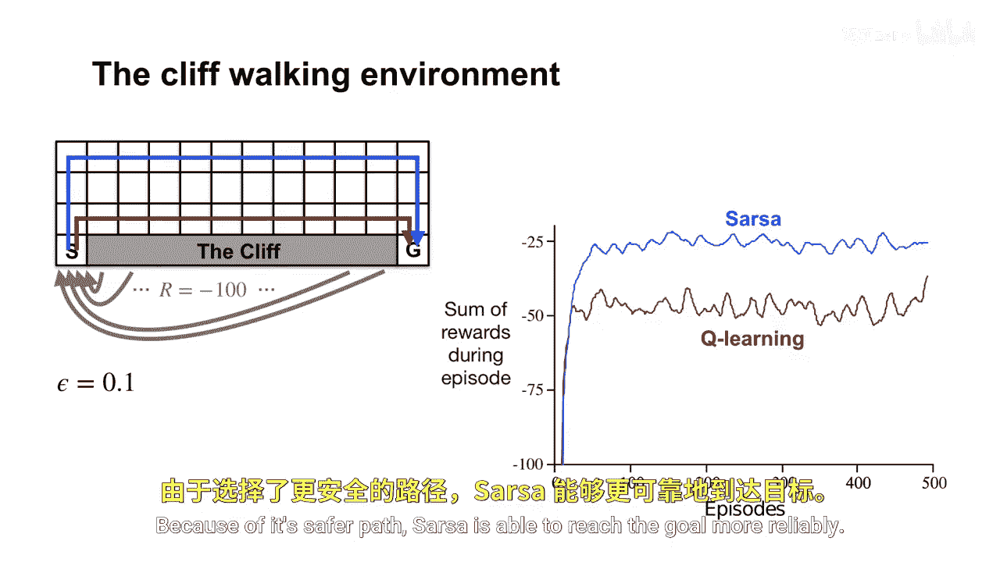
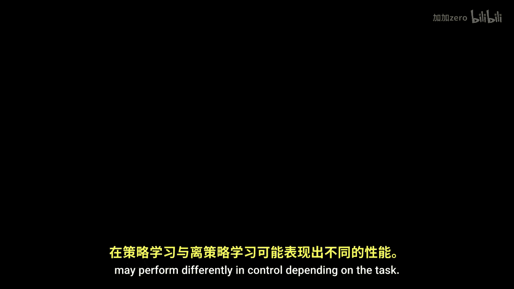

# 062：Q学习为何是离策略的？🤔

在本节课中，我们将探讨Q学习算法的一个核心特性：它是一种离策略算法，但却没有使用重要性采样。我们将理解其背后的原理，并比较在策略与离策略学习在控制任务中的不同表现。

## 核心概念回顾

上一节我们介绍了离策略算法通常使用重要性采样。本节中，我们来看看Q学习如何在不使用重要性采样的情况下实现离策略学习。

首先，回忆一下关键定义：智能体根据其目标策略下的期望回报来估计价值函数。在实际行为中，它遵循的是行为策略。当目标策略与行为策略相同时，智能体是在进行**在策略**学习；否则，就是**离策略**学习。

## Q学习的离策略本质

SARSA是一个典型的在策略算法。在SARSA中，智能体基于其**将要执行**的下一个动作的价值进行自举更新，而这个动作是从其行为策略中采样得到的。

Q学习则不同。它基于下一个状态中**最大的动作价值**进行自举更新。这相当于从一个对最优策略的估计中采样动作，而不是从行为策略中采样。由于Q学习学习的是它**可能采取**的最佳动作，而不是它**实际采取**的动作，因此它是离策略的。

## 目标策略与行为策略

对于任何强化学习算法，一个自然的问题是：它的目标策略和行为策略分别是什么？

*   Q学习的目标策略始终是相对于其当前价值函数的**贪婪策略**。
*   其行为策略可以是任何能在学习过程中持续访问所有“状态-动作”对的策略，例如**ε-贪婪策略**。

目标策略与行为策略之间的这种差异，证实了Q学习是离策略的。

## 为何无需重要性采样？

既然Q学习是离策略的，为什么我们看不到任何重要性采样比率呢？

原因在于，智能体是在用一个**已知的策略**（即贪婪目标策略）来估计动作价值。它不需要重要性采样比率来修正动作选择上的差异。

以下是其工作原理：
1.  动作价值函数 `Q(s, a)` 代表了在给定状态下采取每个动作后能获得的回报。
2.  目标策略 `π(a|s)` 代表了在给定状态下采取每个动作的概率。
3.  将这两者结合，智能体可以计算出在目标策略下，从任何给定状态（特别是下一个状态 `s_{t+1}`）出发的期望回报。

Q学习正是利用了这一技术来实现离策略学习。由于智能体的目标策略相对于其动作价值是贪婪的，所有非最大价值的动作概率为零。因此，从该状态出发的期望回报就等于该状态下的最大动作价值，即 `max_a Q(s_{t+1}, a)`。

## 在策略与离策略学习的性能比较

之前我们提到，Q学习不交替进行策略评估和策略改进，而是直接学习最优价值函数。直接学习最优策略听起来很棒，但在某些特定情况下，存在一些细微差别使其不那么理想。

让我们通过“悬崖行走”的例子来理解这些细微差别。

**环境描述：**
悬崖行走环境是一个无折扣的分幕式网格世界，底部边缘有一道悬崖。
*   在大多数步骤中，智能体获得-1的奖励。
*   如果掉下悬崖，智能体会回到起点，并获得-100的奖励。

我们在此环境中比较Q学习和SARSA，设置ε=0.1。

以下是两种算法的表现分析：

*   **Q学习**：由于它学习最优价值函数，因此很快学会最优策略是紧贴悬崖边缘行走。然而，由于其行为是ε-贪婪的，紧贴悬崖行走偶尔会导致掉下悬崖。
*   **SARSA**：它学习当前策略的价值，并考虑了ε-贪婪动作选择的影响。考虑到偶尔的探索性动作，它学会了走一条更长但更可靠的路径，通常可以避免随机掉下悬崖。

由于其更安全的路径，SARSA能够更可靠地到达目标。

## 总结

本节课中，我们一起学习了：
1.  **Q学习是离策略算法**：它通过基于对最优策略的估计（即最大Q值）进行更新来实现离策略学习，而不是基于实际采取的行为策略。
2.  **无需重要性采样**：因为它使用已知的贪婪目标策略来计算下一个状态的期望回报（即最大Q值），所以不需要重要性采样来纠正策略差异。
3.  **性能差异**：在像“悬崖行走”这样的任务中，直接学习最优策略的Q学习可能因为探索行为而承担更高风险；而在策略的SARSA通过考虑探索的影响，可能学到更安全、更稳健的策略。选择在策略还是离策略学习取决于具体任务的需求。

