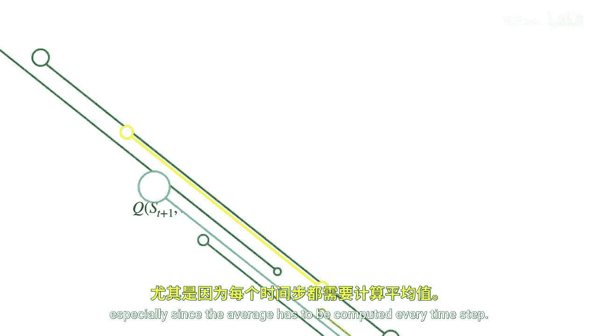

强化学习专项课程：P63：期望SARSA算法


在本节课中，我们将学习第三种时序差分控制方法——期望SARSA。我们将了解它与SARSA和Q学习的区别，并理解其核心思想、更新规则以及优缺点。


上一节我们讨论了SARSA和Q学习这两种时序差分控制方法。本节中，我们将介绍另一种方法：期望SARSA。通过本视频，你将能够解释期望SARSA算法。

回忆一下动作价值函数的贝尔曼方程，其中包含了对下一个“状态-动作”对价值的期望。将这个期望分解，我们可以看到它是对所有可能的下一状态和下一动作的求和。

SARSA通过从环境中采样下一个状态，并从其策略中采样下一个动作来估计这个期望。但智能体已经知道自己的策略，为什么还要采样下一个动作呢？相反，它应该直接计算这个期望。在这种情况下，我们可以对所有可能的下一动作的价值进行加权求和。权重是智能体策略下采取每个动作的概率。显式地计算对下一动作的期望，是期望SARSA算法背后的核心思想。


现在让我们看看期望SARSA的学习更新规则。

由于期望SARSA仍然基于动作价值函数的贝尔曼方程，它使用了我们熟悉的学习更新形式。该算法与SARSA几乎完全相同，除了TD误差使用的是下一动作价值的期望估计值，而不是下一动作价值的采样值。

这意味着在每一个时间步，智能体都必须根据策略的概率分布，对下一状态的动作价值进行平均。

例如，对于以下价值和策略，期望SARSA会使用值1.4作为其对期望下一动作价值的估计。

```python
# 假设下一状态的动作价值 Q(s', a) 和策略 π(a|s')
Q_values = {'left': 1.0, 'right': 2.0}
policy = {'left': 0.6, 'right': 0.4}
# 计算期望值
expected_value = Q_values['left'] * policy['left'] + Q_values['right'] * policy['right']
print(expected_value)  # 输出：1.4
```

然而，显式计算期望有一个巨大的好处：期望SARSA比SARSA拥有更稳定的更新目标。

让我们看一个例子来更清楚地说明这一点。在这个例子中，中间奖励是确定性的+1。SARSA和期望SARSA都从下一状态的**真实**动作价值开始。即使在这种理想情况下，SARSA所做的下一动作采样也可能导致其价值更新方向错误。它依赖于在多次更新的期望中方向是正确的这一事实。相比之下，期望SARSA的更新目标是完全正确的，并且不会使估计值偏离真实值。总的来说，期望SARSA的更新目标方差比SARSA低得多。



不过，较低的方差也带来了一个缺点。随着动作数量的增加，计算下一动作的平均值会变得更加昂贵。当存在许多动作时，计算平均值可能需要很长时间，尤其是因为每个时间步都必须计算这个平均值。


本节课中，我们一起学习了期望SARSA算法。我们了解到，该算法显式计算其策略下的期望值，这虽然比采样更昂贵，但具有更低的方差。