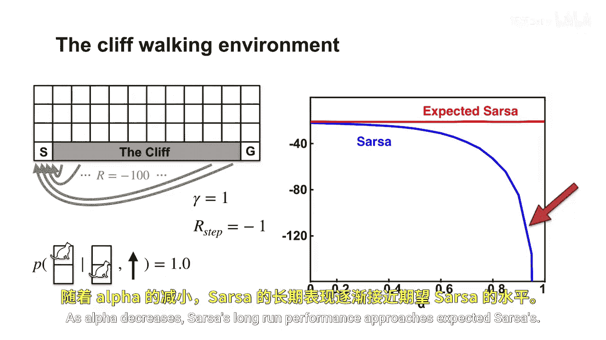

# 064：悬崖世界中的期望SARSA算法 🧠

在本节课中，我们将学习期望SARSA控制算法，并通过在悬崖行走环境中的实例，观察其实际表现。我们还将从经验上比较期望SARSA与SARSA算法的性能差异。

---

上一节我们介绍了期望SARSA控制算法。本节中，我们来看看它在具体环境中的运行效果。

通过本视频的学习，你将能够：
*   描述期望SARSA在悬崖行走环境示例中的行为。
*   通过实验比较期望SARSA和SARSA算法。

我们将再次使用悬崖行走环境，以便可以同时讨论SARSA、Q学习和期望SARSA算法。让我们先回顾一下这个环境。这是一个无折扣的分幕式网格世界，底部边缘有一片悬崖。

智能体移动到悬崖会使其回到起点，并获得-100的奖励。在其他情况下，每一步的奖励为-1。SARSA算法在这个领域表现优于Q学习，因为SARSA的策略考虑到了自身的探索行为。

今天，我们将比较ε=0.1时，期望SARSA与SARSA的表现。

下图是通过用不同的步长参数α值测试每个智能体而创建的。我们进行了100幕，并在50,000次独立运行中平均了所有结果。

Y轴显示每幕的平均回报，X轴显示步长值。

SARSA的性能随着步长值的增大而提高，但仅在一定范围内。在此例中，SARSA的最佳α值为0.9。期望SARSA在几乎所有α值上都优于SARSA。

期望SARSA能够更有效地使用更大的α值。这是因为它明确地对自身策略带来的随机性进行了平均。这个环境是确定性的，因此没有其他随机性来源需要考虑。这意味着对于给定的状态和动作，期望SARSA的更新是确定性的。相比之下，SARSA的更新可能因下一个动作的不同而有显著差异。

现在，让我们看看在100,000幕之后每幕的平均回报。此时，每个算法都已学到了所有能学到的内容。

期望SARSA的长期行为不受α影响。在这个例子中，它的更新是确定性的。因此，步长只决定了估计值接近其目标值的速度。

SARSA在这里的表现则大不相同。对于较大的α值，它甚至无法收敛。随着α减小，SARSA的长期性能逐渐接近期望SARSA。

---

在本节课中，我们一起学习了期望SARSA算法在悬崖世界中的表现。我们看到，期望SARSA能够在该环境中快速学习到一个良好的策略，并且相比SARSA算法，它对较大的步长参数具有更强的鲁棒性。